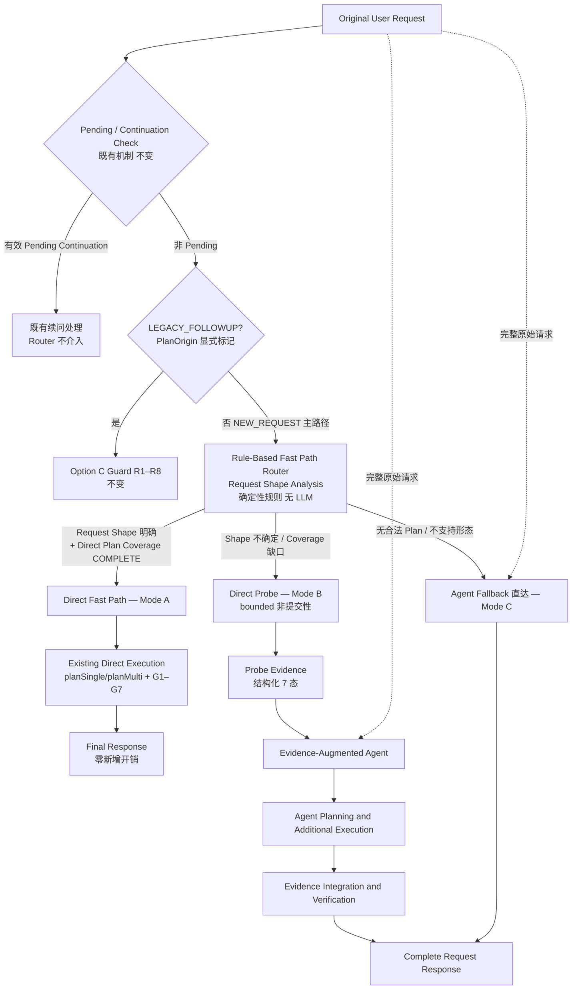

# analysis-project Phase 0.1 — Architecture & Decision Baseline V2

> **文档定位**：Phase 0.1 唯一权威架构基线（Canonical Architecture Baseline）。本文档与《Phase 0.1 — Contracts, Golden Matrix & Phase 1A Readiness V2》（下称 Doc 2）共同构成 Phase 0.1 当前唯一权威实施基线；两份均为自包含文档，读者无需翻阅历史文档即可理解当前架构。Phase 1A 实施以两份 V2 文档为依据。
>
> **最终架构（冻结）**：**Rule-Based Fast Path Router + Direct Probe + Evidence-Augmented Agent Fallback**
>
> **冻结日期**：2026-11-24　**版本**：V2（从零重建）　**历史依据**：Phase 0.1 Revised Architecture Decision & Acceptance Contract（已 SUPERSEDED，保留为历史审计材料）

---

## 1. Executive Summary

Phase 0.1 的目标：在保证复杂请求能够完整执行的前提下，尽可能保留简单请求的快速、低成本、低延迟 Direct Execution；并将「Direct Execution 成功」与「用户整个 Request 已完成」彻底解耦。

当前问题：现有 Direct Execution 将「Skill 执行成功」默认等价为「请求完成」。该等价在两类场景下不成立——Direct Plan 只覆盖部分请求目标；同一 Skill 需要多 Invocation（不同参数）而 Plan 只生成一次调用。为补救缺口而引入 LLM-first 判定（先调 LLM 判断请求是否简单）会让所有简单请求承担额外 LLM 成本与延迟。

最终架构三模式：

- **Mode A — Direct Fast Path**：Rule-Based Router 通过 **Request Shape Analysis**（确定性、无 LLM）确认请求形态明确且 Direct Plan 完整覆盖 → 走既有 Direct 执行，零新增开销。产品目标：**至少 80% 简单数据分析请求进入 Fast Path**（待 Shadow Mode 实测验证）。
- **Mode B — Direct Probe → Evidence-Augmented Agent**：Request Shape 不确定或 Direct Coverage 存在缺口 → 至多一次 bounded Direct Probe（非提交性）→ 结构化 Evidence → Agent 携带**完整原始请求** + Evidence 继续规划、补充执行，完成整个 Request。
- **Mode C — Agent Fallback 直达**：Probe 无执行发生（无合法 Plan / 不支持形态）→ 直接以完整原始请求进入 Agent。

核心设计原则：禁止 LLM 路由；禁止伪概率；Hard Coverage Constraints 优先于 Confidence；Fail-Closed；Probe Success ≠ Request Completion；Agent Goal = Original Full User Request；Same Skill ≠ Same Invocation；冻结决策（Option C / R1–R8 / PlanOrigin / Snapshot Isolation / Whole-Request Yield / Multi-Skill G1–G7 / V1-V2）完整继承。

## 2. Background & Problem Statement

### 2.1 Direct Execution 的七个不足

| # | 问题 |
|---|---|
| P-1 | Direct Plan 可能只覆盖部分 Request Objectives——Skill 成功 ≠ 请求完整 |
| P-2 | 同一 Skill 可能需要多个 Invocation（不同参数），现有 Plan 只生成一次调用 |
| P-3 | Runtime 支持重复调用 ≠ Plan 已生成重复调用 |
| P-4 | Script 能聚合/排名/排序 ≠ Request 已完整表达 |
| P-5 | Direct Execution Success ≠ Request Completion（禁止隐式等价） |
| P-6 | 复杂请求缺乏可靠的完整性保障（无目标覆盖判定与整轮完成语义） |
| P-7 | 不能让所有简单请求都承担 LLM 成本（LLM-first 判定方向已否决） |

### 2.2 必须显式区分的概念（禁止合并）

```text
Skill Capability ≠ Runtime Capability ≠ Direct Plan Coverage ≠ Request Completion
Skill Capability ≠ Direct Plan
Direct Plan      ≠ Planned Invocation ≠ Executed Invocation
Probe Evidence   ≠ Request Objective ≠ Request Completion
```

**不得把 Skill Capability、Runtime Capability 与 Direct Plan Coverage 混为一谈**（本档 §14 Case 2 锚点）。

### 2.3 被否决的旧方向（Superseded — 仅历史记录）

以下设计方向已被 2026-11-24 决策正式废弃，不得作为当前架构的有效设计：LLM Request Decomposition + Direct Feasibility Guard（旧主路径 CRCR Guard §7.1–7.4）；LLM-first Request Classification；仅基于 Direct Plan 判断是否 Yield；仅基于 Skill 数量 / Dimension 数量判断复杂度；Direct Success 即 Request Completion；只将当前 Direct 结果（文本）传给 Agent；以单 Skill、单 Script 作为 Probe 默认限制；没有 Evidence Contract 的 Agent Fallback；没有 Probe Side-Effect Isolation；仅依赖关键词判断复合请求（「和」/「最高」判断器、conjunction 检测器）。

其中 §7.5 Context-Aware Follow-up Guard（Option C）**不在废弃范围**——仅限 LEGACY_FOLLOWUP 轮次、确定性规则判定，完整保留（本档 §5/§22）。

## 3. Product Objectives

### 3.1 Fast Path

对结构清晰、目标单一、现有 Direct Plan 可以完整执行的请求：

- 不调用 LLM 做请求分类；不进行额外 Probe；不增加不必要的 Agent Planning；
- 直接沿用现有 Direct Skill Execution；保持低延迟、低 Token、低成本。

产品目标：**至少 80% 的简单数据分析请求能够进入 Fast Path**。80% 是待通过 Shadow Mode 和实际数据验证的产品目标，不是未经测量的既定事实。文档区分：目标值（80%）/ 当前实测值（待测）/ Shadow 观测值（待采集）/ 上线验收值（Gate 判定）。

### 3.2 Complex Request Completion

对存在复杂请求形态、Direct Plan 覆盖不完整、需要多个执行实例、复杂维度关系或多个分析目标的请求：

- 不直接将不完整的 Direct Result 当作最终答案；
- 允许先运行低成本 Direct Probe；将 Probe Result 转换为结构化 Evidence；
- 携带原始完整用户请求进入 Agent；
- Agent 根据 Evidence 继续规划、补充工具调用和分析；
- 最终完成整个 Request，而不是只完成其中一部分。

## 4. Non-Goals

| # | Non-Goal |
|---|---|
| N-1 | LLM 请求分类 / 为 Router 新增 LLM Routing Round（既有参数抽取中的 LLM 调用不要求移除） |
| N-2 | Goal Extraction Runtime / Goal Scheduling 独立组件（覆盖判定由 Router Shape Analysis + Agent 承接） |
| N-3 | 重建/简化/删除 Multi-Skill Direct Execution；强制单 Skill/单 Script；未经批准的候选数量上限 |
| N-4 | 双 Ask 单 Pending 现状（同一会话同一时刻仅一个 Pending 槽位）不在 Phase 1A 解决范围 |
| N-5 | 多实例部署语义 |
| N-6 | 新增 PlanOrigin 枚举值或改变三值语义 |
| N-7 | Probability-calibrated Confidence（不做概率校准；Confidence 只是辅助指标） |
| N-8 | 把 Probe 强制限制为单 Skill/单 Script；或因 Multi-Skill Plan 存在就无限制运行整个 Plan |
| N-9 | 维度数量 / 指标数量 / Skill 数量作为复杂度的唯一依据；机械地把所有多维度请求判为 Agent |
| N-10 | Pending 回答中新增目标语义（既有消费语义已知限制，Phase 1A 不解决） |
| N-11 | 硬编码维度/指标目录（Router 不自行维护与业务配置脱节的词表） |
| N-12 | 本阶段进行任何代码实现（Router/Probe/Agent 均不提前实现） |

## 5. Frozen Architecture Decisions

以下冻结决策完整继承自 Phase 0.1 冻结契约（原始文本在历史文档中可溯源），**无语义变更**。本节为继承声明与规则要点；完整工程契约在 Doc 2 对应节。

| # | 冻结决策 | 要点 | 落点 |
|---|---|---|---|
| F-01 | Option C（Context-Aware Follow-up Guard） | 仅限 LEGACY_FOLLOWUP；R1–R8 原样；与 Router 分层互不介入 | 本档 §22；Doc 2 §24–§25、Golden Matrix CR-06/CR-11 |
| F-02 | R1–R8 | Pending 绕过 / Pure Ask 例外 / R3 八前置条件 / 语义覆盖证据 / 任务替换独立识别 / 上下文缺失 Fail-Closed / 多 Plan 边界 / Shadow-Enforcement 一致性 | 本档 §5.1 |
| F-03 | PlanOrigin | 三值冻结（NEW_REQUEST / PENDING_CONTINUATION / LEGACY_FOLLOWUP）；显式元数据；禁文本推断 | 本档 §22.3 |
| F-04 | Snapshot Isolation | Candidate vs Committed 生命周期隔离；12 条不变量 + 13 行状态表；规划期不提交 | 本档 §22.1 |
| F-05 | Whole-Request Yield | 现役范围=§7.5；Probe 路径 ≠ Partial Yield；被禁模式=部分 Direct+仅剩余交 ReAct | 本档 §20 |
| F-06 | Pending 契约 | P1（pending.put⟺Ask Plan 存在）/P2（Yield 清孤儿）/P3（键）+A1–A5；TTL 5min 不变 | 本档 §22.2 |
| F-07 | Multi-Skill G1–G7 | 完整保留原始资格判定逻辑；禁止通过 Router 重构破坏 | 本档 §21 |
| F-08 | V1/V2 Parity | 双端点对等接入；SSE 不合并；v1 不豁免 | 本档 §23 |
| F-09 | Shadow Mode | Shadow 不改变实际执行路径；不执行 Probe；零副作用 | 本档 §24 |
| F-10 | recordResult 语义 | 只有满足既有 Direct 成功标准的实际执行才能更新成功历史；Probe 不触发 | 本档 §22.4 |

### 5.1 R1–R8（完整继承）

**R1 — Pending Continuation 整体绕过。** 成功消费有效 Pending 后：PlanOrigin = `PENDING_CONTINUATION`；本轮不进入 Context-Aware Follow-up Guard；保持原有 Pending 参数补齐和确认流程。注记：Pending 回答中疑似新增目标语义属已知限制。

**R2 — Pure Ask Plan 例外。** 纯 Ask Plan 保持既有澄清行为；不将 Ask Plan 当作已执行的 Direct 任务；不得产生孤立 Pending。Mixed Ask + Executable 既有契约有效：Ask 本身不作为新增分析目标；Executable Plan 仍接受适用判定；一旦整体 Yield，整个请求交给 ReAct，不执行任何 Direct Plan，也不输出孤立 Ask 内容。

**R3 — 无新增目标的合法 Follow-up 可以 Direct（八项前置条件缺一不可）。** ① PlanOrigin 明确为 LEGACY_FOLLOWUP；② 存在有效历史成功 Direct 上下文（Committed Successful Snapshot）；③ Follow-up Planner 已产生合法可执行 Plan；④ 当前请求属于参数收窄、参数修改或合法维度选择；⑤ 无新增分析目标；⑥ 无任务替换信号；⑦ 当前 Plan 能表达原任务在当前参数条件下的执行语义；⑧ Guard 所需上下文完整。**Guard 不能凭空创建 Direct Plan**——「给我看看」「结果按表格展示」类请求若 Follow-up Planner 未产生合法 Plan，必须保持原有 ReAct 路径。

**R4 — 新增目标必须有语义覆盖证据。** 不能把参数变化等同于分析目标覆盖。区分参数/过滤条件证据与分析操作语义证据（趋势、排名、Top-N、异常、解释、预测、比较）。覆盖证据评估六项中「当前参数变化」不能单独作为「目标与 Plan 映射关系」的证明。无法建立可靠语义覆盖证据时：不得推断为已覆盖、不得静默丢弃、必须整体 YIELD_REACT。

**R5 — 任务替换必须单独识别。** 「不看缺陷密度了，改为分析月度趋势」类请求是替换而非追加。既有 Follow-up Plan 不能明确表达替换目标时：整体 Yield ReAct、不执行原 Direct Plan、不允许继续使用旧 Skill 伪装成完成了新任务。独立原因码 `FOLLOWUP_TASK_REPLACEMENT`；替换词汇识别不能仅依赖既有 C4b 排除词表，必须建立独立替换信号词表。

**R6 — 上下文缺失必须 Fail-Closed。** Snapshot 不存在/过期/跨会话/跨用户、历史 Skill 不可用、PlanOrigin 缺失或非法、关键上下文无法恢复、Context Assembly 失败、无法建立可靠关系——不得伪造历史参数；不得静默回退为 Direct；不得使用不完整上下文证明覆盖；安全转入 ReAct 或既有安全澄清路径。

**R7 — 多 Plan 边界。** 不引入新的多 Plan 机制；不因 Plan 数量大于 1 就自动 Yield；Legacy Follow-up 当前只产生一个 Plan，不得扩展为同一 Skill 多实例；不新增多 Pending。

**R8 — Shadow、Enforcement 和异常边界。** 区分六类语义（正常 Yield/评估异常/关闭/Shadow/Enforcement/人工回滚）。Enforcement 下 DIRECT_ALLOWED 才进 Direct；评估异常 Fail-Closed；不得出现部分 Direct 后再整体 ReAct。GUARD_DISABLED 不属异常分母；GUARD_EVALUATION_FAILURE 计入异常率分子分母。H7：异常率严格小于 0.5%（等于亦 BLOCKED）；可复现系统性异常单独阻断；不得为 Follow-up 场景单独放宽阈值。

## 6. Architecture Evolution

```text
阶段 0 — Phase 0 原始方案（LLM Request Decomposition + Direct Feasibility Guard）
          │  Superseded：LLM-first 成本不可接受；主路径 Guard 机制废止
          ▼
阶段 1 — Phase 0.1 冻结契约（Option C / R1-R8 / PlanOrigin / Snapshot / Pending）
          │  冻结决策有效至今；主路径判定机制由 REVISED 2026-11-24 重建
          ▼
阶段 2 — REVISED（LLM-first 废止，Rule Router 引入）
          │  确立三模式框架与 Probe/Agent 冻结不变式
          ▼
阶段 3 — 本 V2 基线（Canonical）
          │  新增 Request Shape Analysis 五视角为 Router 核心；
          │  Hard Coverage Constraints 优先于 Confidence；
          │  Shadow 明确不执行 Probe；Evidence 7 态；Golden Matrix 扩展
          ▼
Phase 1A Implementation（以两份 V2 文档为唯一入口）
```

## 7. Final Architecture

### 7.1 Overall Architecture（Mermaid）



### 7.2 Router Decision Flow

```text
User Request
    ↓
既有 Pending / Continuation 检查（不变）
    ├── 有效 Pending Continuation → 既有续问处理（Router 不介入）
    └── 非有效 Pending Continuation
            ↓
LEGACY_FOLLOWUP 轮？（PlanOrigin 显式标记）
    ├── 是 → Option C R1–R8（不变）
    └── 否（NEW_REQUEST 主路径）
            ↓
Request Shape Analysis（确定性，无 LLM）
    Metric Shape / Dimension Shape / Dimension Relationship Shape
    / Objective Shape / Direct Plan Coverage Shape
            ↓
Coverage Evaluation：COMPLETE / PARTIAL / UNCERTAIN / UNSUPPORTED
            ↓
Router Decision Policy
    ├── Shape 明确 + Coverage COMPLETE + Hard Constraints 全过 → DIRECT_FAST_PATH
    ├── Shape 不确定 或 Coverage PARTIAL/UNCERTAIN → PROBE_THEN_AGENT
    ├── Coverage UNSUPPORTED / 无合法 Plan → AGENT_FALLBACK（无 Probe）
    └── 规则冲突 / 评估异常 → fail-closed PROBE_THEN_AGENT
```

### 7.3 Probe / Evidence / Agent Lifecycle

```text
[Probe]
  Eligible → Running → {Completed / Partial / Failed / TimedOut / Skipped}
  终态 → EvidenceReady（7 态 Evidence）→ AgentHandoff（或 Skipped → AgentHandoff）

[Evidence]
  生成（带 provenance/参数/覆盖元数据）→ Agent 消费 → 复用判定
  REUSE / ADDITIONAL_EXECUTION / MIXED / REJECTED

[Agent]
  接收完整原始请求 + Evidence + Coverage Gaps
  → 识别全部 Objective → 分析 Probe 已完成/未完成部分
  → 复用 Evidence / 补充执行（同 Skill 多参数 / 其他 Skill）
  → 依赖规划 → 数据整合/比较/排名/下钻/分析
  → 全请求覆盖验证 → Complete Request Response（或如实报告未完成）
```

### 7.4 V1 / V2 Pipeline Diagram

```text
V1: /ai/chat → ChatController(:48) → ChatStreamServiceImpl(:70)
        └── Rule-Based Router（服务层集成）
                ├── Direct Fast Path → 既有 Direct 执行
                └── Probe → Agent Fallback（复用 v1 既有 ReAct）
        SSE：v1 协议不合并不重构（内网反问轮纯一次性 text 事件硬约束）

V2: /v2/ai/chat → V2ChatController(:53) → V2ChatStreamServiceImpl
        └── Rule-Based Router（服务层集成，共享 Router Core）
                ├── Direct Fast Path → 既有 Direct 执行
                └── Probe → Agent Fallback（复用 v2 既有 ReAct :504-525 fallback）
        SSE：v2 协议不合并不重构

共享：Router Core / Probe 契约 / Evidence 契约 / Agent Handoff 契约
隔离：DirectSkillExecutor 保持不变（Router 不入执行入口）；各 Pipeline 状态与 SSE 独立
```

## 8. Rule-Based Fast Path Router

### 8.1 职责边界

Router 只回答一个问题：

> 当前请求是否具有足够高的确定性，且当前 Direct Plan 能否完整覆盖，从而可以安全地进入现有 Direct Fast Path？

Router 不负责：完整自然语言任务规划、复杂语义任务拆分、多轮推理、复杂依赖推断、代替 Agent 完成所有请求理解——这些能力属于 Agent Fallback。

Router **不是**：关键词分类器、conjunction 检测器、「和」判断器、「最高」判断器、Skill 数量判断器、Dimension 数量判断器、无法解释的 Confidence Score 黑盒。

### 8.2 Deterministic Analysis Principle

请求形态分析必须优先利用系统**已经具备的确定性信息**，禁止为判断请求是否简单而引入 LLM 分类调用。Router 输入来源：

1. 用户原始请求；2. 当前 Direct Plan；3. 已存在的规则提取结果；4. Built-in Dimension Configuration（dimension_key_config / Built-in Keys / Alias / Standard Value / Enabled Status）；5. Dynamic Dimension Configuration（extraDimensions / 业务词表 / Alias）；6. Metric / Tool Routing Catalog（tool_route_metadata topicTags / metricTags）；7. Skill Capability / Parameter Mapping；8. 已有 Dimension Extraction；9. 现有 Direct Execution Shape；10. 现有业务词表和别名解析结果。

**Router 不能自行维护一份与业务配置长期脱节的硬编码维度和指标目录。**

### 8.3 判定原则（冻结）

- **Hard Coverage Constraints 优先于 Confidence**：即使 Confidence 很高，只要 Direct Coverage 存在确定性缺口，也不能进入 Fast Path。
- Fail-Closed：规则冲突、评估异常、无法确定 → PROBE_THEN_AGENT。
- 最终原则：Router 只有在足够明确地确认请求形态明确且 Direct Plan 完整覆盖时才允许 Fast Path；其他一切无法确定的情况都不能默认当成简单问题。
- 规则可解释、可审计、可测试；Reason Codes 为低基数结构化枚举且实际参与决策。
- 不得堆关键词追求表面覆盖率；最小有效规则集须先审查现有代码与真实请求样本确定。
- 原始请求保护：不得因归一化丢失或改写用户原始语义。

## 9. Request Shape Analysis

Router 的核心设计：**低成本、确定性、可解释的 Request Shape Analysis Engine**。五个概念性分析视角（架构职责，不要求机械拆成五个独立 Java 类）：

```text
Request Shape
    ├── Objectives                    （§14 Objective Shape）
    ├── Metrics                       （§10 Metric Shape）
    ├── Dimensions                    （§11 Built-in / Dynamic Dimension Shape）
    ├── Dimension Relationships       （§12/§13 维度关系与层级下钻）
    ├── Invocation Requirements
    └── Integration Requirements

Direct Plan
    ├── Actual Skills
    ├── Actual Invocations
    ├── Actual Parameters
    ├── Objective Coverage
    └── Execution Shape

Coverage Evaluation
    ├── COMPLETE      Direct Plan 完整覆盖 Request Shape
    ├── PARTIAL       覆盖部分目标/指标/维度
    ├── UNCERTAIN     无法可靠判定
    └── UNSUPPORTED   当前执行形态不支持
```

以上仅是逻辑契约；具体数据结构必须依据当前项目实现确定。

## 10. Metric Shape

识别请求中的指标集合。可能来源：Skill Routing Keywords、Tool Routing Metadata、topicTags、metricTags、Metric Catalog、已有 Metrics Extraction。

分析内容：请求涉及哪些指标；指标是否存在多个不同分析目标；指标是否存在语义重叠；当前 Direct Plan 覆盖了哪些指标；是否存在未覆盖指标；是否需要不同的 Skill 或不同参数组合。

**注意（冻结）**：

- 指标词命中不等于独立 Objective；
- 多个指标也不必然需要 Agent——如果现有 Multi-Skill Direct Plan 能完整覆盖多个指标且执行契约允许，保留 Direct Execution（Case 6/9）；
- 反之，如果用户请求多个指标但 Direct Plan 仅覆盖部分指标，**不得把 Direct Result 视为请求完成**（Case 7）。

## 11. Built-in / Dynamic Dimension Shape

识别请求中的维度集合。维度来源必须区分：

### 11.1 Built-in Dimensions

利用已有内置维度配置：dimension_key_config、Built-in Keys、Alias、Standard Value、Enabled Status。系统已有配置识别：部门、应用、产品线、统计组、人员、需求项、版本等。

### 11.2 Dynamic Dimensions

利用现有动态维度配置、extraDimensions、业务词表和 Alias。Router 不应该假设所有维度都是固定内置维度。

- 对已配置的动态维度：利用现有确定性解析能力识别其维度身份，**不能仅因为它不是 Built-in Dimension 就判定为复杂问题**（Case 10）。
- 对无法识别的维度：**不得擅自认定为不存在**；不得通过硬编码词表强制否定；应标记为 **Unknown / Uncertain Dimension Signal**，进入 Probe / Agent Fallback 评估。

### 11.3 DimensionState Projection Limit（Case 11，冻结约束）

如果当前 `DimensionState` 仅保留一个 Peer Dimension，但原始用户请求中同时出现应用、产品线、统计组：**Router 不得只依据 DimensionState 判定为单 Peer Dimension**。必须保留和检查原始请求中的维度信号、Explicit Extraction、Direct Plan 以及 Invocation Parameters。

## 12. Dimension Relationship Shape

不能只统计 Dimension Count。必须识别维度之间的关系：单维度聚合、多维度并列、层级下钻、跨层级组合、同级维度组合、嵌套分组、维度与排名关系、维度与多个分析目标的组合。

业务层级参考（复杂度参考，不是绝对硬编码执行规则）：

```text
Department
    │
    ▼
App / Product Line / Statistical Group
    │
    ▼
Person
```

Router 必须识别的关系形态：

| 形态 | 示例 | 判定 |
|---|---|---|
| A. Single Dimension | 「各部门缺陷密度」 | 一个统计目标一个维度；可以是 Fast Path |
| B. Cross-Level Dimensions | 「各部门和人员的缺陷密度」 | 部门层级与人员层级交叉；应检查 Direct Plan 能否表达完整请求 |
| C. Multiple Peer Dimensions | 「各应用和各产品线的缺陷密度」 | 应用/产品线/统计组属 Peer Dimension 范畴；同时出现多个 Peer Dimension 是复杂度信号；若 Direct Plan 仅支持单 Peer Dimension 参数实例则 Probe → Agent |
| D. Hierarchical Drill-Down | 「各部门下各应用的缺陷密度」「各部门 → 各应用 → 各人员的缺陷密度」 | 必须识别层级/父子/分组内排名/逐级下钻意图 |
| E. Multiple Drill-Down Dimensions | 「各部门、各应用、各产品线、各统计组的缺陷密度」 | 即使全部可被规则识别，也不意味着 Plan 一定可表达；必须检查实际 Plan Shape；无法表达完整分组结构 → Probe → Agent |

**不得强行将应用与产品线合并为一个维度**（Case 4）；不得仅依据维度数量机械判定（完整判定必须结合 Direct Plan 实际表达能力）。

## 13. Hierarchical Drill-Down

层级下钻的判定要求：

- 识别用户是否表达了层级、父子、分组内排名或逐级下钻意图；
- 「各部门下各应用」「各部门、各统计组、各人员」均为下钻/多级分组信号；
- 判定必须落到 Direct Plan Coverage：若当前 Direct Plan 无法表达完整层级分组或嵌套统计 → PROBE_THEN_AGENT（Case 5）；
- 下钻表达不确定时（无法区分并列 vs 下钻）→ UNCERTAIN → PROBE_THEN_AGENT；
- 既有 Drilldown 配置（分布触发默认下钻一级等）继续有效，Router 不改变其行为。

## 14. Objective Shape

识别请求的**分析目标**，而不仅是 Skill 数量。需考虑：单一目标 / 多个独立目标 / 比较目标 / 排名目标 / 极值目标 / 目标之间的依赖 / 先聚合再排名 / 分组后再排名 / 多次查询后合并分析 / 同一 Skill 多次调用但参数不同 / 多 Skill 调用结果之间的整合。

判定示例：

| 请求 | Objective 判定 |
|---|---|
| 「各部门的缺陷密度」 | 可能是一个 Objective |
| 「各部门缺陷密度和各产品线工作量」 | 可能是两个 Objective |
| 「各部门缺陷密度，并找出缺陷密度最高的人员」 | 可能需要两个 Objective |
| 「各部门缺陷密度最高的部门」 | 可能仍然是一个 Skill、一个 Objective、一次调用即可完成 |

**不得仅依据「和」「最高」「对比」等词强制判断**（Case 8 对照）。

## 15. Direct Plan Coverage

当前 Direct Plan 的实际能力是**最重要的执行可行性证据之一**。必须分析：

- Plan 中有哪些 Skills / Invocations / 参数；每个 Invocation 覆盖哪些 Objectives；
- 是否存在重复调用要求；是否需要同一 Skill 不同参数执行多次；是否需要多个不同 Skill；
- 是否存在未覆盖 Objective、参数冲突、维度组合无法表达、下钻关系无法表达；
- 是否存在执行依赖、结果整合要求、当前 Direct Runtime 不支持的执行形态。

**结论规则（冻结）**：

1. Coverage COMPLETE + Shape 明确 → 允许 Fast Path（还需通过 Fast Path Admission 全部条件，§16）；
2. Coverage PARTIAL（部分目标/指标/维度未覆盖）→ Direct Result 只能作为 Probe Evidence，进入 Agent Fallback（Case 1/2/7）；
3. Coverage UNCERTAIN → PROBE_THEN_AGENT（fail-closed）；
4. Coverage UNSUPPORTED → AGENT_FALLBACK（无 Probe 直达 Agent）；
5. **Runtime 支持重复调用不等于 Plan 已经生成重复调用**；Skill 支持相关查询不等于 Plan 已表达。

## 16. Fast Path Admission

满足以下全部条件时，优先 Fast Path（Mode A）：

1. 请求形态明确（Request Shape 五视角均可确定性判定）；
2. Objective 结构清晰；
3. 指标与维度提取稳定；
4. 当前 Direct Plan 可以完整覆盖（Coverage = COMPLETE）；
5. 执行实例数量与请求一致；
6. 参数配置完整；
7. 没有未知的执行依赖；
8. 没有无法表达的维度关系（含 Peer Dimension / Cross-Level / Drill-Down 检查）；
9. 没有未覆盖 Objective；
10. 没有需要跨执行结果整合的复杂任务。

示例：「11月版本各部门的缺陷密度」——若当前 Direct Plan 可以完整覆盖，则进入 Fast Path。

**负向证据（均不构成准入依据）**：Skill 命中（单个或多个）、参数抽取成功或参数完整、Script 存在或可执行、Script 执行成功、返回非空结果、Plan/参数/维度数量本身、DimensionState 投影结果（§11.3）。

## 17. Direct Probe

### 17.1 设计目的

对于低置信度或复杂 Request Shape：在进入 Agent 之前，先运行现有 Direct 能力，获取初步结果和 Evidence。Probe 的目的**不是完成整个请求**，而是获取初步结果和 Evidence。目标：利用现有 Skill 能力；以较低成本获取可用结果；避免 Agent 在完全没有数据证据的情况下开始推理；让 Agent 基于已执行结果继续分析；减少重复执行；保留原始用户请求。

定位：**受控、可界定、具有副作用隔离的初始执行阶段**。

### 17.2 Probe Execution（bounded）

Probe 优先复用现有 Direct Skill Execution 能力（不凭空创建第二套 Skill 执行系统）。必须审计当前 Direct Plan 并明确（Doc 2 §14–§15 契约化）：

- Probe 允许执行哪些现有 Skills；是否允许执行现有 Multi-Skill Plan；
- Invocation 数量限制；执行时间限制；数据量限制；Tool Call 限制；Result Size 限制；
- Timeout / 失败处理；哪些 Skill 不适合 Probe；
- Probe 是否允许读取数据库；是否允许执行有副作用的工具。

**不得未经分析强制规定 Probe 只能执行一个 Skill；不得因现有 Multi-Skill Direct Plan 存在就无限制运行整个 Plan。** 应依据现有能力、成本和安全边界制定合理的 bounded Probe Contract。

- **Invocation Limit（冻结）**：至多一次 Probe 执行尝试，禁止连续多次尝试。
- Probe 使用既有规划机制（planSingle()/planMulti()，含 Multi-Skill G1–G7）产出的 Plan；禁止 top-1 截断。
- 纯 Ask 轮不 Probe、不进 Agent；Probe 不与 Ask 轮并发、不消费 Pending。

### 17.3 Probe States

```text
PROBE_SUCCESS          一次执行尝试成功返回
PROBE_EMPTY_RESULT     执行成功但结果为空
PROBE_EXECUTION_FAILED 执行失败
PROBE_NO_DIRECT_PLAN   规划未产出可执行 Plan（无执行发生 → Mode C）
PROBE_UNSUPPORTED      请求形态不支持 Probe（无执行发生 → Mode C）
PROBE_TIMEOUT          超时
```

**失败语义（冻结）**：除 PROBE_SUCCESS 外均为正常分支——不得阻止 Agent 继续处理完整原始请求，不得据此将请求判为最终失败，不计入异常率。

## 18. Probe Evidence

Probe 结果必须形成结构化 Evidence（不是自由文本）。最低信息集（字段名以现有代码模型为依据，不要求机械复制）：

```text
ProbeEvidence
    requestId
    probeId
    originalRequest
    planOrigin
    skillId
    scriptId
    invocationId
    invocationParameters
    objectiveCoverage      ← 本 Probe 覆盖/未覆盖的目标明细
    resultStatus
    resultSummary
    structuredResult
    executionError
    timeoutStatus
    truncatedStatus
    evidenceTimestamp
```

Evidence 必须区分 **7 态**：`SUCCESS` / `PARTIAL` / `EMPTY` / `FAILED` / `TIMEOUT` / `SKIPPED` / `TRUNCATED`。

**如果 Probe 只执行了部分 Objective，必须明确记录 Partial Coverage**（objectiveCoverage 字段承载）。

## 19. Evidence-Augmented Agent

### 19.1 Agent 输入（最低集）

```text
Original User Request
    +
Relevant Conversation Context
    +
Deterministic Dimension Context
    +
Current Request Shape
    +
Direct Plan
    +
Direct Probe Evidence
    +
Probe Execution Status
    +
Coverage Gaps
```

接入点复用现有 Context Assembly / Agent Prompt / Tool Result / Message History 机制；禁止创建重复 Context Assembly 系统、绕过现有 Agent Runtime、创建平行 Agent Executor、在 V1/V2 复制新 Agent 实现。

### 19.2 Agent Responsibilities（12 项，冻结）

1. 理解完整原始请求；2. 识别所有 Objective；3. 分析 Probe 已完成的部分；4. 识别 Probe 未完成的部分；5. 判断已有 Evidence 是否可复用；6. 避免不必要的重复调用；7. 必要时调用同一个 Skill 多次；8. 必要时调用不同 Skill；9. 根据依赖关系规划剩余执行；10. 完成数据整合、比较、排名、下钻和分析；11. 验证结果是否覆盖整个请求；12. **不能将 Probe Result 直接当成整个 Request 的最终答案**。

### 19.3 Evidence Reuse

Agent 应尽可能复用 Probe Evidence，但不能：盲目信任 Evidence；将 Partial Result 当作 Full Result；将参数不一致的结果当作可复用结果；将过期结果当作当前结果；将失败结果伪装为成功；将 Probe Invocation 与正式 Agent Invocation 混淆。

Evidence Reuse 必须考虑：Skill、Script、Parameters、Metric、Dimensions、Time Range、Scope、Invocation Identity、Result Completeness。如果无法确认 Evidence 与剩余任务匹配，**允许重新执行**。

必须明确区分：`Same Skill ≠ Same Invocation`；`Same Script ≠ Same Invocation`；`Same Invocation Parameters ≠ Automatically Reusable Evidence`。同一 Skill 允许不同参数多次调用；参数不同的 Invocation 不得被错误判定为重复。

## 20. Whole-Request Completion

**请求完成度以原始用户 Request 为基准，不以 Direct Plan、Skill 成功或 Probe 成功为基准。**

```text
Request Completion
    =
Original Request Objective Coverage
    +
Required Invocation Coverage
    +
Required Dimension Coverage
    +
Required Analysis Coverage
    +
Required Result Integration
```

```text
Partial Direct Result ≠ Request Completion
Probe Success         ≠ Request Completion
```

- Whole-Request Yield 现役范围 = §7.5（LEGACY_FOLLOWUP）；**Probe 路径 ≠ Partial Yield**——被禁止的模式是「部分 Direct 执行 + 仅剩余部分交 ReAct（而不告知完整目标）」；Mode B 中 Agent 接收的是完整原始请求，属合法独立路径。
- Agent 必须以完整请求为目标完成任务；除非明确说明无法完成，否则不得将部分结果伪装成完整结果。
- 目标分解区分输入实体与待发现输出实体（「那个人」首轮是待发现实体，不是缺失输入参数）；覆盖 UNKNOWN 按 fail-closed 处理；单一排名/极值目标不得机械拆分。

## 21. Multi-Skill Direct Execution Preservation

**这是 Frozen Architecture。** 必须完整保留原有 Multi-Skill Direct Execution 设计；不得重建、简化或改变其原有资格判定逻辑。

G1–G7 完整保留：

| 规则 | 内容 |
|---|---|
| G1 Explicit Selection / Exclusion | 显式选择直接入围，显式排除直接出局 |
| G2 Domain Hit Conditions / Exclusions | domain 命中只保留命中领域 Skill（通用出局，层级轨也不例外） |
| G3 Bypass Conditions | 旁路条件按既有契约 |
| G4 Priority Tie-Break | Priority 仅在显式、领域和深度条件无法区分候选时作决定性 Tie-Break；深度并列整轮降级 |
| G5 Complete Top-Hit Chain | 保留完整 Top-Hit Chain；Partial/Fallback Expansion 不得被误认为完整 Eligible Candidate Set |
| G6 Legacy-track Exclusion | Legacy Track 候选不入 Multi-Set；不阻塞符合条件 Level Track；显式 Legacy 请求允许单次执行 |
| G7 Eligible Level-track Candidate Requirements | Eligible Level-Track Candidate ≥2 才满足 Multi-Skill 条件；不设未经批准上限；先得完整 Eligible Candidate Set |

同时保留原始规范中的：Mention-order、Injection-only Hits、Comparator Fallback、Shared Extraction、Skill Parameter Mapping、Schema/Backfill、Anchor Suppression、Drill-down、Mixed Ask/Exec、Time/Person Ambiguity、Script Failure Continuation、Serial Execution、boundedElastic、Dimension Extract Event、Per-Script toolCallId、Result Titles/short_summary、Pending Consume Short-circuit、Snapshot、recordResult semantics、Config defaults and effective runtime configuration（完整工程契约在 Doc 2 §26）。

**Router 只负责决定 Fast Path、Probe 或 Agent Fallback，不能通过 Router 重构破坏原 Multi-Skill Direct Execution 的内部规则。** 若现有 Multi-Skill Direct Execution 能完整表达多个 Objective 并满足 G1–G7，不得因 Router 重构而取消、绕过或重写其 Direct Execution 资格（Case 9）。已知代码事实：multi.enabled 默认 false；混合轮仅 multi.enabled 可达。

## 22. Snapshot / Pending / PlanOrigin

### 22.1 Snapshot

- **Candidate Snapshot**：规划阶段生成的候选执行上下文；可用于 Guard 评估；不代表任务已执行；不得覆盖成功历史。
- **Committed Successful Snapshot**：由满足现有成功标准的 Direct 执行结果产生；只有执行成功后才允许提交；是后续 Legacy Follow-up 继承的可信历史来源。
- Planning 不提交成功执行历史；Probe 不污染 Committed Snapshot；Yield 不污染 Snapshot；只有符合既有契约的正式成功执行才允许提交。
- 12 条不变量（要点）：Plan 生成成功 ≠ 执行成功；Guard DIRECT_ALLOWED ≠ 执行成功；只有实际执行成功才更新历史；规划期只构造候选；YIELD 不得提交候选且必须保留原 Snapshot；失败/部分失败不得伪装成功；ReAct 不自动更新；成功判定复用既有标准；更新与实际执行结果绑定。
- 已验证代码事实：`planFollowupDirect` 规划期 `recordLastExec`(:1311) 在 Guard 前写入 → Candidate/Committed 生命周期隔离是 Phase 1A 强制约束；Probe 列为「非提交性执行」，受同一隔离契约约束。
- 多 Plan 轮次整体成功标准未明确前，不得将「部分 Plan 成功」认定为整体成功（1A 前置条件）。
- 连续多轮污染测试（强制验收）：Turn1 成功产生 S1 → Turn2 候选 S2 被 YIELD → Turn3 必须仍以 S1 为历史上下文。

### 22.2 Pending

- 正式 Ask / Pending 行为不变；TTL（PENDING_TTL_MS = 5 分钟）不变；键 `userId:conversationId` 不变。
- Probe 不创建、不消费、不污染正式 Pending；Agent Fallback 不与 Ask 轮并发。
- Pending Consume 短路规则：consumePending 在 planAll 最前，命中即消费返回（短路后续）；消费成功 ⟹ PlanOrigin = PENDING_CONTINUATION。
- 写入不变式 P1：pending.put 发生 ⟺ Plan 列表含 Ask Plan；P2：Yield 时清除本轮已写入 pending（不得遗留孤儿）；A1–A5（消费侧）完整继承。
- Clarification 后的计划重新评估：既有 consumeClarification（别名改写）行为不变；PlanOrigin 推导发生在其后。
- Pending Continuation 整体绕过 Router/Guard（F-02 R1）；过期/无效 Pending 未命中的轮次按真实分支归属标记 origin，不得一律按 NEW_REQUEST。

### 22.3 PlanOrigin

三值冻结：`NEW_REQUEST` / `PENDING_CONTINUATION` / `LEGACY_FOLLOWUP`（唯一合法产生条件见 Doc 2 §25）。显式元数据传递；禁止文本推断；三值禁止合并互转。

**明确区分（不得混淆）**：Direct Fast Path（正式 Direct Execution）／Direct Probe（**非提交性**执行尝试）／Agent Fallback（Agent 路径）／Agent Tool Invocation（Agent 内工具调用）／Final Execution（正式终态执行）。

**不得因为 Probe 复用 Direct Skill Executor 就将 Probe 误认为正式 Direct Execution。** Probe 使用的 Plan 沿用既有来源标记（NEW_REQUEST 主路径产出），不新增 PlanOrigin 值；Probe 执行不记录为独立成功 Direct 执行历史。

### 22.4 recordResult

只有满足既有 Direct 成功标准的实际执行才能更新成功执行历史；Probe 不触发正式 recordResult；Snapshot 更新必须与实际执行结果绑定。

## 23. V1 / V2 Integration

预期原则（冻结）：

- V1 `/ai/chat` 保留原有 Pipeline；V2 `/v2/ai/chat` 保留原有 Pipeline；两者 SSE 协议不合并；
- V1 与 V2 Service 层分别集成 Router；Shared Router Core 可以复用；
- **不在共享 DirectSkillExecutor 内强制实施 Router**；DirectSkillExecutor 原有职责与 Direct Execution 契约保持稳定；
- Fast Path 不改变原有 Direct Execution 结果；Probe 不能破坏原有执行状态；Agent Fallback 必须能够接收 Evidence；V1/V2 行为必须保持一致。

已验证代码事实：v1 = ChatController(:48) → ChatStreamServiceImpl(:70)，planAll(:499)；v2 = V2ChatController(:53) → V2ChatStreamServiceImpl，planAll(:461)、空列表 → ReAct(:504-525)、dimensionState 写点(:465)、consumeClarification(:340-344)、pending TTL 5min(:442)、snapshot TTL 30min(:453)；DirectSkillExecutor 共享单例 bean（V2SkillConfig :209）；consumePending 在 planAll 最前(:573-578)；multi.enabled 默认 false(:226)；Vue 前端走 v1（frontend/src/api/chat.ts:97），React /pm 走 v2。

**不得未经审计认定两个 Pipeline 完全相同**；1A-0 必须核实差异（v1 planAll 空列表分支行为、v1 SSE 硬约束适用性、v1 侧写点位置——详见 Doc 2 §33）。

## 24. Shadow Mode

Shadow Mode 不改变实际用户请求的执行路径：

```text
Current Production Decision
        │
        ├── Execute Existing Path
        │
        └── Shadow Router
                │
                ├── Request Shape
                ├── Confidence
                ├── Decision
                ├── Reason Codes
                ├── Metric Signals
                ├── Dimension Signals
                ├── Hierarchy Signals
                ├── Objective Signals
                ├── Direct Coverage
                └── Expected Route
```

**必须评估的指标**：Fast Path Precision / Fast Path Recall / Complex Request Detection / Objective Coverage Gap Detection / Repeated Invocation Detection / Dimension Combination Detection / Hierarchical Drill-down Detection / Multiple Metric Detection / False Fast Path / False Probe / Probe Cost / Agent Cost / Fast Path Latency / Probe Latency / Request Completion Rate。

**冻结约束**：Shadow Mode **不执行 Probe**（Router 仅计算并记录判定）；Shadow 不污染 Snapshot、Pending、recordResult；Shadow 判定不提交 Snapshot；Shadow 判定不计入异常率分母。

必须设计从 Shadow 到 Enforcement 的阶段和 Kill Switch（本档 §25/§26）。

## 25. Rollout Strategy

```text
Architecture Baseline（本档 + Doc 2）
        ↓
Phase 1A Contracts and Tests（1A-0 ~ 1A-8）
        ↓
Shadow Mode（1A-9；仅记录判定，不执行 Probe）
        ↓
Golden E2E（1A-10）
        ↓
Metrics Evaluation（15 项 Shadow 指标实测；false_fast_path / false_probe 阈值定标）
        ↓
Independent Review（1A-11；Critical/Major 修复）
        ↓
Enforcement Readiness（1A-12；Gate 全条件满足）
        ↓
Controlled Rollout（双端点独立；默认 OFF）
        ↓
Kill Switch / Rollback
```

模式框架：每端点开关 × 三模式（OFF / SHADOW / ENFORCEMENT），默认 OFF；DB 配置 + 有界 TTL 缓存 + 双端点独立配置 + 安全默认 OFF；三类故障分法（配置不可用 ≠ 算法异常 ≠ 主动回滚）。

## 26. Kill Switch

- 每端点开关可独立关闭；关闭后请求回退既有 Direct/ReAct 原路径；行为与升级前现状一致；
- 关闭动作不属于异常分母；
- 任一端点可独立回退，不影响另一端点；
- 人工回滚为六类语义之一（R8），独立计量与告警；
- Golden Case CR-16 验证 Kill Switch 演练。

## 27. Architecture Risks

| # | 风险 | 缓解 |
|---|---|---|
| R-1 | False Fast Path（复杂请求被放行 Fast Path） | Hard Coverage Constraints + false_fast_path_rate Shadow 定标后方可 Enforcement |
| R-2 | False Probe（简单请求被送 Probe+Agent） | 成本代价无正确性风险；false_probe_rate 定标 |
| R-3 | Probe 成本（Multi-Skill Plan 全量执行过重） | bounded Probe Contract（预算参数 1A 冻结）；禁止无限制运行整个 Plan |
| R-4 | 规划期 recordLastExec 污染 | Candidate/Committed 隔离为 1A 强制约束 + 连续多轮污染测试 |
| R-5 | v1/v2 行为分叉 | 1A-0 差异清单 + G-Parity 对照；divergence = 发布 Blocker |
| R-6 | 维度识别不足（动态维度/Unknown Dimension 误判） | Unknown/Uncertain Dimension Signal fail-closed 进 Probe/Agent；禁硬编码否定 |
| R-7 | Agent 接入破坏既有 Runtime | 强制复用现有 Context Assembly/Runtime/SSE；平行实现禁止 |
| R-8 | H7 异常率超限 | 严格 <0.5%；系统性异常单独阻断；Shadow 先行 |

## 28. Deferred Decisions

| # | 待定项 | 说明 |
|---|---|---|
| D-1 | Mode C（Shadow 后的第三模式扩展）延期 | 不纳入 MVP；主路径双模式已覆盖目标；Shadow 数据产出后重估 |
| D-2 | Probe「一次」的确切含义 | 单 Invocation vs 单 Plan 集合执行；以现有代码实际执行模型为准，1A-0 审查后记录 |
| D-3 | Evidence DTO 字段名 | 架构层锁最低信息集；字段名依现有代码确定（1A-5） |
| D-4 | Probe 预算数值 | Time/Result Size/Tool Call/Invocation 数量上限（实施前必须冻结的配置，1A-4 默认保守值起步） |
| D-5 | false_fast_path / false_probe 阈值与 Confidence 定标 | 初始 ~0.8 为设计值未经实验验证；计算依据 1A 定义并支持 Shadow 调整；阈值 Shadow 实测后定标 |
| D-6 | Fast Path ≥80% 目标的实测校准 | 设计目标非承诺；Shadow 定标 |
| D-7 | DimensionState 投影限制的代码现状 | 「仅保留一个 Peer Dimension」须 1A-0 审计核实并据此定 Router 输入策略 |
| D-8 | v1 planAll(:499) 空列表分支行为 | 1A-0 最高优先级前置验证 |
| D-9 | 多 Plan 轮次整体成功标准 | 部分成功 ≠ 整体成功，标准须先明确 |
| D-10 | M-C 双 Ask 单 Pending / 多实例部署 / 独立 Coverage Runtime | 历史拍板明确不在本期范围 |

## 29. Phase 1A Implementation Boundary

Phase 1A 以 Doc 2 §33 实施序列（1A-0 ~ 1A-12）为唯一入口：

- **允许**：Request Shape Model 建模、Rule Router 实现、Direct Coverage Guard、bounded Probe、Evidence Model、Agent Fallback 接入、Isolation 测试、V1/V2 集成、Shadow、Golden E2E；
- **禁止**：提前实现（本阶段不写代码）；修改业务代码；修改现有 Direct Skill Execution；改变运行时行为；将复杂度简化为关键词判断；重建/破坏 Multi-Skill；
- **前置阻塞项**：v1 planAll(:499) 空列表分支行为验证（最高优先级）；Probe 预算数值冻结；多 Plan 成功标准明确；
- 每阶段 Scope/Dependencies/Deliverables/Tests/Exit Criteria/Risks 见 Doc 2 §33。

## 30. Final Decision Summary

| # | 决策 | 结论 |
|---|---|---|
| 1 | 架构 | Rule-Based Fast Path Router + Direct Probe + Evidence-Augmented Agent Fallback |
| 2 | Router 核心 | Request Shape Analysis Engine（五视角），复用既有确定性配置，禁硬编码目录，禁 LLM |
| 3 | 路由决策 | DIRECT_FAST_PATH / PROBE_THEN_AGENT / AGENT_FALLBACK；Hard Coverage Constraints > Confidence；冲突/异常 fail-closed |
| 4 | 维度判定 | Built-in vs Dynamic 区分；Unknown Dimension fail-closed；禁 DimensionState 单一投影依赖；禁维度数量机械判定 |
| 5 | 关系判定 | 同级并列 / 跨层级 / 层级下钻 / 多级分组必须识别并落到 Direct Plan Coverage |
| 6 | Fast Path 准入 | 10 项全过；负向证据清单排除 Skill 命中等伪证据；80% 为待验证产品目标 |
| 7 | Probe | bounded、至多一次、复用既有执行、非提交性、6 态、失败属正常分支 |
| 8 | Evidence | 结构化 7 态 + objectiveCoverage 字段；Same Skill ≠ Same Invocation |
| 9 | Agent | 12 项职责冻结；完整原始请求 + Coverage Gaps；复用现有 Runtime |
| 10 | 完成语义 | Request Completion 五项覆盖之和；Partial/Probe Success ≠ Completion |
| 11 | Multi-Skill | G1–G7 Frozen；Router 不得重构破坏 |
| 12 | Option C | 仅限 LEGACY_FOLLOWUP；R1–R8 原样 |
| 13 | PlanOrigin | 三值冻结；Probe ≠ 正式 Direct Execution |
| 14 | Snapshot/Pending/recordResult | 隔离契约原样；Probe 列扩展为非提交性 |
| 15 | V1/V2 | Service 层分别集成；共享 Router Core；SSE 不合并；v1 不豁免 |
| 16 | Shadow | 不执行 Probe；15 项指标；零副作用 |
| 17 | Rollout/Kill Switch | 七段晋级；双端点独立开关；默认 OFF |
| 18 | 异常 | H7 严格 <0.5%；系统性异常单独阻断 |
| 19 | 文档权威 | 本档 + Doc 2 为唯一 Canonical Baseline；历史文档 SUPERSEDED 保留 |

---

*本文档为从零重建的 V2 权威基线（2026-11-24）。如后续出现新决策，必须通过正式 Decision Update 修订 Baseline，而不是散落修改。*
