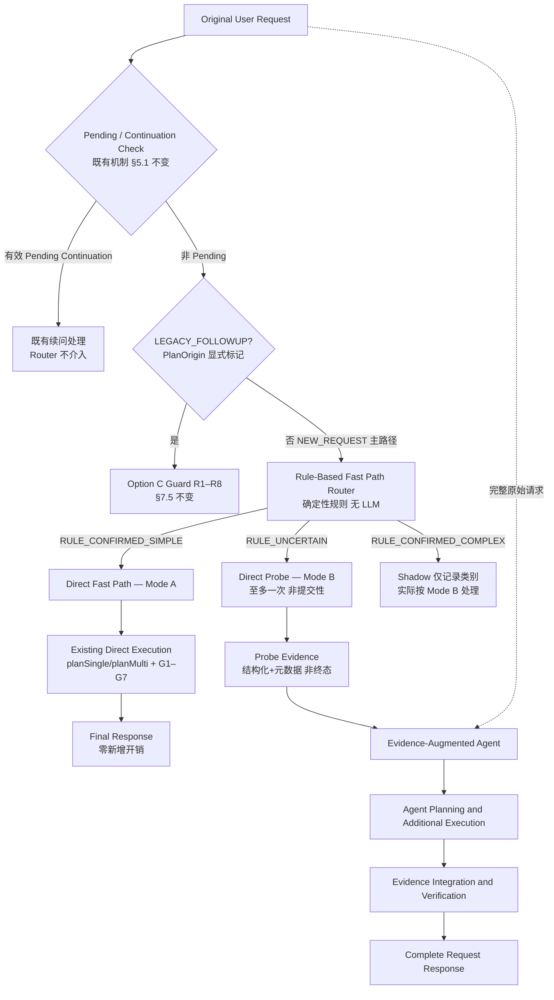

# analysis-project Phase 0.1 — Architecture & Decision Baseline V2

> **文档定位**：Phase 0.1 唯一权威架构基线（Architecture Baseline）。描述为什么设计、架构是什么、各模块职责、执行路线、冻结决策及其边界。
>
> **文档层级**：本文档与《Phase 0.1 — Contracts, Golden Matrix & Phase 1A Readiness V2》共同构成 Phase 0.1 当前唯一权威实施基线。原始 Phase 0.1 文档（含 REVISED 冻结契约）降级为历史依据，其冻结决策在本档 Part IX 完整继承。Phase 1A 实施必须以两份 V2 文档为依据。
>
> **冻结日期**：2026-11-24　**文档版本**：V2（从零重建）　**前置权威**：Phase 0.1 Revised Architecture Decision & Acceptance Contract（PHASE 0.1 — FROZEN）

---

## Part I — Executive Summary

### I.1 Phase 0.1 目标

在保证复杂请求能够完整执行的前提下，尽可能保留简单请求的快速、低成本、低延迟 Direct Execution；并将「Direct Execution 成功」与「用户整个 Request 已完成」这两个概念彻底解耦，建立可实施、可测试、可审计的 Request Objective Coverage 体系。

### I.2 当前问题

现有 Direct Execution 体系将「Skill 执行成功」默认等价为「请求完成」。该等价在两类场景下不成立：

1. Direct Plan 只覆盖请求的部分分析目标（Skill 成功 ≠ 请求完整）；
2. 同一个 Skill 需要多个 Invocation（不同参数）才能完成请求，而现有 Plan 只生成单 Invocation。

同时，为补救上述缺口而引入 LLM-first 判定（先调 LLM 判断请求是否简单/复杂）会让所有简单请求承担额外 LLM 成本与延迟，违背产品目标。

### I.3 新架构方向（最终冻结）

正式架构名称：

**Rule-Based Fast Path Router + Direct Probe + Evidence-Augmented Agent Fallback**

- **Mode A — Direct Fast Path**：Router 以确定性规则确认「简单单问题」→ 走既有 Direct 执行（planSingle()/planMulti() + Multi-Skill G1–G7），零新增开销，目标 ≥80% 简单请求覆盖。
- **Mode B — Direct Probe → Evidence-Augmented Agent**：Router 无法确认 → 至多一次既有 Direct 执行尝试（Probe，非提交性），产出结构化 Evidence → Agent 接收**完整原始请求** + Evidence，判定目标覆盖并继续/复用，整合全部证据给出完整回答。
- **Mode C — RULE_CONFIRMED_COMPLEX**：规则可确认复杂，**延期不纳入 Phase 1A MVP**；Shadow 期仅记录类别，实际按 Mode B 处理。

### I.4 核心设计原则

1. **禁止 LLM 路由**：不为「判断请求是否简单」新增任何 LLM 调用；分类由确定性规则完成。
2. **禁止伪概率**：不实现无统计意义的 `confidence: 0.92` 数值；分类是三态规则判定，如实现 rule score 必须声明为 deterministic rule score。
3. **Fail-Closed**：规则冲突、评估异常、无法确定 → 一律 Uncertain → Mode B。
4. **Probe Success ≠ Request Success**：Probe 是非提交性执行，不提交 Snapshot、不消费 Pending、不改变 PlanOrigin、不计入异常率。
5. **Agent Goal = Original Full User Request**：禁止把目标缩减为「解释 Probe 结果」或「只补剩余部分而不告知完整目标」。
6. **Same Skill ≠ Same Invocation**：同一 Skill 允许不同参数多次调用；禁止盲目去重。
7. **冻结决策原样继承**：Option C / R1–R8 / PlanOrigin / Snapshot Isolation / Whole-Request Yield / Multi-Skill G1–G7 / V1-V2 双端点全部保持约束力。

### I.5 Phase 1A 实施前提

Phase 1A 不得直接写代码。实施前必须完成：《Phase 0.1 — Contracts, Golden Matrix & Phase 1A Readiness V2》（本任务书姊妹文档，下称 Doc 2）Part XIV 1A-0 Contract Audit，并满足其全部 Gate 条件。已知最高优先级前置项：v1 `planAll`(:499) 返回空列表时的分支行为验证（无 fallback 则 Yield/Probe 路径退化为无输出）。

---

## Part II — Problem Statement

### II.1 Direct Execution 的七个不足

| # | 问题 | 说明 |
|---|---|---|
| P-1 | Direct Plan 可能只覆盖部分 Request Objectives | 用户请求含多个分析目标，Direct Plan 仅执行其中一部分；Skill 执行成功但请求未完成。 |
| P-2 | 同一 Skill 可能需要多个 Invocation | 例如「11月版本国库组的缺陷密度和那个人的缺陷密度最高」意图包含：① 查询国库组缺陷密度；② 按人员维度查明细并确定最高者。现有 Plan 可能只生成一个 Invocation（dimension=人员, groupName=国库组, versionPlan=2026年11月份版本），返回人员数据表不等于两个目标完成。 |
| P-3 | Runtime 支持重复调用 ≠ Plan 已生成重复调用 | Runtime 能重复调用 Skill 不代表 Direct Plan 已经包含多个 Invocation。 |
| P-4 | Script 能聚合 ≠ Request 已完整表达 | Script 能完成聚合、排名、排序，不代表当前请求已被完整表达和执行。 |
| P-5 | Direct Execution Success ≠ Request Completion | 两者必须显式区分，禁止隐式等价。 |
| P-6 | 复杂请求缺乏可靠的完整性保障 | 现有体系对复合请求没有目标覆盖判定与整轮完成语义。 |
| P-7 | 不能让所有简单请求都承担 LLM 成本 | LLM-first 判定方向已否决：判断「是否简单」本身不得调用 LLM。 |

### II.2 必须显式区分的概念（禁止合并）

```text
Skill Capability
    ≠ Direct Plan
    ≠ Planned Invocation
    ≠ Executed Invocation
    ≠ Probe Evidence
    ≠ Request Objective
    ≠ Request Completion
```

Skill 能够执行某个分析，不代表 Direct Plan 已经包含用户请求的所有分析目标；Runtime 能够重复调用某个 Skill，不代表 Direct Plan 已经生成多个 Invocation；Script 能够完成聚合、排名、排序，不代表当前请求已被完整表达和执行。

### II.3 被否决的旧方向（Superseded — 仅历史记录）

以下设计方向已被 REVISED 2026-11-24 决策正式废弃，不得作为当前架构的有效设计出现在任何实施文档中：

- LLM Request Decomposition + Direct Feasibility Guard（旧主路径 Guard 对 Executable Plan 集合的覆盖判定，契约 §7.1–7.4）；
- LLM-first Request Classification（先调 LLM 判定简单/复杂）；
- 仅基于 Direct Plan 判断是否 Yield；
- 仅基于 Skill 数量判断复杂度；
- Direct Success 即 Request Completion；
- 只将当前 Direct 结果（文本）传给 Agent 而丢失原始请求；
- 以单 Skill、单 Script 作为 Probe 的默认限制；
- 没有 Evidence Contract 的 Agent Fallback；
- 没有 Probe Side-Effect Isolation；
- 仅依赖关键词判断复合请求（如「出现『和』即复合」「出现『最高』即 Yield」）。

其中 §7.5 Context-Aware Follow-up Guard（Option C）不属于上述废弃范围——它仅限 `LEGACY_FOLLOWUP` 轮次、本身是确定性规则判定，完整保留（Part IX）。

---

## Part III — Goals / Non-Goals

### III.1 Goals

| # | Goal | 说明 |
|---|---|---|
| G-A | Simple Request Fast Path | 规则确认简单 → 既有 Direct 零开销执行；产品目标 **≥80% 简单请求进入 Fast Path**（`simple_request_fast_path_coverage` 度量，目标值非实测值）。 |
| G-B | Request Completion | 建立 Request Objective Coverage 模型，最终回答以完整原始请求为基准。 |
| G-C | Rule-Based Router | 确定性三态分类，无 LLM，可解释、可审计、可测试、规则集版本化。 |
| G-D | Direct Probe | Uncertain 请求获得至多一次低成本初始执行尝试，产出结构化 Evidence。 |
| G-E | Evidence-Augmented Agent | Agent 接收完整原始请求 + Evidence，复用或补充执行，负责整体完成判定。 |
| G-F | Objective Coverage | 区分输入实体与待发现输出实体；覆盖三态 COMPLETE/INCOMPLETE/UNKNOWN；UNKNOWN 按 fail-closed 处理。 |
| G-G | Multi-Invocation | 同一 Skill/Script 允许不同参数多次调用；Invocation Identity 防错误去重。 |
| G-H | Existing Multi-Skill Preservation | 既有 Multi-Skill Direct Execution 与 G1–G7 完整保留，不被 Router 禁止或降级。 |
| G-I | Shadow Validation | Shadow 模式在不改变用户行为的前提下评估 Router/Probe/Agent 全链路。 |
| G-J | V1/V2 Consistency | 双端点（/ai/chat 与 /v2/ai/chat）遵循相同核心架构契约，各自 SSE 不被重构。 |

### III.2 Non-Goals（本阶段明确不做）

| # | Non-Goal | 说明 |
|---|---|---|
| N-1 | Mode C MVP 实施 | RULE_CONFIRMED_COMPLEX 路由生效延期；Shadow 仅记录。 |
| N-2 | Goal Extraction Runtime / Goal Scheduling | 不新建独立的目标提取/调度 Runtime；覆盖判定由 Router 规则 + Agent 判定承接。 |
| N-3 | 重建 Multi-Skill | 禁止重建/简化/删除 Multi-Skill，禁止强制单 Skill/单 Script，禁止引入未经批准的候选数量上限（Doc 2 Part IX）。 |
| N-4 | 双 Ask 单 Pending 问题 | 同一会话同一时刻仅一个 Pending 槽位的现状不在 Phase 1A 解决范围。 |
| N-5 | 多实例部署语义 | 不在本次范围。 |
| N-6 | 新的 PlanOrigin 值 | Router/Probe/Agent 不新增 PlanOrigin 枚举值、不改三值语义。 |
| N-7 | 移除既有参数抽取中的 LLM 调用 | 既有参数抽取已含的 LLM 调用不要求移除；禁止的是为 Router 新增独立 LLM Routing Round。 |
| N-8 | 把 Probe 强制限制为单 Skill/单 Script | 未经论证不得施加该限制（Doc 2 Part IV）。 |
| N-9 | Probability-calibrated Confidence | 不做概率校准；rule score 如实现必须声明为 deterministic。 |
| N-10 | Pending 回答中新增目标语义 | 属既有消费语义已知限制，Phase 1A 不解决（契约 §6.3）。 |

---

## Part IV — Architecture Overview

### IV.1 Overall Architecture



> 此图为架构概念图。实际模块、接口、执行边界、线程模型、生命周期、事件结构必须以真实代码审查结果（Doc 2 Part XIV 1A-0）与后续实施契约为依据；不得为了让图更漂亮而虚构现有模块或接口。

### IV.2 Component Responsibilities

| 组件 | 职责 | 明确不做 |
|---|---|---|
| Pending/Continuation Check（既有） | 有效 Pending 续问承接 | Router 不介入；PlanOrigin=PENDING_CONTINUATION 整体绕过 Router/Guard |
| LEGACY_FOLLOWUP 判定（既有） | 追问层识别 | 产出 LEGACY_FOLLOWUP origin 后走 §7.5，不经 Router |
| Rule-Based Fast Path Router | 回答一个问题：该请求能否被确定性规则安全确认为简单单问题 | 不做自然语言任务规划、语义拆分、多轮推理、依赖推断、代替 Agent 理解请求 |
| Direct Fast Path（既有 Direct 执行） | planSingle()/planMulti() + 参数抽取 + Script 执行 + 返回 | 不因新架构增加任何 LLM 调用 |
| Direct Probe | 至多一次既有 Direct 执行尝试，产出 Evidence | 不是最终答案、不是完整请求执行、不是 Agent Plan、不是成功提交、不是新 Runtime |
| Evidence | 结构化执行证据（6 类状态） | 不是自由文本；不是 Request Completion |
| Evidence-Augmented Agent | 接收完整原始请求 + Evidence；判定覆盖；复用/补充执行；整合回答 | 不从零开始；不盲信 Probe；不丢失原始请求 |
| §7.5 Option C Guard | LEGACY_FOLLOWUP 轮上下文感知判定（R1–R8） | 不作用于 NEW_REQUEST 主路径；不凭空创建 Direct Plan |
| Shadow Recorder | 记录 Route Decision / Probe State / Metrics | 零副作用；不改变实际执行 |

### IV.3 Request Lifecycle（主路径决策流）

```text
User Request
    ↓
既有 Pending / Continuation 检查（§5.1，不变）
    ├── 有效 Pending Continuation → 既有续问处理（Router 不介入）
    └── 非有效 Pending Continuation
            ↓
LEGACY_FOLLOWUP 轮？（§6.2 PlanOrigin / 追问层判定）
    ├── 是 → §7.5 Option C R1–R8（不变）
    └── 否（NEW_REQUEST 主路径）
            ↓
Rule-Based Fast Path Router（确定性规则，无 LLM）
    ├── RULE_CONFIRMED_SIMPLE（Mode A）→ 既有 Direct → 返回
    ├── RULE_UNCERTAIN（Mode B，默认兜底）→ Direct Probe → Evidence → Agent → 完整回答
    └── RULE_CONFIRMED_COMPLEX（Mode C — 延期）→ Shadow 仅记录，实际按 Mode B 处理
```

### IV.4 State Transitions

本架构不新建平行状态系统。涉及的既有状态及 Probe 的关系：

| 状态 | 归属 | 与 Probe 的关系 |
|---|---|---|
| PlanOrigin（NEW_REQUEST / PENDING_CONTINUATION / LEGACY_FOLLOWUP） | 既有三值，冻结 | Probe 沿用 Plan 既有来源标记（NEW_REQUEST 主路径产出），不新增值 |
| Candidate Snapshot | §5.9 既有 | Probe 可产生候选执行上下文，**不得**转为 Committed |
| Committed Successful Snapshot | §5.9 既有 | Probe 前后必须完全一致 |
| Pending（TTL 5min） | §6 既有 | Probe 不消费、不写入 |
| recordResult / 成功执行历史 | §5.9 既有 | Probe 不调用；Probe 是「非提交性执行」 |
| Probe State（6 态枚举） | 本架构新增 | PROBE_SUCCESS / PROBE_EMPTY_RESULT / PROBE_EXECUTION_FAILED / PROBE_NO_DIRECT_PLAN / PROBE_UNSUPPORTED / PROBE_TIMEOUT |
| Evidence Reuse Decision | 本架构新增 | REUSE / ADDITIONAL_EXECUTION / MIXED / REJECTED |

### IV.5 Execution Routes

| Route | 触发 | 执行体 | 成本 | 侧写 |
|---|---|---|---|---|
| Route 1 — Direct Fast Path | RULE_CONFIRMED_SIMPLE | 既有 Direct 全链路 | 零新增（与现状一致） | 无 Probe、无 Agent |
| Route 2 — Probe then Agent | RULE_UNCERTAIN（含 fail-closed 兜底） | 至多一次 Probe + Agent | Probe 一次 Direct 成本 + Agent ReAct 成本 | Probe 非提交性 |
| Route 3 — Pure Ask（旁路） | 规划产出纯 Ask Plan | 既有 Ask/Clarification | 不变 | 不 Probe、不进 Agent |
| Route 4 — Pending Continuation | 有效 Pending 命中 | 既有续问路径 | 不变 | 整体绕过 |
| Route 5 — Legacy Follow-up | LEGACY_FOLLOWUP origin | §7.5 R1–R8 判定 | 不变 | 与 Router 互不介入 |

### IV.6 Agent Handoff（概览，契约细节见 Doc 2 Part VII）

Handoff 传递物最低集：Original Full User Request、相关会话上下文、Router Decision、Probe Execution Status（Probe State）、Probe Skill/Script 元数据、Probe Parameters、Probe Result/Error、Evidence Reuse Instructions、Full Request Completion Instructions。接入点复用现有 Context Assembly / Agent Prompt / Tool Result / Message History 机制。

---

## Part V — Rule-Based Fast Path Router

### V.1 Rule-Based Classification

Router 只回答一个问题：

> 这个请求能否被确定性规则安全地确认为简单单问题，从而进入既有 Direct Fast Path？

三态分类：`RULE_CONFIRMED_SIMPLE` / `RULE_UNCERTAIN` / `RULE_CONFIRMED_COMPLEX`（可选）。规则冲突与评估异常 fail-closed 为 Uncertain。

### V.2 Admission Criteria（规则族）

| 规则 | 方向 | 要点 |
|---|---|---|
| R-S1 | 确认简单 | 单一指标 + 单一主体/范围 + 无独立任务连接 + 无重复执行需求 + 无多步骤依赖 + 现有 Direct Plan 可表达 → SIMPLE |
| R-S2 | 确认简单 | 单一指标 + 多个过滤参数 ≠ 多个分析目标；不得因参数数量判复杂 |
| R-U1 | 多目标连接风险 | 「A和B/A以及B/A，同时查询B/分别」等结构；连接词命中≠多目标（「国库组和研发组的缺陷密度」可能单查询可覆盖）；无法可靠区分 → Uncertain |
| R-U2 | 同 Skill 多次执行风险 | 同指标不同维度/整体+排名/整体+明细等结构，且现有执行模型仅单 Invocation 时 → Uncertain；不得把「最高/TopN/人员维度」参数本身判复杂 |
| R-U3 | 排名/比较/聚合组合风险 | 整体+排名、总量+明细、均值+极值、比较+趋势等组合且规则无法确认单次执行可覆盖 → Uncertain；单一 Ranking/Comparison/Aggregation 不一律判复杂 |
| R-U4 | 指代/省略/歧义 | 「那个人/其中最高的/这个组/再看看/同时」等；指代可能指向历史上下文，也可能（首轮）是待发现实体表达；无法确定 → Uncertain |
| R-U5 | 不支持的任务形态 | 多目标独立执行/同 Skill 多参数执行/前序结果影响后续参数/需动态规划/Plan 无法表达/语义不明/规则冲突/未知结构 → Uncertain 或 Agent |

**规则优先级**：Explicit Complex / Unsupported Structure > Uncertain / Ambiguous / Conflict > Confirmed Simple > Fallback Uncertain。

最终原则：**Router 只有在足够明确地确认请求属于简单单问题时才允许 Fast Path；其他一切无法确定的情况都不能默认当成简单问题。**

### V.3 Confidence / Threshold

- 初始高置信度阈值 **~0.8 作为候选基线**（rule score，deterministic，非概率）；该值如何在规则系统中实际应用由 Phase 1A 依现有代码与真实请求样本确定。
- 如果 Confidence 不是经过概率校准的值，**不得**将其描述成具有统计意义的概率。
- 优先使用规则命中与冲突判定，而非数值打分。

### V.4 禁止的简单关键词逻辑

禁止采用以下未经验证的判定：出现「和」即复合；出现「最高」即必须 Yield；出现多个 Skill 即进 Agent；同一 Skill 出现两次即进 Agent；有一个 Skill 即 Direct 一定完整；Direct 执行成功即请求完整。

Router 必须考虑请求结构、当前 Direct Plan 的表达能力、执行实例数量、请求目标覆盖和确定性。规则应可解释、可审计、可测试。无法通过规则可靠确定的请求进入 Uncertain Route，不得通过错误规则强行进入 Fast Path。

**不得堆关键词**：不通过增加大量关键词追求表面覆盖率；最小有效规则集必须先审查现有代码与真实请求样本确定。

### V.5 Route Decision / Reason Codes

Route Decision Codes（Doc 2 Part II 契约化）：

```text
ROUTE_RULE_CONFIRMED_SIMPLE    → DIRECT_FAST_PATH
ROUTE_RULE_UNCERTAIN           → PROBE_THEN_AGENT
ROUTE_RULE_COMPLEX_OBSERVED    → Shadow 记录（实际走 PROBE_THEN_AGENT）
ROUTE_RULE_CONFLICT            → fail-closed PROBE_THEN_AGENT
ROUTE_RULE_EVALUATION_FAILURE  → fail-closed PROBE_THEN_AGENT
```

Reason Codes 为低基数结构化枚举，实际参与决策，不得仅用于日志装饰。

### V.6 False Positive / False Negative 风险

| 风险 | 定义 | 度量 | 处置 |
|---|---|---|---|
| False Fast Path（假简单） | 实为复杂/多目标请求被放行 Fast Path | `false_fast_path_rate` | 阈值须在 Shadow 期定标后方可开启 Enforcement（Gate J） |
| False Probe（假不确定） | 实为简单请求被送入 Probe+Agent | `false_probe_rate` | 同上；该风险有成本代价但无正确性风险 |
| 漏网复杂请求直接成功返回 | Probe 路径不存在此问题（Agent 兜底） | — | Fast Path 侧由 false_fast_path_rate 约束 |

### V.7 Shadow Metrics

- Shadow 期记录：Rule Set Version + Matched Rules + Route Reason + Route Decision + endpoint 标签（§10.1 Shadow Router 项）。
- 核心指标（Doc 2 Part XI 契约化）：`rule_confirmed_simple_rate`、`false_fast_path_rate`、`false_probe_rate`、`simple_request_fast_path_coverage`、`probe_evidence_reuse_rate` 等，全部带 endpoint 标签。

### V.8 80% Simple Request Target

> 至少 80% 的简单请求可以进入快速 Direct Fast Path。

这个 80% 是**产品目标，不是未经测量的事实**。文档与指标体系必须区分：目标值（80%）、当前实测值（待 Shadow）、Shadow Mode 观测值（待采集）、上线验收值（Gate J 判定）。

### V.9 分层边界

Router 只作用于 `NEW_REQUEST` 主路径；`PENDING_CONTINUATION`（§5.1/§6）与 `LEGACY_FOLLOWUP`（§7.5）不经过 Router 分类，各自契约不变。

---

## Part VI — Direct Probe Architecture

### VI.1 Probe Purpose

对于 Router 判断为复杂或不确定的请求：在进入 Agent 之前，先运行现有 Direct 能力，获取初始分析结果作为 Evidence。目标：

- 利用现有 Skill 能力；
- 以较低成本获取可用结果；
- 避免 Agent 在完全没有数据证据的情况下开始推理；
- 让 Agent 能够基于已执行结果继续分析；
- 减少重复执行；
- 保留原始用户请求，确保最终完成整个 Request。

定位：**受控、可界定、具有副作用隔离的初始执行阶段**。

### VI.2 Probe Eligibility

- 仅 NEW_REQUEST 主路径的 RULE_UNCERTAIN 请求进入 Probe。
- 纯 Ask 轮不 Probe、不进 Agent（既有 Ask/Clarification 机制处理）。
- Probe 不与 Ask 轮并发，不消费 Pending（§6）。
- `PROBE_NO_DIRECT_PLAN` / `PROBE_UNSUPPORTED` 时无执行发生，直接以完整原始请求进入 Agent。

### VI.3 Probe Scope / Reuse of Existing Direct Execution

- Probe 使用既有规划机制（`planSingle()` / `planMulti()`，含 Multi-Skill G1–G7）产出的 Plan。**不凭空创建第二套 Skill 执行系统。**
- **不得假设 Probe 只能调用一个 Skill 或一个 Script**；不得为降低成本而未经论证地把 Probe 强制限制成单 Skill 执行。
- 「一次 Probe」的确切含义（单 Invocation vs 单 Plan 集合执行）以现有代码实际执行模型为准，Phase 1A 审查后确定并在审计报告中记录。

### VI.4 Invocation Boundaries / Execution Limits / Result Limits

| 边界 | 契约 | 默认建议 |
|---|---|---|
| Invocation Limit | **至多一次 Probe 执行尝试**，禁止连续多次尝试 | 冻结 |
| Skill/Script 范围 | 复用既有 Plan 完整 Invocation 集合；禁止 top-1 截断 | 冻结（范围）；预算值 1A 定标 |
| Time Budget | 沿用既有超时/失败机制 | 1A 定标 |
| Result Size Budget | Evidence 超限必须标记 Truncation | 1A 定标 |
| Timeout | 超时 → PROBE_TIMEOUT，正常分支 | 沿用既有 |
| Cancellation | 用户取消 → 生命周期清理，无状态残留 | 1A 定义 |
| Partial Failure | 部分 Invocation 成功部分失败 → PROBE 分态 + 分型 Evidence | 冻结（语义） |

所有预算参数的具体数值如需 Phase 1A 进一步确定，必须标记为**实施前必须冻结的配置**，不得遗漏（Doc 2 Part IV）。

### VI.5 Failure Handling（Probe States）

```text
PROBE_SUCCESS          一次执行尝试成功返回
PROBE_EMPTY_RESULT     执行成功但结果为空
PROBE_EXECUTION_FAILED 执行失败
PROBE_NO_DIRECT_PLAN   规划未产出可执行 Plan（无执行发生）
PROBE_UNSUPPORTED      请求形态不支持 Probe（无执行发生）
PROBE_TIMEOUT          超时
```

**失败语义（冻结）**：除 PROBE_SUCCESS 外的所有状态均为**正常分支**——不得阻止 Agent 继续处理完整原始请求，不得据此将请求判为最终失败，**不得计入异常率**（§13）。失败信息仅作为 Agent 诊断上下文。

### VI.6 Side-Effect Isolation（冻结）

Probe 不能被视为正式的成功执行记录。Probe 期间不得意外：

- Commit Candidate Snapshot / 更新 Committed Snapshot / 污染原有 Snapshot；
- 更新正式成功执行历史；
- 调用正式 recordResult；
- 消费或污染 Pending；
- 将 Probe 结果写入会影响后续正常请求的用户状态；
- 将 Probe 的部分成功当作整个请求完成；
- 因 Probe 成功而跳过 Agent Fallback。

```text
Probe Execution
    ├── Temporary Execution State      （允许）
    ├── Probe Result                   （允许）
    ├── Probe Evidence                 （允许）
    └── Agent Handoff                  （允许）

Probe Execution
    └── MUST NOT automatically become
        ├── Committed Snapshot
        ├── Official Success History
        ├── Pending Consumption
        └── recordResult
```

如果现有代码无法保证以上隔离（已知风险点：`planFollowupDirect` 规划期 `recordLastExec`(:1311) 在 Guard 前写入——见 Part IX.4），必须将其列为 Phase 1A 的**实现阻塞项**，而不是假定已经支持。

### VI.7 Probe Lifecycle

状态机设计（mermaid 图与合法转移的最终确定）见 Doc 2 Part IV；核心生命周期：Eligible → Running → {Completed/Partial/Failed/TimedOut} → EvidenceReady → AgentHandoff（或 Eligible → Skipped → AgentHandoff）。Probe State 六态枚举（VI.5）是终态判定的事实标准。

---

## Part VII — Evidence-Augmented Agent Architecture

### VII.1 Original Request Preservation（冻结）

`Agent Goal = Original Full User Request`。Agent Fallback 必须接收：

1. Original User Request；
2. 当前请求的必要上下文；
3. Router Decision；
4. Probe Execution Status；
5. Probe Evidence；
6. Probe Failure / Partial Result；
7. 现有可用的相关 Execution Context。

**禁止**：

- 仅将 Probe 的最终文本结果传给 Agent，导致原始请求丢失；
- 将经过缩减的 Probe 请求作为 Agent 的最终任务；
- 创建重复 Context Assembly 系统；
- 绕过现有 Agent Runtime / Tool Calling / SSE；
- 创建平行 Agent Executor；
- 在 V1/V2 复制新 Agent 实现。

### VII.2 Evidence Context

Evidence 是结构化对象（契约详见 Doc 2 Part VI），六类状态：Successful / Failed / Partial / Empty / Truncated / Unavailable。Agent 必须能够理解 Probe 结果的可信边界和完整性。Evidence 元数据最低集：原始请求、Probe 对应 Skill、Script 标识、实际执行参数、执行状态（Probe State）、返回数据或错误信息、数据来源、执行时间/可追踪标识、可复用性客观信息（参数范围、指标口径、覆盖维度）。

### VII.3 Agent Planning / Additional Execution

Agent 必须根据 Original Request + Probe Evidence + Evidence Coverage + Request Objectives 决定是否：

- 直接整合现有 Evidence；
- 继续执行其他 Skill；
- 对同一个 Skill 进行不同参数的再次调用；
- 追加必要的分析；
- 验证现有结果；
- 对部分失败进行恢复；
- 补齐未完成目标；
- 汇总多个结果；
- 输出完整答案。

### VII.4 Evidence Reuse

- 已有 Evidence 可以复用；不强制复用（Probe 结果不要求必须复用）。
- 不应无条件重复执行相同的 Skill + Script + Parameters；Evidence 充分时禁止重复执行。
- 不应因为已有某个 Skill 结果就跳过其他必要目标。
- 同一个 Skill 允许根据不同参数执行多次；参数不同的 Invocation 不得被错误判定为重复。
- Evidence 不完整时可以追加执行；失败时可以尝试恢复；不足以完成请求时必须继续；与当前请求上下文不匹配时不得盲目复用。

必须明确区分：

```text
Same Skill            ≠ Same Invocation
Same Script           ≠ Same Invocation
Same Invocation Parameters ≠ Automatically Reusable Evidence
```

Evidence 复用判断应考虑实际请求、参数、上下文、结果有效性和时效。

### VII.5 Verification（Objective Coverage 判定）

Agent 必须以**完整原始请求**为基准判定目标覆盖：

- Probe Success 不构成跳过覆盖分析的理由；
- 禁止因 Probe 成功而遗漏其他目标；
- 不过度分解：单一排名/极值目标不得被机械拆成多目标；
- 待发现的输出实体不得转换为空输入参数（如「那个人」首轮是待发现实体，不是缺失输入参数）；
- 覆盖三态 COMPLETE/INCOMPLETE/UNKNOWN；UNKNOWN 必须按不覆盖（fail-closed）处理。

Evidence Reuse 决策枚举：`REUSE` / `ADDITIONAL_EXECUTION` / `MIXED` / `REJECTED`。

### VII.6 Completion / Partial Failure / Final Response

- **完成语义**：Agent 整合全部证据后给出覆盖完整原始请求的回答。
- **部分失败**：对不能完成的目标必须明确说明；不得将部分成功包装成完整成功。
- **无法完成**：按既有 ReAct 失败路径处理，不得谎报完成。
- **Probe Evidence 不是最终答案、不是 Request Completion**；Agent 必须负责确认用户请求的整体完成情况。

---

## Part VIII — Request Objective Coverage & Completion

### VIII.1 核心命题

> Direct Execution 的成功状态不能替代整个 User Request 的完成状态。

### VIII.2 概念链

```text
Skill
    ↓
Script
    ↓
Invocation + Parameter Set
    ↓
Execution
    ↓
Evidence
    ↓
Objective Coverage
    ↓
Request Completion
```

**不得**：把 Skill Coverage 当作 Request Objective Coverage；把 Execution Count 当作 Objective Count；把 Evidence Count 当作 Completion Count。

### VIII.3 两类典型遗漏场景

**Scenario A — Direct Plan 只覆盖部分请求目标**：用户请求包含多个分析目标，Direct Plan 仅执行其中一部分，Skill 成功但请求未完成。禁止路径：

```text
Direct Skill Success → Final Answer        ✗ 禁止
```

正确路径：

```text
Original Request → Request Objectives → Direct Plan / Probe Coverage
    → Evidence → Agent Continuation → Remaining Objectives
    → Verification → Complete Request Answer
```

**Scenario B — 同一个 Skill 需要多个 Invocation**：以用户真实问题为例：

> 11月版本国库组的缺陷密度和那个人的缺陷密度最高

其意图包含：① 查询 11 月版本国库组的缺陷密度；② 查询该组人员维度的缺陷密度并确定最高者。当前 Direct Plan 若只生成一个 Invocation：

```json
{ "dimension": ["人员"], "groupName": ["国库组"], "versionPlan": ["2026年11月份版本"] }
```

一次执行返回人员数据表，并不等价于两个目标已经完成。必须明确区分：Request Objective / Planned Invocation / Executed Invocation / Invocation Parameter Set / Evidence Coverage / Objective Completion / Request Completion。同一个 Skill 可以对应多个 Invocation；同一个 Script 可以对应多个 Invocation；同一个 Invocation 可以产生多个 Evidence。**不能将这些概念合并。**

### VIII.4 Objective 模型要点

- 目标分解区分**输入实体**与**待发现输出实体**：输出实体（如「那个人」）不得误判为缺失输入参数；
- 覆盖三态：COMPLETE / INCOMPLETE / UNKNOWN；UNKNOWN ≠ COMPLETE（fail-closed）；
- 能力充分性判定：Skill 名称/关键词/Plan 命中本身**不构成**能力证据；
- 参数变化 ≠ 目标覆盖：「再分析月度趋势」即使 Plan 中存在 timeRange 参数也不能证明趋势分析已执行；参数变化（⑤）不能单独作为目标与 Plan 映射关系（⑥）的证明。

### VIII.5 Whole-Request Completion

对进入 Agent Fallback 的请求：

- Agent 接收完整原始请求；
- Agent 不仅完成 Probe 所覆盖的部分、不仅完成第一个 Skill、不仅完成当前已有 Invocation；
- Agent 必须确认整个请求是否完成；
- 对不能完成的目标必须明确说明；
- 不能将部分成功包装成完整成功。

---

## Part IX — Frozen Decisions（完整继承）

以下冻结决策全部原样继承自《Phase 0.1 Revised Architecture Decision & Acceptance Contract》（PHASE 0.1 — FROZEN, 2026-11-24）。**本 Part 为继承性声明 + 完整规则文本；实施细节契约在 Doc 2 对应 Part。**

### IX.1 Option C — Context-Aware Follow-up Guard（§7.5）

核心原则：

> LEGACY_FOLLOWUP 不是无条件绕过 Guard，也不是把当前短文本当作独立的新请求进行普通 Guard 判定，而是基于当前请求、此前成功的 Direct 执行上下文、当前参数变化、当前 Plan 集合和新增目标信号进行上下文感知判定。

- 保留原有 Direct Skill Follow-up 快速路径：当 Follow-up 请求只是对原任务进行合法的参数收窄或修改，且 Follow-up Planner 已产生合法可执行 Plan，同时 Guard 能确认没有新增或替换分析目标时，允许 `DIRECT_ALLOWED`。
- 当请求引入新的分析目标、替换原分析任务，或现有 Plan 无法表达当前请求时，整个原始请求交给 ReAct。
- 不得采用 Partial Direct + Residual ReAct；不得为了提高 Direct 命中率而静默丢弃新增目标。

### IX.2 R1–R8（完整继承）

**R1 — Pending Continuation 整体绕过。** 成功消费有效 Pending 后：PlanOrigin = `PENDING_CONTINUATION`；本轮不进入 Context-Aware Follow-up Guard；保持原有 Pending 参数补齐和确认流程；不得将 Pending Continuation 与普通 Follow-up 混为一谈。注记：Pending 回答中疑似新增目标语义不在本轮判定范围，属已知限制。

**R2 — Pure Ask Plan 例外。** 纯 Ask Plan 保持既有澄清行为：不因 Ask 本身触发新增分析目标判断；不将 Ask Plan 当作已经执行的 Direct 任务；不得因 Guard 处理而产生孤立 Pending；保持既有 Ask/Pending 对应关系。Mixed Ask + Executable 的既有契约仍然有效：Ask 本身不作为新增分析目标；Executable Plan 仍接受适用判定；一旦整体 Yield，整个请求交给 ReAct，不执行任何 Direct Plan，也不输出孤立 Ask 内容；DIRECT_ALLOWED 时保留既定 Mixed Plan 行为。

**R3 — 无新增目标的合法 Follow-up 可以 Direct（前置条件 1–8 缺一不可）。** 只有同时满足：① PlanOrigin 明确为 `LEGACY_FOLLOWUP`；② 存在有效的历史成功 Direct 上下文（Committed Successful Snapshot）；③ 当前 Follow-up Planner 已产生合法、可执行的 Plan；④ 当前请求属于对既有任务的参数收窄、参数修改或合法维度选择；⑤ 没有识别到新增分析目标；⑥ 没有识别到任务替换信号；⑦ 当前 Plan 能够表达原任务在当前参数条件下的执行语义；⑧ Guard 所需上下文完整——才允许 `DIRECT_ALLOWED`。

**Guard 不能凭空创建 Direct Plan。**「给我看看」「结果按表格展示」类请求如果既有 Follow-up Planner 没有产生合法 Plan（既有行为：selector 空 + C3 无维度信号 → 回退 LLM），必须保持原有 ReAct 路径。「那开发一部呢」「改成北京测试部」「改成最近一年」只有在 Follow-up Planner 能产生合法可执行 Plan、且其他 Guard 条件通过时才允许 Direct。

**R4 — 新增目标必须有语义覆盖证据。** 不能把参数变化等同于分析目标覆盖。必须区分参数/过滤条件证据（department、region、timeRange、person 等）与分析操作语义证据（趋势、排名、Top-N、异常检测、原因解释、预测、比较等）。「再分析月度趋势」即使 Plan 中存在 `timeRange` 参数，也不能据此证明已经执行趋势分析；「只看杭州开发一部，并找出缺陷最多的人」即使 Plan 中成功更新了 department 参数，也不能据此证明已经完成了人员排名。覆盖证据评估包括：① 当前请求中的目标信号；② 历史任务目标；③ 当前 Plan 的 Skill 能力；④ 当前 Plan 的任务语义；⑤ 当前参数变化；⑥ 目标与 Plan 之间的明确映射关系——**其中第 ⑤ 项不能单独作为第 ⑥ 项的证明**。无法建立可靠语义覆盖证据时：不得推断为已覆盖、不得静默丢弃、必须整体 `YIELD_REACT`。

**R5 — 任务替换必须单独识别。** 任务替换与新增目标不是同一种情况。「不看缺陷密度了，改为分析月度趋势」「不分析销售额，改为分析利润」「换成异常检测」「不要原来的分析了，改为排名」可能不是在原任务上增加目标，而是要求替换原任务。既有 Follow-up Plan 不能明确表达新的替换目标时：整体 Yield ReAct、不执行原 Direct Plan、不允许继续使用旧 Skill 伪装成完成了新任务。使用独立原因码 `FOLLOWUP_TASK_REPLACEMENT`。替换词汇识别**不能仅依赖既有 C4b 排除词表**——例如「不看」与「不要」不能假定为同一个既有检测结果，Guard 必须建立独立的替换信号词表。

**R6 — 上下文缺失必须 Fail-Closed。** Snapshot 不存在、过期、属于其他 conversation、属于其他 user、历史 Skill 已不可用、PlanOrigin 缺失或非法、关键上下文无法恢复、Context Assembly 失败、Guard 无法建立当前请求与历史任务之间的可靠关系——任一出现时：不得伪造历史参数；不得静默回退为 Direct；不得使用不完整上下文证明新增目标已覆盖；按契约规定安全转入 ReAct 或既有安全澄清路径；记录对应 Guard 原因码和异常指标。

**R7 — 多 Plan 边界。** 不引入新的多 Plan 机制：保留现有 `planMulti()` / `planSingle()` 行为；不因为 Plan 数量大于 1 就自动 Yield；已有合法多 Plan 且能够表达请求时，仍可按既定规则 Direct；Legacy Follow-up 当前只产生一个 Plan，不得扩展为同一 Skill 多实例；Mixed Ask + Executable 遵循既有契约；不新增多 Pending。

**R8 — Shadow、Enforcement 和异常边界。** 区分 Guard 正常 Yield、Guard 评估异常、Guard 被关闭、Shadow 判定、Enforcement 实际路由、人工回滚六类语义。Shadow 只记录判定、不改变实际路由、不产生新的 Direct/ReAct 执行副作用、不影响 Pending/Snapshot/dimensionState（Guard 引入的部分）。Enforcement 下 `DIRECT_ALLOWED` 才能进入 Direct；`YIELD_REACT` 整体进入 ReAct；评估异常 Fail-Closed；不得出现部分 Direct 后再整体 ReAct。`GUARD_DISABLED` 不属于异常分母；`GUARD_EVALUATION_FAILURE` 计入异常率分子和分母；正常 `YIELD_REACT` 不属于异常。H7 阈值规则原样适用：异常率严格小于 0.5%（等于 0.5% 亦 BLOCKED）；可复现的系统性异常单独阻断；不得为 Follow-up 场景单独创造更宽松的异常阈值。

判定表：

| 条件 | 预期结果 |
|---|---|
| Pending Continuation 且成功消费 | Bypass（R1） |
| Pure Ask Plan | 保留既有 Ask 流程（R2） |
| Legacy Follow-up 有有效历史、合法 Plan、纯参数收窄、无新增目标 | DIRECT_ALLOWED（R3） |
| Legacy Follow-up 有新增目标且 Plan 无明确语义覆盖证据 | YIELD_REACT（R4） |
| Legacy Follow-up 有任务替换信号且 Plan 无法表达替换目标 | YIELD_REACT（R5，`FOLLOWUP_TASK_REPLACEMENT`） |
| Follow-up Planner 未产生合法可执行 Plan | 保持既有 ReAct 路径（R3——Guard 不凭空生成 Plan） |
| 历史上下文缺失或失效 | Fail-Closed（R6） |
| Guard Context Assembly 异常 | Fail-Closed（R6/R8） |
| Guard 评估异常 | Fail-Closed（R8） |
| 多 Plan 合法且表达完整 | 不因 Plan 数量本身 Yield（R7） |

### IX.3 PlanOrigin（§6.2，完整继承）

枚举：`NEW_REQUEST` / `PENDING_CONTINUATION` / `LEGACY_FOLLOWUP`。

产生条件（唯一合法来源）：

| Plan Origin | 产生条件 |
|---|---|
| `NEW_REQUEST` | 既未成功消费有效 Pending，也未进入既有 Follow-up Planner 分支的正常请求 |
| `PENDING_CONTINUATION` | **只能**由成功消费有效 Pending 状态的执行分支（consumePending 命中且上下文合并）明确产生 |
| `LEGACY_FOLLOWUP` | **只能**由真实进入既有 Follow-up Planner 分支（`planFollowupDirect` 及其后续演进）的执行路径明确产生 |

强制规则：① 必须作为规划结果的显式元数据传递，禁止文本推断（不得根据文本长度、关键词、Plan 数量、参数形态或 Snapshot 是否存在推断）；② 三值禁止合并、互转、兜底覆盖；③ 写入 Guard 评估记录、Shadow 指标标签与日志（不含隐私内容）；④ LEGACY_FOLLOWUP 接受 §7.5 判定；⑤ 标记机制属 Phase 1A 交付物，当前代码不存在，不得描述为现有能力；⑥ Guard 不得依据 Plan Origin 差异化放宽判定标准（豁免边界=R1：仅 PENDING_CONTINUATION 整体绕过）；⑦ 双 Ask 单 Pending 现状不在解决范围；⑧ PlanOrigin 推导发生在 consumeClarification（别名改写）之后；⑨ v1 与 v2 均使用携带 PlanOrigin 的规划结果供 Guard 使用。

与 Router/Probe/Agent 的关系：三值不变；Router/Probe/Agent 不新增值、不改语义；Probe 使用的 Plan 沿用其既有来源标记（NEW_REQUEST 主路径产出）；过期/无效 Pending 未命中的轮次不得一律按 NEW_REQUEST 处理，按真实分支归属标记 origin（selector 命中 → NEW_REQUEST；进入 Follow-up Planner → LEGACY_FOLLOWUP）。

### IX.4 Snapshot Isolation — Candidate vs Committed（§5.9，完整继承）

**不变量规则（12 条）**：① Plan 生成成功不等于 Direct 执行成功；② Guard `DIRECT_ALLOWED` 不等于 Direct 执行成功；③ 只有满足既有 Direct 成功标准的实际执行，才能更新成功执行历史；④ 规划阶段只能构造候选 Snapshot，不得提交为成功执行历史；⑤ Guard `YIELD_REACT` 不得提交候选 Follow-up Snapshot；⑥ Guard `YIELD_REACT` 必须保留此前最后一次成功 Direct Snapshot；⑦ Direct 执行失败不得把当前轮次记录为成功 Direct 历史；⑧ Direct 执行部分失败时，不得将失败结果伪装成成功历史；⑨ Pending Continuation 必须遵循既有 Pending 语义；⑩ ReAct 执行不自动更新 Direct Snapshot；⑪ Snapshot 的成功判定必须复用现有 Direct 执行成功标准；⑫ Snapshot 更新必须与实际执行结果绑定。

**定义**：Candidate Snapshot=规划阶段生成的候选执行上下文；可用于 Guard 评估；不代表任务已执行；不得覆盖成功历史。Committed Successful Snapshot=由满足现有成功标准的 Direct 执行结果产生；只有执行成功后才允许提交；是后续 Legacy Follow-up 继承的可信历史来源。Phase 1A 必须实现二者生命周期隔离；不得仅通过给现有 `recordLastExec` 增加布尔参数就宣称完成隔离。

**Snapshot 状态转移表（13 行）**：

| 场景 | 是否允许生成候选 Snapshot | 是否提交成功 Snapshot | 原有成功 Snapshot |
|---|---|---|---|
| NEW_REQUEST 规划完成，尚未执行 | 可以 | 不允许 | 保留 |
| NEW_REQUEST Guard Direct Allowed，执行成功 | 可以 | 允许 | 替换为本次成功结果 |
| NEW_REQUEST Guard Yield | 可以 | 不允许 | 保留 |
| LEGACY_FOLLOWUP 规划完成，尚未 Guard | 可以 | 不允许 | 保留 |
| LEGACY_FOLLOWUP Guard Direct Allowed，执行成功 | 可以 | 允许 | 替换为本次成功结果 |
| LEGACY_FOLLOWUP Guard Yield | 可以 | 不允许 | **必须保留** |
| Direct 执行失败 | 可以 | 不允许 | 保留 |
| Direct 部分执行失败 | 可以 | 不允许提交为整体成功 | 保留 |
| PENDING_CONTINUATION 尚未完成执行 | 可以 | 不允许 | 保留 |
| PENDING_CONTINUATION 完成且 Direct 执行成功 | 可以 | 按既有成功标准允许 | 替换为本次成功结果 |
| PENDING_CONTINUATION 失败 | 可以 | 不允许 | 保留 |
| ReAct 执行 | 不适用 | 不允许自动提交 | 保留 |
| Guard Shadow | 可以 | 不因 Shadow 判定而提交 | 由实际 Legacy 执行结果决定 |

**连续多轮污染测试（Phase 1A 强制验收）**：Turn 1 成功产生 S1 → Turn 2 Follow-up 产生候选 S2 → Guard 判 YIELD_REACT → Turn 2 不执行不提交 → Turn 3 必须仍以 S1 为历史成功上下文。断言：S1 未被覆盖；S2 未成为成功历史；Turn 2 未被伪装成 Direct 成功；Turn 3 不继承未执行的 Turn 2 候选任务；ReAct 执行不自动覆盖 Direct Snapshot。

**已验证代码事实与 Probe 的关系**：`planFollowupDirect` 规划期 `recordLastExec`(:1311) 在 Guard 前写入——Candidate/Committed 隔离是 Phase 1A 强制约束。**Probe 列为「非提交性执行」，受同一隔离契约约束**（§16.4：PRESERVED + EXTENDED）。

**多 Plan 成功标准前置问题**：现有系统对多 Plan 轮次的整体成功标准尚未明确；Phase 1A 不得擅自将「部分 Plan 成功」认定为整体成功，必须先明确该标准作为实施前置条件。

### IX.5 Whole-Request Yield（划界后语义）

- **现役范围**：Whole-Request Yield 语义现役于 §7.5（LEGACY_FOLLOWUP 轮次）。主路径旧 CRCR Guard（§7.1–7.4）已 Superseded。
- **Yield Trigger**：R4 新增目标无语义覆盖证据 / R5 任务替换 / R6 上下文缺失 / R8 评估异常。
- **Yield Scope**：整个原始请求交给 ReAct——不是仅 Yield 当前 Skill、当前 Script 或当前 Plan 的局部语义。
- **Original Request Preservation**：Yield 不得覆盖/改写用户原始请求；`currentRawRequest` 必须在任何文本归一化之前保留。
- **Direct Partial Execution**：禁止 Partial Direct + Residual ReAct；Yield 时整轮 Plan 集合不被采纳。
- **Probe Evidence 的区分**：**Probe 路径 ≠ Partial Yield**。被禁止的模式是「部分 Direct 执行 + 仅剩余部分交 ReAct」；Mode B 中 Probe 是非提交性证据获取，Agent 接收的是完整原始请求——这是新架构下的合法独立路径，二者严格区分。
- **Yield Side Effects**：Yield 时本轮 planAll 已写入的 pending 必须被清除（§6.4 P2）；不产生孤立 Ask 内容。
- **Yield Completion / Failure Handling**：Yield 后走既有 ReAct 全链路；失败按既有失败语义。

### IX.6 Pending 契约（§6，完整继承）

Pending Continuation 优先于新 Guard 的普通请求判定。规则要点：只有现有机制验证为有效的 Pending Continuation 才能 bypass；Pending 存在本身不构成绕过授权；过期 Pending 按既有行为处理；Guard 不得覆盖 Pending、不得创建新 Pending 状态模型、不得破坏 Snapshot、不得改变 TTL（PENDING_TTL_MS = 5 分钟）、不得引入新续问循环、不得覆盖用户原始请求、不得污染后续请求参数或维度。

**写入不变式（CR-05，实现不变式而非架构自动保证）**：

- **P1**：`pending.put` 发生 ⟺ 本次 planAll 返回的 Plan 列表中存在至少一个 Ask Plan（已验证四个写入点均满足）。
- **P2**：Guard Yield（ENFORCEMENT 下 YIELD_REACT 采纳）时，本轮 planAll 已写入的 pending 必须被清除，不得遗留孤儿 Pending。
- **P3**：pending 键为 `userId:conversationId`（sessionKey），不得引入第二套键或存储。
- **A1**：consumePending 在 planAll 最前执行，命中即消费并合并上下文；消费成功 ⟹ Plan Origin = `PENDING_CONTINUATION`。
- **A2**：consumePending 未命中 ⟹ Plan Origin = `NEW_REQUEST`，既有 Legacy 行为不变。
- **A3**：pending 消费只影响参数补全，不得改变本轮请求的目标集合。
- **A4**：TTL 过期的 Pending 消费失败不得产生任何 Plan Origin 标记残留。
- **A5**：任何 Guard 分支（含异常分支）不得创建、修改或延长 Pending 生命周期。

**边界**：有效 Pending Continuation 命中轮次整体绕过 Guard/Router；不得因补充参数出现新词就把 Pending Continuation 重新解释为普通 Follow-up；Pending 过期、缺失、会话不匹配或消费失败时不得伪造 Pending Continuation 身份；Guard 判定 YIELD_REACT 的轮次不得写入任何 Pending。

### IX.7 recordResult / 成功执行历史

- 只有满足既有 Direct 成功标准的实际执行，才能更新成功执行历史（§5.9 不变量 ③）。
- Probe 不调用正式 recordResult（冻结隔离不变式，Doc 2 Part V Isolation Matrix）。
- Snapshot 更新必须与实际执行结果绑定，不能仅与 Plan 生成、参数合并或 Guard 判定绑定。
- 多 Plan 轮次整体成功标准未明确前，不得将「部分 Plan 成功」认定为整体成功。

### IX.8 V1/V2 双端点（§5.8，完整继承）

- 触发事实：Vue 生产前端（`frontend/src/api/chat.ts:97`）走 **/ai/chat（v1）**；React（`frontend-pm/src/api/chat.ts:96`）走 /v2/ai/chat（v2）。只挂 v2 则生产流量零保护——因此 **v1 不豁免**，Router/Probe/Agent 双端点接入。
- v1 路径：`/ai/chat` → ChatController(:48) → ChatStreamServiceImpl(:70, planAll :499)；v2 路径：`/v2/ai/chat` → V2ChatController(:53) → V2ChatStreamServiceImpl（planAll :461）。
- 共享核心：DirectSkillExecutor 为共享单例 bean（V2SkillConfig :209）；`needsAsk()`=missingAsk 非空（DirectSkillExecutor:369）；consumePending 在 planAll 最前（:573-578）。
- 三大 v1 实施风险（1A-0 必须先验证）：① v1 planAll(:499) 返回空列表时的分支行为（无 fallback 则 Yield 退化为无输出）——**最高优先级**；② v1 SSE 内网前端反问轮纯一次性 text 事件硬约束（SkillFlowChatRouter 先例）；③ v1 侧 dimensionState/pending/Snapshot 写点相对 Guard 位置未排查。
- 详细契约矩阵见 Doc 2 Part X。

### IX.9 Shadow Mode（§12.2，完整继承 + 扩展）

- Shadow 只记录判定、不改变实际路由、不产生新的执行副作用、不影响 Pending/Snapshot/dimensionState。
- **Shadow Router Decision ≠ Shadow Probe Execution**：Shadow 期 Router 判定仅记录；Probe 是否在 Shadow 期实际执行必须显式决策并满足副作用隔离、执行预算及数据安全约束（Doc 2 Part XI）。
- Feature Mode 框架（§12.5/§12.7）：OFF / SHADOW / ENFORCEMENT；四开关（router / probe / evidence-injection / agent-fallback integration），默认 OFF；DB 配置 + 有界 TTL 缓存 + 双端点独立配置 + 安全默认 OFF。

### IX.10 多 Skill 保护（MS-1~MS-11）

《Multi-Skill Preservation Contract》（P0，与冻结契约同级）全部适用。分类边界：该附录及 AMENDED/AMENDED-2 记录属 AMENDMENT 类新架构决策，非漂移四类；漂移分类仅适用于原始 2026/11/13 Multi-Skill 规格 vs 实际代码。

### IX.11 G1–G7（完整继承，契约细节 Doc 2 Part IX）

| 规则 | 内容 |
|---|---|
| G1 — Explicit Selection / Exclusions | 保留显式选择和排除规则。 |
| G2 — Domain Hit Conditions / Exclusions | 保留领域命中条件及排除规则。 |
| G3 — Bypass Conditions | 保留绕过条件。 |
| G4 — Priority Tie-Break | Priority 仅在显式、领域和深度条件无法区分候选时，作为决定性的 Tie-Break。 |
| G5 — Complete Top-Hit Chain | 必须保留完整 Top-Hit Chain；Partial / Fallback Expansion 不得被误认为完整 Eligible Candidate Set。 |
| G6 — Legacy Track Handling | Legacy Track 候选不得进入 Multi-Set；但不得阻塞符合条件的 Level Track；显式 Legacy 请求仍允许单次执行。 |
| G7 — Eligible Candidate Threshold | Eligible Level-Track Candidate 数量达到至少 2 个，才满足 Multi-Skill 条件；不得人为设置未经批准的候选数量上限；必须先得到完整 Eligible Candidate Set，再进行后续处理。 |

语义项（完整契约在 Doc 2 Part IX）：Mention Order / Injection-Only Hits Last / Comparator Fallback / Shared Extraction / Skill Parameter Mapping / Parameter Schema / Backfill / Anchor Suppression / Drilldown / Mixed Ask-Exec / Time Ambiguity / Person Ambiguity / Whole-Round Ask / Script Failure Continue / Serial Execution / boundedElastic / Dimension Extract Event / per-Script toolCallId / Result Titles / short_summary / Snapshot 更新规则 / Pending Consume Short-Circuit / Default Configuration / Effective Runtime Configuration。

**已知代码事实**：multi.enabled 默认 false（:226）；混合轮仅 multi.enabled 可达。

### IX.12 Decision Traceability Matrix（D-01~D-13）

| ID | Frozen Decision / Contract | Original Source | Audit Correction | Final Decision | New Document Location |
|---|---|---|---|---|---|
| D-01 | Option C | 冻结契约 §7.5（U-1 决策 2026-11-24） | 三轮独立复核（LEGACY_FOLLOWUP 映射行、J26 补充） | 继承，仅限 LEGACY_FOLLOWUP | 本档 IX.1；Doc 2 Part I/IX、G-19~G-21 |
| D-02 | R1–R8 | 冻结契约 §7.5 | R4 经 Amended-2 升级为完整目标覆盖判定模型（后由 §16 吸收判定机制，边界不变） | 继承原样 | 本档 IX.2；Doc 2 Part I、Part VIII |
| D-03 | PlanOrigin | 冻结契约 §6.2（CR-03 显式标记） | 禁文本推断；过期 Pending 轮按真实分支归属 | 继承三值 | 本档 IX.3；Doc 2 Part V/VII |
| D-04 | Snapshot Isolation | 冻结契约 §5.9 | recordLastExec(:1311) 规划期写入升级为 1A 强制约束 | 继承 + Probe 列扩展 | 本档 IX.4；Doc 2 Part V、G-21 |
| D-05 | Whole-Request Yield | 冻结契约 §11/§7.5 | REVISED 划界：现役范围=§7.5；Probe≠Partial Yield | 继承（划界后） | 本档 IX.5；Doc 2 Part VII/VIII |
| D-06 | Multi-Skill Direct Execution | Multi-Skill Preservation Contract（MS-1~MS-11） | MS-3 分类边界（AMENDMENT≠漂移） | 继承，禁止重建/简化 | 本档 IX.10；Doc 2 Part IX |
| D-07 | G1–G7 | 原始 Multi-Skill 规格（2026/11/13）+ G6 拍板①（11/16） | G6 存量轨剔除不阻断+点名恒单执行；G5 删 fallbackExpanded | 继承 | 本档 IX.11；Doc 2 Part IX |
| D-08 | V1/V2 Pipeline Consistency | 冻结契约 §5.8 + Dual Endpoint Amendment（11/24） | v1 不豁免；三大 v1 前置验证 | 继承 + Router/Probe/Agent 双端点扩展 | 本档 IX.8；Doc 2 Part X |
| D-09 | Shadow Mode | 冻结契约 §12.2/§12.5/§12.7 | CR-09 DB 配置+TTL 缓存+三类故障分法 | 继承 + Router/Probe 范围扩展 | 本档 IX.9；Doc 2 Part XI |
| D-10 | Pending / recordResult | 冻结契约 §6.4（CR-05）/§5.9 | P1⟺Ask Plan 存在为测试固定不变式 | 继承 | 本档 IX.6/IX.7；Doc 2 Part V、G-20/G-22 |
| D-11 | Probe Isolation | 冻结契约 §16.2（REVISED 新增） | 新方案；继承 §5.9 隔离契约 | 冻结 | 本档 VI.6；Doc 2 Part IV/V |
| D-12 | Evidence-Augmented Agent | 冻结契约 §16.3（REVISED 新增） | 新方案；吸收 Amended-2 保护性不变式 | 冻结 | 本档 VII；Doc 2 Part VI/VII |
| D-13 | Rule-Based Fast Path Router | 冻结契约 §16.1/§5.10（REVISED 新增） | 新方案；废 LLM-first | 冻结 | 本档 V；Doc 2 Part II |

> 追溯原则：每项冻结决策有原始来源；审计修正有依据；不允许凭记忆恢复架构要求；不允许将未经批准的假设写成冻结决策；无法确认的决策标记 UNRESOLVED（当前 D-01~D-13 无 UNRESOLVED 项）；不静默删除、弱化或重新解释原始约束。

---

## Part X — V1/V2 Architecture

### X.1 Pipeline

```text
V1: /ai/chat  → ChatController(:48) → ChatStreamServiceImpl(:70)
        → planAll(:499) → Direct 执行 / ReAct fallback（行为待 1A-0 验证）

V2: /v2/ai/chat → V2ChatController(:53) → V2ChatStreamServiceImpl
        → planAll(:461) → 空列表 → ReAct(:504-525)
        → dimensionState 写点(:465)、consumeClarification(:340-344)
        → pending TTL 5min(:442)、snapshot TTL 30min(:453)
```

### X.2 Integration Boundary / Shared Core / Independent SSE

- **共享核心**：DirectSkillExecutor 共享单例 bean（V2SkillConfig :209）；PlanOrigin 判定语义与枚举两端点完全一致；Guard/Guard-类组件仍然位于服务层，**不得塞进 v1/v2 共用的 DirectSkillExecutor 执行入口**。
- **独立 SSE**：两者 SSE 协议不得被重构或混淆；v1 内网前端反问轮纯一次性 text 事件硬约束（SkillFlowChatRouter 先例）；v2 维持既有事件流。
- **集成点**：Router/Probe/Agent 在两个 Pipeline 的服务层集成；Probe 的「一次」语义、Evidence DTO、Agent 接入点以 1A-0 代码审查为准。
- **行为差异（已知，1A-0 核查清单）**：v1 planAll 空列表分支行为未验证；v1 侧 dimensionState/pending/Snapshot 写点相对 Guard 位置未排查；multi.enabled 默认 false 下混合轮不可达。
- **不得假定两个 Pipeline 天然一致**；是否存在仅 V1/V2 支持的功能、历史分叉、Pipeline-specific Side Effects 由 1A-0 审计确认。

### X.3 Shadow / Enforcement / Kill Switch

- 双端点独立配置（DB + 有界 TTL 缓存）；Shadow Parity 与 Enforcement Parity 要求同一请求在两个 Pipeline 下遵循相同核心路由与隔离契约（Doc 2 G-25）。
- Kill Switch：任一端点可独立安全退回原 Direct 路径（Doc 2 G-28）。

---

## Part XI — Rollout Strategy

```text
Architecture Baseline（本文档 + Doc 2）
        ↓
Phase 1A Contracts and Tests（1A-0 ~ 1A-6）
        ↓
Shadow Mode（1A-7；Shadow Router Decision / Shadow Probe Policy 显式区分）
        ↓
Metrics Evaluation（§15.6 指标；false_fast_path / false_probe 阈值定标）
        ↓
Enforcement Readiness（1A-9；Gate J 全部条件满足）
        ↓
Controlled Rollout（双端点独立；默认 OFF）
        ↓
Kill Switch / Rollback（任一端点独立回退；三类故障分法：配置不可用 ≠ 算法异常 ≠ 主动回滚）
```

模式框架：每端点四开关（router / probe / evidence-injection / agent-fallback integration）× 三模式（OFF / SHADOW / ENFORCEMENT），默认 OFF。

---

## Part XII — Risks / Deferred Decisions

### XII.1 已冻结（无歧义）

本档 Part V–IX 全部决策；Doc 2 Part II–XI 全部契约。

### XII.2 待 Phase 1A 冻结（实施前必须定标）

| # | 待定项 | 说明 |
|---|---|---|
| F-1 | Probe「一次」的确切含义 | 单 Invocation vs 单 Plan 集合执行；以现有代码实际执行模型为准，1A 审查后记录 |
| F-2 | Evidence DTO 字段名 | 架构层只锁最低信息集；字段名依现有代码确定 |
| F-3 | Probe 预算数值 | Time Budget / Result Size Budget / Cancellation 细节（Doc 2 Part IV 标记为实施前必须冻结的配置） |
| F-4 | false_fast_path / false_probe 阈值 | Shadow 实测后定标，方可开启 Enforcement |
| F-5 | rule score 应用方式 | ~0.8 候选基线如何映射到规则命中判定 |
| F-6 | 多 Plan 轮次整体成功标准 | 部分成功 ≠ 整体成功，标准须先明确 |

### XII.3 需要代码验证（1A-0 前置审计）

- v1 planAll(:499) 空列表分支行为（最高优先级）；
- v1 SSE 反问轮纯一次性 text 事件约束对新路径的适用性；
- v1 侧 dimensionState/pending/Snapshot 写点位置；
- Probe 对既有 Execution State 类型的复用适配点；
- planFollowupDirect(:1311) recordLastExec 隔离改造方案。

### XII.4 需要实测

- 80% Fast Path 覆盖率（目标值 vs Shadow 观测值）；
- Probe 实际成本与 Evidence 复用率；
- H7 异常率 <0.5%（严格小于）。

### XII.5 明确禁止的设计方向

见 Part II.3（十项 Superseded 清单）。补充：禁止伪概率 confidence；禁止堆关键词；禁止把 Probe 强制为单 Skill；禁止未经批准的候选数量上限；禁止将 Guard/Router 塞进 DirectSkillExecutor。

---

## Part XIII — Final Decision Summary

| # | 决策 | 结论 |
|---|---|---|
| 1 | 架构 | **Rule-Based Fast Path Router + Direct Probe + Evidence-Augmenting Agent Fallback**；Mode A/B 现役，Mode C 延期 |
| 2 | 路由 | 确定性三态规则；无 LLM；无伪概率；冲突/异常 fail-closed=Uncertain；规则集版本化 |
| 3 | Fast Path 准入 | 仅 RULE_CONFIRMED_SIMPLE；Skill 命中/参数完整/Script 成功/非空结果均不构成准入证据（§5.10） |
| 4 | 80% 目标 | 产品目标非实测事实；`simple_request_fast_path_coverage` 度量；Shadow 定标 |
| 5 | Probe | 至多一次既有 Direct 执行尝试；非提交性；6 态枚举；失败属正常分支不计异常率 |
| 6 | Probe 隔离 | 不提交 Snapshot / 不消费 Pending / 不 recordResult / 不改 PlanOrigin / 不冒充 Agent Plan |
| 7 | Evidence | 结构化 6 类状态；Same Skill ≠ Same Invocation；不强制复用、不盲目去重、不盲目信任 |
| 8 | Agent | Goal = Original Full User Request；复用现有 Runtime；判定目标覆盖；失败按既有 ReAct 失败路径 |
| 9 | 目标覆盖 | 输入实体 vs 输出实体区分；UNKNOWN fail-closed；Skill 命中不是能力证据；部分达成禁止 |
| 10 | Multi-Skill | G1–G7 完整保留；Probe 复用 planMulti() 完整候选集合；禁止 top-1 截断 |
| 11 | Option C | 仅限 LEGACY_FOLLOWUP；R1–R8 原样；与 Router 分层互不介入 |
| 12 | PlanOrigin | 三值冻结；显式元数据；禁文本推断；不新增值 |
| 13 | Snapshot | Candidate vs Committed 生命周期隔离；13 行状态表；Probe 列=非提交性执行 |
| 14 | Yield | 现役范围=§7.5；Probe ≠ Partial Yield；被禁模式=部分 Direct+仅剩余交 ReAct |
| 15 | Pending | P1/P2/P3 + A1–A5 实现不变式；Yield 清除孤儿 Pending；TTL 5min 不变 |
| 16 | V1/V2 | 双端点对等接入；v1 不豁免；共享核心=Svc 层集成，不动 DirectSkillExecutor |
| 17 | Shadow | Router Decision ≠ Probe Execution 显式区分；四开关×三模式；默认 OFF |
| 18 | Rollout | Baseline → 1A → Shadow → Metrics → Enforcement Readiness → Rollout → Kill Switch |
| 19 | 异常 | H7：异常率严格 <0.5%；系统性异常单独阻断；Probe 失败不计入 |
| 20 | 文档权威 | 本档 + Doc 2 为 Phase 0.1 唯一权威实施基线；旧文档降级为历史依据 |

---

*本文档为从零重建的 V2 权威基线。如后续出现新决策，必须通过正式 Decision Update 修订 Baseline，而不是散落修改。*
