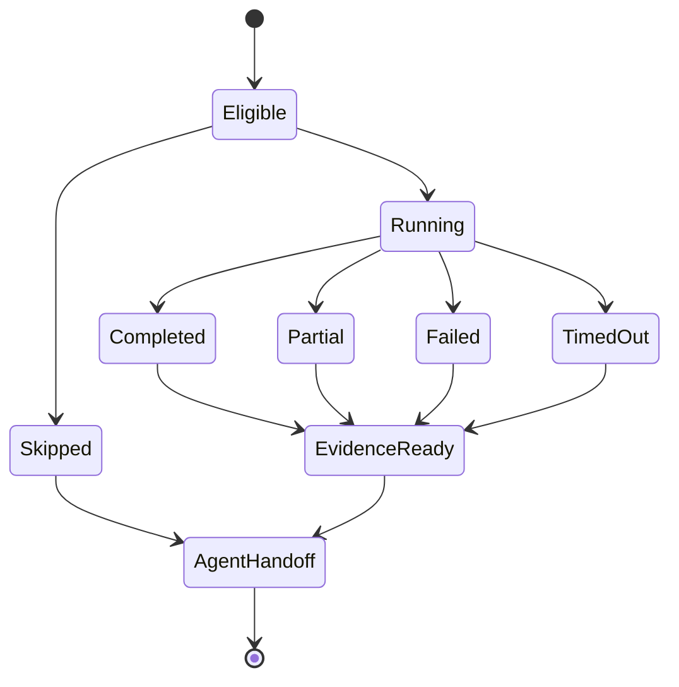

# analysis-project Phase 0.1 — Contracts, Golden Matrix & Phase 1A Readiness V2

> **文档定位**：将 Architecture Baseline（《Phase 0.1 — Architecture & Decision Baseline V2》，下称 Baseline）转化为可实施、可测试、可审计的工程契约。本档不重复 Baseline 的架构介绍，只定义契约、判定矩阵、验收用例与实施序列。
>
> **文档层级**：本档与 Baseline 共同构成 Phase 0.1 唯一权威实施基线。Phase 1A 必须以两份 V2 文档为实施依据。冻结日期 2026-11-24。

---

## Part I — Contract Overview

### I.1 Contract Scope

本档覆盖 Phase 0.1 现役架构（Rule-Based Fast Path Router + Direct Probe + Evidence-Augmented Agent Fallback）的全部工程契约：

- Router 契约（Part II）、Direct Fast Path 契约（Part III）、Probe 契约（Part IV）、Probe 副作用隔离契约（Part V）、Evidence 契约（Part VI）、Agent Handoff 契约（Part VII）、Objective Coverage 契约（Part VIII）、Multi-Skill Direct Execution 契约（Part IX）、V1/V2 契约（Part X）、Shadow 契约（Part XI）；
- Golden Matrix G-01~G-30（Part XII）、Failure Matrix（Part XIII）、Phase 1A 实施序列（Part XIV）、Acceptance Criteria（Part XV）。

### I.2 Contract Principles

1. **契约可测试**：每条不变式必须可由单测/集成测试固定；无法验证的描述不得写成 Acceptance Criteria。
2. **Fail-Closed 默认**：规则冲突、评估异常、上下文缺失、UNKNOWN 覆盖态——一律按不通过处理。
3. **低基数枚举**：Reason Code / Probe State / Route Code / Metric Label 均为低基数枚举，不得携带自由文本。
4. **不虚构代码**：概念模型（record/DTO 示例）仅为契约接口语义说明，不得伪装成现有代码对象；字段名由 Phase 1A 依现有代码确定。
5. **隐私边界**：日志/指标不得记录原始用户请求、敏感用户标识或不必要的敏感内容（Baseline Part IX.9、契约 §17 同样适用）。
6. **实现不变式显式声明**：依赖既有代码行为的约束（如 Pending 写入⟺Ask Plan 存在）是测试固定的实现不变式，不是架构自动保证。

### I.3 Lifecycle

```text
Contract（本档） → 1A-0 Audit → 1A-1..6 实施 → 1A-7 Shadow → 1A-8 Review → 1A-9 Enforcement
```

契约变更必须通过正式 Decision Update 修订 Baseline + 本档，禁止散落修改。

### I.4 Component Boundaries

| 边界 | 契约 |
|---|---|
| Router 只作用 NEW_REQUEST 主路径 | PENDING_CONTINUATION（§5.1/§6）与 LEGACY_FOLLOWUP（§7.5）不经 Router |
| Guard/Router 类组件位置 | 服务层；禁止塞进 v1/v2 共用的 DirectSkillExecutor 执行入口 |
| Probe 复用既有执行 | 使用 planSingle()/planMulti()；禁止新建第二套 Skill 执行系统 |
| Agent 复用既有 Runtime | 禁止重复 Context Assembly / 平行 Agent Executor / V1V2 复制实现 |
| 双端点对等 | 核心契约两端一致；SSE 各自独立不重构 |

### I.5 Failure Semantics（总纲）

| 失败类别 | 语义 | 是否计入异常率 |
|---|---|---|
| Router 评估异常 | fail-closed → Uncertain → Mode B | 计入（H7：<0.5% 严格小于） |
| Router 规则冲突 | fail-closed → Uncertain → Mode B | 计入 |
| Probe 失败/超时/空/不支持 | 正常分支，Evidence 分型 | **不计入** |
| Agent 失败 | 既有 ReAct 失败路径 | 按既有口径 |
| 配置不可用 / 算法异常 / 主动回滚 | 三类故障分法，独立计量 | 分别处理 |

### I.6 Compatibility

Baseline Part IX.11 兼容矩阵为权威：Option C/R1–R8、PlanOrigin、Snapshot Isolation（+Probe 列扩展）、Whole-Request Yield（划界）、Ask Plan 优先、Multi-Skill G1–G7、双端点、Shadow/异常策略、Rollout/开关、§8 信号/§9 Residual（转角色）、Amended-2 附录（SUPERSEDED-BY-ABSORPTION）。

---

## Part II — Router Contract

### II.1 Router Input / Output

**Input（最低集）**：原始用户请求（归一化前保留 + 归一化后副本）、既有信号（§8 信号族，转角色为规则输入）、当前可用规划上下文、Rule Set Version。

**Output（结构化）**：

```java
// 概念模型，仅为契约接口语义示例，本轮不新增 Java 代码
record RouteDecision(
    RouteCode routeCode,          // 见 II.2
    String ruleSetVersion,        // 规则集版本
    List<String> matchedRules,    // 命中规则 ID（R-S1/R-U1/...）
    String routeReason,           // 低基数枚举，非自由文本
    boolean failClosed            // 冲突/异常触发
) {}
```

### II.2 Decision Type / Route Codes

```text
DIRECT_FAST_PATH      规则确认简单 → 既有 Direct 零开销（Mode A）
PROBE_THEN_AGENT      Uncertain（含冲突/异常 fail-closed）→ Probe + Agent（Mode B）
AGENT_FALLBACK        Probe 无执行发生（NO_DIRECT_PLAN / UNSUPPORTED）→ 直接 Agent
```

Route Decision Codes 与 Route Code 的映射：

| Route Decision Code | Route Code |
|---|---|
| ROUTE_RULE_CONFIRMED_SIMPLE | DIRECT_FAST_PATH |
| ROUTE_RULE_UNCERTAIN | PROBE_THEN_AGENT |
| ROUTE_RULE_COMPLEX_OBSERVED | Shadow 记录；实际 PROBE_THEN_AGENT（Mode C 延期） |
| ROUTE_RULE_CONFLICT | PROBE_THEN_AGENT（fail-closed） |
| ROUTE_RULE_EVALUATION_FAILURE | PROBE_THEN_AGENT（fail-closed） |

不得让不同模块对同一 Decision 的含义产生歧义。具体名称可依代码规范调整，但语义必须一致且明确。

### II.3 Confidence / Threshold

- 三态规则判定为主；如实现 rule score，必须声明为 **deterministic rule score（非概率）**。
- 候选基线阈值 ~0.8：映射方式（规则命中加权 / 冲突惩罚）由 Phase 1A 依真实请求样本确定并写入 Rule Set Version。
- 禁止伪概率描述；禁止堆关键词追求表面覆盖率。

### II.4 Reason Codes（低基数枚举，最低集）

```text
RULE_MATCH_SINGLE_OBJECTIVE          R-S1/R-S2 确认简单
RULE_MULTI_GOAL_CONNECTIVE_RISK      R-U1
RULE_MULTI_INVOCATION_RISK           R-U2
RULE_AGGREGATION_COMBO_RISK          R-U3
RULE_REFERENCE_AMBIGUITY             R-U4
RULE_UNSUPPORTED_SHAPE               R-U5
RULE_CONFLICT                        冲突 fail-closed
RULE_EVALUATION_FAILURE              异常 fail-closed
```

Reason Code 必须实际参与决策与指标统计，不得仅用于日志装饰。

### II.5 Admission / Uncertain / Rule Priority

- **Admission**：只有 `RULE_CONFIRMED_SIMPLE` 进入 Fast Path。Skill 命中、参数抽取成功、Script 存在/成功、返回非空结果、Plan/参数/维度数量本身——**均不构成**准入证据（Baseline §5.10 继承）。
- **Uncertain**：默认兜底路线 → Mode B。禁止把无法确定的情况默认当成简单问题。
- **Rule Priority**：Explicit Complex / Unsupported Structure > Uncertain / Ambiguous / Conflict > Confirmed Simple > Fallback Uncertain。

### II.6 Determinism / Explainability

- 同一输入 + 同一 Rule Set Version ⇒ 同一 Decision（确定性）。
- Matched Rules + Route Reason 可完整解释每次判定（可审计）。
- 原始请求保护（§9.3）对 Router 适用：不得因归一化丢失或改写用户原始语义。

### II.7 Shadow Behavior / Enforcement Behavior

- **Shadow**：记录 RouteDecision（含 Rule Set Version / Matched Rules / endpoint 标签），不改变实际执行路由；`ROUTE_RULE_COMPLEX_OBSERVED` 仅记录类别。
- **Enforcement**：`DIRECT_FAST_PATH` 才进 Fast Path；其余走 Mode B；评估异常 fail-closed。
- 双端点独立开关（Part XI）。

---

## Part III — Direct Fast Path Contract

### III.1 Admission 条件

- Router 输出 `DIRECT_FAST_PATH`（Enforcement 下）。
- 准入后走**既有 Direct 全链路**：planSingle()/planMulti() → 参数抽取 → Script 执行 → 返回。零新增开销；禁止新增任何 LLM 调用。

### III.2 Existing Direct Execution / Multi-Skill Direct Execution

- 既有 Direct 行为完全不变：Ask Plan 优先（§5.1–5.4）、Multi-Skill G1–G7（Part IX）、参数保形（array/number）、维度继承等既有契约原样适用。
- Router 分类不得改变既有 Plan 机制的内部行为。

### III.3 Execution Completion / Result Handling

- Fast Path 的完成语义 = 既有 Direct 完成语义（单问题请求下二者一致；这正是 Fast Path 准入规则的意义所在）。
- 执行失败 → 既有 Direct 失败路径；不得因 Router 放行而掩盖失败。

### III.4 Snapshot Commit / recordResult / Pending

| 项 | 契约 |
|---|---|
| Snapshot Commit | 既有提交规则不变（Baseline IX.4 状态转移表：Direct Allowed + 执行成功 → 允许提交） |
| recordResult | 既有行为不变；仅实际执行成功可更新成功历史 |
| Pending | P1 不变式适用：pending.put ⟺ Plan 列表含 Ask Plan |

### III.5 Failure Handling / SSE Lifecycle

- 失败走既有失败语义与 SSE 事件流；Fast Path 不引入新 SSE 事件类型。
- v1 反问轮纯一次性 text 事件约束不变（若 Fast Path 产出 Ask Plan）。

**必须确保简单请求不因为新架构而增加不必要的 LLM 调用。**

---

## Part IV — Direct Probe Contract

### IV.1 Probe Entry / Eligibility

- **Entry**：NEW_REQUEST 主路径 + Route Code = PROBE_THEN_AGENT（或 AGENT_FALLBACK 时无 Probe）。
- **Eligibility**：仅针对 Executable Plan。纯 Ask 轮不 Probe、不进 Agent；Probe 不与 Ask 轮并发；不消费 Pending。

### IV.2 Probe Scope / Invocation Selection / Multi-Skill Compatibility

- Probe 使用既有规划机制（`planSingle()` / `planMulti()`，含 Multi-Skill G1–G7）产出的 Plan。
- **不得假设 Probe 只能调用一个 Skill 或一个 Script**；不得为了降低成本而未经论证地把 Probe 强制限制成单 Skill 执行；不得为 Probe 破坏现有 Multi-Skill Direct Execution；**禁止 top-1 截断**。
- **Invocation Selection**：执行既有 Plan 的完整 Invocation 集合；「一次 Probe」的确切含义（单 Invocation vs 单 Plan 集合执行）以现有代码实际执行模型为准，**1A-0 审查后确定并记录（F-1，实施前必须冻结）**。

### IV.3 Invocation Bounds / Time Budget / Result Budget / Timeout / Cancellation

| 边界 | 契约 | 状态 |
|---|---|---|
| Invocation Limit | **至多一次 Probe 执行尝试**，禁止连续多次尝试 | **冻结** |
| Skill/Script Execution Bounds | 复用既有 Plan 完整集合；逐 Script 失败语义按既有（Script Failure Continue） | **冻结**（语义）；数值 1A 定标 |
| Time Budget | 沿用既有超时机制；超预算 → PROBE_TIMEOUT | 数值 **实施前必须冻结的配置** |
| Result Size Budget | Evidence 超限必须标记 Truncated Evidence | 数值 **实施前必须冻结的配置** |
| Timeout | 沿用既有超时/失败机制；失败信息仅作 Agent 诊断上下文 | **冻结**（语义） |
| Cancellation | 用户取消 → 清理 Temporary Execution State；无 Snapshot/Pending/recordResult 残留 | **冻结**（语义） |

### IV.4 Failure Handling / Partial Success / Empty Result

Probe States（终态枚举，冻结）：

```text
PROBE_SUCCESS          PROBE_EMPTY_RESULT     PROBE_EXECUTION_FAILED
PROBE_NO_DIRECT_PLAN   PROBE_UNSUPPORTED      PROBE_TIMEOUT
```

- 除 PROBE_SUCCESS 外均为**正常分支**：不阻止 Agent、不判请求最终失败、**不计入异常率**。
- Partial Success：部分 Invocation 成功部分失败 → Probe State 取分态（1A 依既有 Result/Error 类型确定映射），Evidence 按 Invocation 分型（Successful/Failed/Partial/...）。
- Empty Result：PROBE_EMPTY_RESULT，Agent 接收 Empty Evidence。
- PROBE_NO_DIRECT_PLAN / PROBE_UNSUPPORTED：**无执行发生**，Route Code = AGENT_FALLBACK，直接以完整原始请求进入 Agent。

### IV.5 Evidence Creation

Probe 结束（含失败态）必须产出 Evidence（Part VI），带完整元数据（provenance、参数、状态、错误、截断标记）。无执行发生的终态产出 Unavailable Evidence（标注原因）。

### IV.6 Probe State Machine



> 该状态机是设计示例。必须结合真实代码和完整架构确定最终状态、合法转移和终止条件（1A-0/1A-2 交付物）；Probe State 六态枚举（IV.4）是终态判定的事实标准，状态机是其生命周期表达。

### IV.7 隔离与失败语义引用

- 隔离不变式（冻结）：见 Part V Isolation Matrix 与 Baseline VI.6。
- 与既有冻结契约的兼容：PlanOrigin 沿用 Plan 既有标记；复用/适配既有 Result/Error/Execution State 类型（§10.4），不新建平行状态系统。

---

## Part V — Probe Side-Effect Isolation Contract

### V.1 状态与副作用定义

| 概念 | 定义 |
|---|---|
| Temporary Execution State | Probe 执行期临时状态（执行上下文、中间缓冲）；Probe 结束即清理 |
| Candidate Snapshot | 规划阶段生成的候选执行上下文；不得覆盖成功历史（Baseline IX.4） |
| Committed Successful Snapshot | 满足现有成功标准的 Direct 执行结果提交后的可信历史 |
| Execution History | 正式成功执行历史（recordLastExec 链路） |
| Pending | `userId:conversationId` 键的既有续问状态（TTL 5min） |
| recordResult | 既有正式执行结果记录链路 |
| Planning State | planAll 规划期产生的状态（含 recordLastExec 规划期写入风险点 :1311） |
| Probe State | 本架构新增的 Probe 六态终态枚举 |
| Agent State | 既有 Agent Runtime 状态（Message History / Context Assembly） |

### V.2 Isolation Matrix（冻结，必须测试固定）

| State / Side Effect | Direct Fast Path | Probe | Agent Continuation | Yield |
|---|---|---|---|---|
| Temporary Execution State | Allowed（既有） | Allowed（结束后清理） | Allowed | Allowed |
| Candidate Snapshot | 既有契约 | **Isolated**（不得转 Committed） | 既有契约 | 既有契约（不提交） |
| Committed Successful Snapshot | 既有提交规则 | **Forbidden**（Probe 前后完全一致） | 既有提交规则 | 既有规则（必须保留） |
| Official Success History | 既有规则 | **Forbidden** | 既有规则 | 既有规则 |
| Pending Consumption | 既有规则 | **Forbidden**（不消费不写入） | 既有规则 | Forbidden（P2：清除孤儿 Pending） |
| recordResult | 既有规则（成功才写） | **Forbidden** | 既有规则 | Forbidden |
| Planning State | 既有 | 只读复用 Plan；不得产生新的规划期提交 | 既有 | 既有 |
| Probe State | 不适用 | 写入（六态） | 读取（作为诊断上下文） | 不适用 |
| Agent State | 不适用 | 不写入 | 写入（既有机制） | 写入（既有 ReAct） |

> 依据：原始契约 §5.9/§6.4 + REVISED §16.2 隔离不变式 + 真实代码事实（recordLastExec(:1311) 规划期写入、consumePending(:573-578) 在 planAll 最前）。**不得未经依据将 Agent Continuation 中所有 Commit 行为设为允许，也不得改变现有 Direct 成功提交规则。** 若现有代码无法保证 Probe 列的隔离（已知风险：规划期 recordLastExec），列为 Phase 1A **实现阻塞项**，不得假定已支持。

### V.3 测试要求

- 每行 Forbidden/Isolated 必须有对应断言测试（G-21/G-22 承载）。
- Probe 结束（成功/失败/超时/取消）后 Committed Snapshot 字节级一致断言。
- Yield + pending 清除（P2）断言（G-20 承载）。

---

## Part VI — Evidence Contract

### VI.1 Evidence 结构（最低信息集）

```java
// 概念模型，仅为契约所需信息说明；字段名由 Phase 1A 依现有代码确定，不在架构层锁死
record ProbeEvidence(
    String evidenceId,              // Evidence Identity
    String requestId,               // 关联请求
    String probeId,                 // Probe Identity
    String skillId,                 // Provenance
    String scriptId,                // Invocation Identity 组成
    String invocationId,            // Invocation Identity
    Map<String, Object> invocationParameters,   // Parameter Identity
    ProbeState executionStatus,     // Status（六态）
    Object resultPayload,           // Result Payload
    String resultReference,         // Result Reference（大结果外置引用）
    String resultSummary,           // Result Summary
    String provenance,              // 数据来源
    Instant timestamp,              // Timestamp
    String errorInformation,        // Error Information
    CompletenessStatus completeness, // Completeness
    TruncationStatus truncation     // Evidence Limit / Truncation Status
) {}
```

> 示例仅用于说明结构，不得伪装成现有代码对象；不能为了文档而虚构代码中已经存在的字段。

### VI.2 Evidence 六类状态（冻结）

```text
Successful Evidence    执行成功且结果完整
Failed Evidence        执行失败（含错误信息）
Partial Evidence       部分 Invocation 成功部分失败的分型
Empty Evidence         执行成功但结果为空
Truncated Evidence     超出 Result Size Budget 被截断
Unavailable Evidence   无执行发生（NO_DIRECT_PLAN / UNSUPPORTED / Cancellation）
```

Agent 必须能够理解 Probe 结果的可信边界和完整性。

### VI.3 Identity 关系（不得合并）

```text
Same Skill            ≠ Same Invocation
Same Script           ≠ Same Invocation
Same Invocation Parameters ≠ Automatically Reusable Evidence
```

同一个 Skill 可对应多个 Invocation；同一个 Script 可对应多个 Invocation；同一个 Invocation 可产生多个 Evidence。

### VI.4 Reuse Rules

- 已有 Evidence 可以复用；**不强制复用**。
- 不应无条件重复执行相同 Skill + Script + Parameters；Evidence 充分时禁止重复执行。
- 参数不同的 Invocation 不得被错误判定为重复（禁止盲目去重）。
- Evidence 不完整可追加执行；失败可尝试恢复；不足必须继续；上下文不匹配不得盲目复用。
- 复用判断维度：实际请求、参数、上下文、结果有效性、时效。

### VI.5 Invalid / Stale Evidence

- 上下文不匹配、参数范围/指标口径不一致、数据时效不符 → 不得复用（REJECTED 或重新执行）。
- Reuse 决策枚举：`REUSE` / `ADDITIONAL_EXECUTION` / `MIXED` / `REJECTED`。

---

## Part VII — Agent Handoff Contract

### VII.1 Original Request（冻结）

`Agent Goal = Original Full User Request`。**Agent 不得丢失原始 Request**；禁止仅传 Probe 最终文本结果；禁止将缩减后的 Probe 请求作为 Agent 最终任务。

### VII.2 Context Assembly（最低集）

1. Original Full User Request；2. 相关会话上下文；3. Probe Execution Status（Probe State）；4. Probe Skill/Script 元数据；5. Probe Parameters；6. Probe Result / Error；7. Evidence Reuse Instructions；8. Full Request Completion Instructions。

接入点**复用现有 Context Assembly / Agent Prompt / Tool Result / Message History 机制**。禁止：创建重复 Context Assembly 系统、绕过现有 Agent Runtime / Tool Calling / SSE、创建平行 Agent Executor、在 V1/V2 复制新 Agent 实现。

Handoff 输入还包括：Router Decision、Probe Evidence（含 Failed/Partial Evidence）、现有可用的相关 Execution Context。

### VII.3 Agent Continuation / Additional Invocation

Agent 必须根据 Original Request + Probe Evidence + Evidence Coverage + Request Objectives 决定：

- 直接整合现有 Evidence；
- 继续执行其他 Skill；
- 对同一 Skill 进行不同参数的再次调用（Additional Invocation）；
- 追加必要的分析；验证现有结果；对部分失败进行恢复；补齐未完成目标；汇总多个结果；输出完整答案。

**Agent 如何识别尚未完成的目标**：以完整原始请求为基准做 Objective Coverage 判定（Part VIII），Probe Success 不构成跳过覆盖分析的理由；待发现的输出实体不得转换为空输入参数；单一排名/极值目标不得机械拆分。

**Agent 何时可以停止**：所有可判定目标达到 COMPLETE（UNKNOWN 按 fail-closed 处理）；或确认剩余目标不可完成且已明确说明。

**Agent 无法完成时如何报告**：按既有 ReAct 失败路径处理；对不能完成的目标必须明确说明；不得谎报完成；不得将部分成功包装成完整成功。

### VII.4 Verification / Completion Status / Final Response

- Verification：Evidence Integration 后对每个 Request Objective 标定覆盖态。
- Completion Status：低基数枚举（COMPLETE / INCOMPLETE / FAILED，1A 定名）。
- Final Response：整合全部证据，覆盖完整原始请求的回答。

---

## Part VIII — Request Objective Coverage Contract

### VIII.1 Objective 模型

| 字段 | 说明 |
|---|---|
| Objective Identity | 目标标识（低基数、可追踪） |
| Objective Description | 目标描述（判定用，不得入日志） |
| Objective Type | 查询 / 排名 / 趋势 / 比较 / 聚合 / 解释 / 预测 等 |
| Required Invocation Shape | 目标所需的 Invocation 形态 |
| Required Parameters | 目标所需参数 |
| Planned Invocation Coverage | Plan 中 Invocation 对该目标的覆盖 |
| Executed Invocation Coverage | 实际执行对该目标的覆盖 |
| Evidence Coverage | Evidence 对该目标的支撑 |
| Completion Status | COMPLETE / INCOMPLETE / UNKNOWN |

### VIII.2 概念链（冻结）

```text
Skill → Script → Invocation + Parameter Set → Execution → Evidence → Objective Coverage → Request Completion
```

**不得**：把 Skill Coverage 当作 Request Objective Coverage；把 Execution Count 当作 Objective Count；把 Evidence Count 当作 Completion Count。

### VIII.3 判定规则（继承 Amended-2 保护性不变式）

- 目标分解区分**输入实体**与**待发现输出实体**；输出实体（如「那个人」）不得误判为缺失输入参数。
- 覆盖三态；**UNKNOWN ≠ COMPLETE（fail-closed）**。
- 能力充分性判定：Skill 名称/关键词/Plan 命中**不构成**能力证据。
- 参数变化 ≠ 目标覆盖；参数变化（⑤）不能单独作为目标与 Plan 映射（⑥）的证明。
- 整轮让位原子性：禁止部分 Direct、禁止静默丢弃目标、禁止请求改写。

### VIII.4 两类典型遗漏场景（验收锚点）

**Scenario A** — Direct Plan 只覆盖部分目标：禁止 `Direct Skill Success → Final Answer`；正确路径见 Baseline VIII.3。对应 G-04。

**Scenario B** — 同一 Skill 需要多 Invocation：

> 「11月版本国库组的缺陷密度和那个人的缺陷密度最高」意图 = ① 国库组缺陷密度查询 + ② 人员维度缺陷密度明细并定最高。

当前 Direct Plan 只生成单 Invocation（dimension=人员/groupName=国库组/versionPlan=2026年11月份版本）时，返回人员数据表 ≠ 两目标完成。对应 G-05/G-06。

### VIII.5 Request Completion（冻结）

- Direct Execution Success ≠ Request Completion；
- Probe Success ≠ Request Success；
- Agent 负责确认整体完成情况；
- Partial Result 不得当作完整结果。

---

## Part IX — Multi-Skill Direct Execution Contract

### IX.1 G1–G7 完整定义（冻结，原样继承）

**G1 — Explicit Selection / Exclusions**：用户显式点名/排除的 Skill 优先——显式选择直接入围，显式排除直接出局；不因 Router 或其他机制改写。

**G2 — Domain Hit Conditions / Exclusions**：domain 命中只保留命中领域 Skill（通用 Skill 出局，层级轨也不例外）。

**G3 — Bypass Conditions**：旁路条件按既有契约；旁路检查相对 plan() 的位置（后移决策）维持已实施行为。

**G4 — Priority Tie-Break**：Priority 仅在显式、领域和深度条件无法区分候选时，作为决定性的 Tie-Break；深度并列时整轮降级（混排反问）。

**G5 — Complete Top-Hit Chain**：必须保留完整 Top-Hit Chain；Partial / Fallback Expansion 不得被误认为完整 Eligible Candidate Set（G5 修订：已删 fallbackExpanded，与拍板⑦一致）。

**G6 — Legacy Track Handling**：Legacy Track 候选不得进入 Multi-Set；但 Legacy Track 不得阻塞符合条件的 Level Track（拍板①：存量轨剔除不阻断）；显式 Legacy 请求仍允许单次执行（点名恒单执行）。

**G7 — Eligible Candidate Threshold**：Eligible Level-Track Candidate 数量达到至少 2 个，才满足 Multi-Skill 条件；不得人为设置未经批准的候选数量上限；必须先得到完整 Eligible Candidate Set，再进行后续处理。

**禁止（对 Router/Probe 全部适用）**：重建/简化/删除 Multi-Skill；强制单 Skill/单 Script；引入未经批准的候选数量上限；将 Multi-Skill 直接判定为复杂请求；将 Multi-Skill 改成 Agent Only；用新 Router 代替原 Multi-Skill 选取算法；让 Probe 破坏原有 Multi-Skill Execution。

### IX.2 语义项完整契约（冻结）

| 项 | 契约 |
|---|---|
| Mention Order | 候选排序遵循用户提及顺序；Injection-Only Hits Last（仅注入命中排最后） |
| Comparator Fallback | 比较级兜底按既有规则 |
| Shared Extraction | 共享参数抽取按既有规则 |
| Skill Parameter Mapping | 按 skill params_schema 单一真相源映射 |
| Parameter Schema | params_schema 为唯一参数真相源；array 恒传 List；number/integer 解除转数值（整数→Long 小数→Double 失败保底） |
| Backfill | 回填按既有规则（metrics 双词源回填未实施，不在本次范围） |
| Anchor Suppression | 时间锚点屏蔽按既有规则 |
| Drilldown | 分布触发默认下钻一级；drillDown/dimension 按 mapping 实际配置补 |
| Mixed Ask / Exec | 混排反问契约；multi.enabled 默认 false 时混合轮不可达；一旦整体 Yield 不执行任何 Direct Plan 不输出孤立 Ask |
| Time Ambiguity | 歧义时间锚反问（:1273/:1302 写入点）；裸日期/裸季度按既有词表让位规则 |
| Person Ambiguity | person 反问（:857 写入点）；部门/组两轴过滤免反问；会话级人名钉定 |
| Whole-Round Ask | 整轮反问原子性 |
| Script Failure Continue | 单 Script 失败不阻断其余 Script 继续（逐 plan 成功/失败分支） |
| Serial Execution | 串行执行按既有实现 |
| boundedElastic | 既有调度线程模型不变 |
| Dimension Extract Event | 维度抽取事件按既有 |
| per-Script toolCallId | 每脚本独立 toolCallId |
| Result Titles | 逐文档结果标题 |
| short_summary | short_summary 事件按既有 |
| Snapshot 更新规则 | Baseline IX.4（多 Plan 整体成功标准未明确前部分成功≠整体成功） |
| Pending Consume Short-Circuit | consumePending 在 planAll 最前，命中即返回短路后续 |
| Default Configuration | multi.enabled 默认 false；开关矩阵见 Part XI |
| Effective Runtime Configuration | 生效配置以运行时实际读取为准（Effective 配置审计） |

### IX.3 与新架构的兼容

- Router 不得代替 G1–G7 选取算法；Fast Path 准入后的 Multi-Skill 执行原样走既有链路。
- Probe 复用 planMulti() 的**完整候选集合**（G5）；G-08/G-09 验证兼容性。

---

## Part X — V1/V2 Contract

### X.1 Entries

```text
V1: /ai/chat   → ChatController(:48)   → ChatStreamServiceImpl(:70)       → planAll(:499)
V2: /v2/ai/chat → V2ChatController(:53) → V2ChatStreamServiceImpl          → planAll(:461)
```

### X.2 V1/V2 Contract Matrix

| 契约项 | V1 | V2 | 一致性要求 |
|---|---|---|---|
| Router Core | 服务层接入 | 服务层接入 | 同一实现；双端点独立开关 |
| Probe Isolation | 同 Part V 矩阵 | 同 Part V 矩阵 | 完全一致 |
| Evidence Contract | 同 Part VI | 同 Part VI | 同一 DTO 语义 |
| Agent Handoff | 复用既有 v1 ReAct 接入 | 复用既有 v2 ReAct 接入 | Goal=完整原始请求；不复制实现 |
| SSE Compatibility | 既有 v1 SSE 不重构（反问轮纯一次性 text 事件硬约束） | 既有 v2 SSE 不重构 | 各自独立 |
| Event Lifecycle | 既有事件流 | 既有事件流 | 不新增事件类型（Probe/Agent 复用既有） |
| Shadow Parity | 独立开关 | 独立开关 | 判定语义一致；指标带 endpoint 标签 |
| Enforcement Parity | 独立开关 | 独立开关 | 同一请求同一路由语义（G-25） |
| Kill Switch | 独立回退 | 独立回退 | 任一端点可独立退回原路径 |
| PlanOrigin | 携带 PlanOrigin 的规划结果供 Guard 使用 | 同左 | 三值语义完全一致 |
| Shared Executor | DirectSkillExecutor 共享单例 bean（V2SkillConfig :209） | 同左 | Guard/Router 不塞入执行入口 |

### X.3 已知差异与前置验证（1A-0 清单）

1. v1 planAll(:499) 空列表分支行为未验证（无 fallback 则 Yield/Probe 路径退化为无输出）——**最高优先级**；
2. v1 SSE 内网前端反问轮纯一次性 text 事件对新路径的适用性；
3. v1 侧 dimensionState/pending/Snapshot 写点相对 Guard/Router 位置未排查；
4. 混合轮仅 multi.enabled（default false :226）可达。

不得假定两个 Pipeline 天然一致；1A-0 必须输出差异清单。

---

## Part XI — Shadow Mode Contract

### XI.1 Shadow Router Decision vs Shadow Probe Execution（显式区分，冻结）

**二者是不同概念，禁止混同**：

| 阶段 | 是否实际执行 Skill | 说明 |
|---|---|---|
| Shadow Router Decision | **否** | 仅计算并记录 RouteDecision（Rule Set Version + Matched Rules + Route Reason + endpoint） |
| Shadow Probe Execution | **可配置，默认否** | 若开启：Probe 实际执行必须满足完整副作用隔离（Part V 矩阵 Probe 列全部 Forbidden/Isolated 生效）+ 执行预算（Part IV.3）+ 数据安全约束 |
| Agent Shadow | 否（1A 不实施 Agent Shadow 执行） | 记录 Agent Handoff 触发事实（若 Probe Shadow 开启） |

不得将 Shadow Mode 定义为仅执行一段分类逻辑而忽略真实 Probe 风险。

### XI.2 Shadow 行为契约

- Shadow 只记录判定、不改变实际路由、不产生新的 Direct/ReAct 执行副作用、不影响 Pending/Snapshot/dimensionState。
- Shadow 判定不提交 Snapshot（Baseline IX.4 状态表第 13 行）。
- `GUARD_DISABLED` 类（开关关闭）不属于异常分母；Shadow 判定不计入 Enforcement 异常率。

### XI.3 Metrics / Logging / Trace / Privacy

- 指标（全部带 endpoint 标签，低基数）：`rule_confirmed_simple_rate`、`false_fast_path_rate`、`false_probe_rate`、`simple_request_fast_path_coverage`、`probe_evidence_reuse_rate`、Route Code 分布、Probe State 分布、Reuse 决策分布。
- Logging：Request Correlation ID / Route Code / Reason Code / Probe State / endpoint / Latency；禁止记录原始用户请求、业务数据、敏感参数。
- Trace：Request Correlation ID 贯穿 Router→Probe→Evidence→Agent。

### XI.4 Enforcement Transition / Kill Switch

- 晋级条件（Gate J，Baseline/契约 §19 继承）：Shadow 观测达标 + false_fast_path/false_probe 阈值定标 + 隔离测试全绿 + 独立评审通过。
- Kill Switch：四开关任一可独立关闭；关闭后请求回退既有 Direct/ReAct 原路径；关闭动作不属于异常分母。
- 三类故障分法：配置不可用 ≠ 算法异常 ≠ 主动回滚，独立计量与告警。

---

## Part XII — Golden Matrix

每个 Golden Case 按统一 12 字段表定义。Golden Matrix 与契约 G 组（GC-01~16）、K 组（G-CTX-COV-01）并存：G-01~G-30 是 Phase 1A 测试实施主矩阵，契约 §14 组为其上游依据。

### G-01 Simple Single Objective

| Field | Value |
|---|---|
| Case ID | G-01 |
| Scenario | 高置信度单目标请求 |
| Input | 「查一下11月版本国库组的缺陷密度」 |
| Initial Context | 无 |
| Expected Router Decision | DIRECT_FAST_PATH |
| Expected Probe Behavior | 不执行 Probe |
| Expected Evidence | 无 Evidence（Fast Path 不产 Evidence） |
| Expected Agent Behavior | 不触发 Agent |
| Expected Completion | 既有 Direct 完成语义 |
| Expected Side Effects | 与现状一致（既有 Snapshot/Pending 规则） |
| V1/V2 Applicability | V1+V2 |
| Regression Risk | 低——不得为简单请求新增 LLM 调用 |

### G-02 Simple Request — Fast Path Preservation

| Field | Value |
|---|---|
| Case ID | G-02 |
| Scenario | 多种不同形式的简单请求（参数多、含「展示/统计一下/帮我分析」等表达） |
| Input | ①「杭州开发一部11月版本缺陷密度，按周展示」②「统计一下测试组的人员维度缺陷分布」③「帮我分析国库组的版本质量」 |
| Initial Context | 无 |
| Expected Router Decision | 均为 DIRECT_FAST_PATH（多过滤参数 ≠ 多目标，R-S2；§8.2 表达不得触发复合判定） |
| Expected Probe Behavior | 不发生不必要的 Probe |
| Expected Evidence | 无 |
| Expected Agent Behavior | 不发生不必要的 Agent |
| Expected Completion | 既有 Direct 完成语义 |
| Expected Side Effects | 与现状一致 |
| V1/V2 Applicability | V1+V2 |
| Regression Risk | 中——Router 过度触发会破坏 Fast Path 低延迟；规则不得堆关键词 |

### G-03 Compound Request

| Field | Value |
|---|---|
| Case ID | G-03 |
| Scenario | 明确包含多个独立分析目标 |
| Input | 「分析各组缺陷密度，并找出缺陷最多的人」 |
| Initial Context | 无 |
| Expected Router Decision | PROBE_THEN_AGENT（R-U1/R-U3；契约 §14 GC-01 同源） |
| Expected Probe Behavior | 至多一次 Probe（执行既有 Plan；不 top-1 截断） |
| Expected Evidence | 分型 Evidence（按 Invocation） |
| Expected Agent Behavior | 接收完整原始请求 + Evidence；识别未覆盖目标（人员排名）并补充执行 |
| Expected Completion | 两目标均完成或明确说明未完成项 |
| Expected Side Effects | Probe 列全隔离（Part V 矩阵） |
| V1/V2 Applicability | V1+V2 |
| Regression Risk | 中——禁止仅因「和」字机械判复杂（G-07 对照） |

### G-04 Partial Objective Coverage

| Field | Value |
|---|---|
| Case ID | G-04 |
| Scenario | Direct Plan 只覆盖部分 Request Objectives，但已执行的 Skill 成功 |
| Input | 「只看杭州开发一部，并找出缺陷最多的人」（Plan 仅更新 department 参数） |
| Initial Context | 无 |
| Expected Router Decision | PROBE_THEN_AGENT |
| Expected Probe Behavior | Probe 执行既有 Plan（仅参数更新部分） |
| Expected Evidence | Successful Evidence（部门过滤部分）+ 覆盖分析指出人员排名目标无 Invocation 支撑 |
| Expected Agent Behavior | 接收完整原始请求；不将参数变化当作目标覆盖（R4 语义）；补充执行排名目标 |
| Expected Completion | 不得将 Partial Result 当作完整结果；最终覆盖两目标或明确说明 |
| Expected Side Effects | Probe 不提交 Snapshot/recordResult/Pending |
| V1/V2 Applicability | V1+V2 |
| Regression Risk | 高——这是本架构的核心存在理由（Scenario A） |

### G-05 Same Skill — Multiple Invocation

| Field | Value |
|---|---|
| Case ID | G-05 |
| Scenario | 同一个 Skill 需要不同参数执行多次；当前 Direct Plan 只生成一个 Invocation |
| Input | 「11月版本国库组的缺陷密度和那个人的缺陷密度最高」 |
| Initial Context | 无 |
| Expected Router Decision | PROBE_THEN_AGENT（R-U2：同指标不同维度结构） |
| Expected Probe Behavior | 至多一次 Probe（现有单 Invocation Plan：dimension=人员/groupName=国库组/versionPlan=2026年11月份版本） |
| Expected Evidence | Successful Evidence（人员明细数据）+ 元数据完整（参数/口径/范围） |
| Expected Agent Behavior | 识别目标 ①（组级查询）无 Invocation 支撑；对同一 Skill 以不同参数（组级汇总）再次调用；整合两目标结果 |
| Expected Completion | 人员明细 + 组级查询均完成；输出最高者与组级密度 |
| Expected Side Effects | Probe 全隔离；同 Skill 多次调用不触发错误去重 |
| V1/V2 Applicability | V1+V2 |
| Regression Risk | 高——Scenario B 锚点用例（契约 GC-01 同源） |

### G-06 Same Skill — Different Parameter Sets

| Field | Value |
|---|---|
| Case ID | G-06 |
| Scenario | 同一个 Skill、同一个 Script，不同参数集合 |
| Input | 同 G-05 的两次调用（组级汇总 vs 人员明细） |
| Initial Context | G-05 的 Probe 已产出人员明细 Evidence |
| Expected Router Decision | （Agent 内部决策，不涉 Router） |
| Expected Probe Behavior | 不适用 |
| Expected Evidence | 两条 Evidence 的 invocationParameters 不同 → Invocation Identity 不同 |
| Expected Agent Behavior | 不错误 Deduplicate（Same Skill ≠ Same Invocation）；两次执行均保留 |
| Expected Completion | 两参数集结果均可用 |
| Expected Side Effects | 无污染 |
| V1/V2 Applicability | V1+V2 |
| Regression Risk | 中——验证 Invocation Identity 设计 |

### G-07 Same Skill — Single Invocation Actually Sufficient

| Field | Value |
|---|---|
| Case ID | G-07 |
| Scenario | 请求涉及多个表述，但现有一个 Invocation 足以完整覆盖所有目标 |
| Input | 「国库组和研发组的缺陷密度」（两过滤值可由单查询 GROUP BY 覆盖） |
| Initial Context | 无 |
| Expected Router Decision | DIRECT_FAST_PATH（R-S2：连接词命中 ≠ 多目标；R-U1 不强制 Uncertain） |
| Expected Probe Behavior | 不 Probe |
| Expected Evidence | 无 |
| Expected Agent Behavior | 不触发 Agent |
| Expected Completion | 既有 Direct 单次执行；Completion 基于 Objective Coverage 而非关键词 |
| Expected Side Effects | 与现状一致 |
| V1/V2 Applicability | V1+V2 |
| Regression Risk | 中——防止「和」字规则误伤；与 G-03 构成对照对 |

### G-08 Multi-Skill Direct Execution

| Field | Value |
|---|---|
| Case ID | G-08 |
| Scenario | 符合 G1–G7 的多 Skill 请求 |
| Input | 「查一下缺陷密度和需求交付情况」（multi.enabled=true 下两个 Level-Track 候选） |
| Initial Context | multi.enabled=true |
| Expected Router Decision | DIRECT_FAST_PATH（多 Skill 命中不等于复杂请求；G7 ≥2 阈值满足走既有 Multi-Skill 执行） |
| Expected Probe Behavior | 不 Probe |
| Expected Evidence | 无 |
| Expected Agent Behavior | 不触发 Agent |
| Expected Completion | 既有 Multi-Skill 双路径循环执行语义（提及序、混排反问等 IX.2 全适用） |
| Expected Side Effects | 与现状一致（per-Script toolCallId、逐文档围栏、short_summary） |
| V1/V2 Applicability | V1+V2（multi.enabled 生效端） |
| Regression Risk | 高——Multi-Skill 回归保护（D-06/D-07） |

### G-09 Multi-Skill + Probe

| Field | Value |
|---|---|
| Case ID | G-09 |
| Scenario | Probe 对已有 Multi-Skill Direct Plan 的兼容性 |
| Input | R-U2/R-U3 触发 Uncertain 且 planMulti() 产出多 Skill Plan |
| Initial Context | multi.enabled=true |
| Expected Router Decision | PROBE_THEN_AGENT |
| Expected Probe Behavior | Probe 执行完整多 Skill Plan 集合（禁止 top-1 截断）；逐 Script 失败语义按既有 |
| Expected Evidence | 按 Invocation/Script 分型 Evidence |
| Expected Agent Behavior | 基于 Evidence 判定覆盖；可复用/补充执行 |
| Expected Completion | 完整请求语义 |
| Expected Side Effects | Multi-Skill 既有执行语义不被 Probe 破坏 |
| V1/V2 Applicability | V1+V2 |
| Regression Risk | 高——Probe 与 G1–G7 交互面 |

### G-10 Probe Success

| Field | Value |
|---|---|
| Case ID | G-10 |
| Scenario | Probe 成功 |
| Input | 任一 PROBE_THEN_AGENT 请求，Plan 执行成功且结果非空 |
| Initial Context | 无 |
| Expected Router Decision | PROBE_THEN_AGENT |
| Expected Probe Behavior | PROBE_SUCCESS |
| Expected Evidence | Successful Evidence，元数据完整 |
| Expected Agent Behavior | 基于 Evidence 继续完成 Request（REUSE / ADDITIONAL_EXECUTION / MIXED 由覆盖判定决定）；不因 Probe 成功跳过覆盖分析 |
| Expected Completion | 完整原始请求覆盖 |
| Expected Side Effects | 无 Snapshot/Pending/recordResult 写入 |
| V1/V2 Applicability | V1+V2 |
| Regression Risk | 中 |

### G-11 Probe Partial Success

| Field | Value |
|---|---|
| Case ID | G-11 |
| Scenario | 部分 Invocation 成功，部分失败 |
| Input | 多 Invocation Plan，其中一 Script 失败 |
| Initial Context | 无 |
| Expected Router Decision | PROBE_THEN_AGENT |
| Expected Probe Behavior | 分态 Probe State；Script Failure Continue 语义沿用 |
| Expected Evidence | Mixed：Successful + Failed Evidence 分型 |
| Expected Agent Behavior | 继续补齐失败/缺失目标；不将 Partial 当作完整 |
| Expected Completion | 完整请求语义或明确未完成项 |
| Expected Side Effects | 隔离矩阵全生效 |
| V1/V2 Applicability | V1+V2 |
| Regression Risk | 中 |

### G-12 Probe Failure

| Field | Value |
|---|---|
| Case ID | G-12 |
| Scenario | Probe 执行失败 |
| Input | PROBE_THEN_AGENT 请求，Script 执行报错 |
| Initial Context | 无 |
| Expected Router Decision | PROBE_THEN_AGENT |
| Expected Probe Behavior | PROBE_EXECUTION_FAILED；属正常分支 |
| Expected Evidence | Failed Evidence（含错误信息） |
| Expected Agent Behavior | 仍基于完整原始请求独立继续，不被 Probe 失败阻断 |
| Expected Completion | Agent 路径完成或按既有失败语义 |
| Expected Side Effects | 不计入异常率；无状态污染 |
| V1/V2 Applicability | V1+V2 |
| Regression Risk | 中 |

### G-13 Probe Empty Result

| Field | Value |
|---|---|
| Case ID | G-13 |
| Scenario | Probe 返回空结果 |
| Input | 合法查询但数据为空 |
| Initial Context | 无 |
| Expected Router Decision | PROBE_THEN_AGENT |
| Expected Probe Behavior | PROBE_EMPTY_RESULT |
| Expected Evidence | Empty Evidence |
| Expected Agent Behavior | 正确处理空 Evidence（视为信息而非失败；可换参数重试或报告无数据） |
| Expected Completion | 明确的无数据回答或继续执行 |
| Expected Side Effects | 无 |
| V1/V2 Applicability | V1+V2 |
| Regression Risk | 低 |

### G-14 Probe Timeout

| Field | Value |
|---|---|
| Case ID | G-14 |
| Scenario | Probe 超时 |
| Input | 长耗时 Script |
| Initial Context | 无 |
| Expected Router Decision | PROBE_THEN_AGENT |
| Expected Probe Behavior | PROBE_TIMEOUT；超时控制生效 |
| Expected Evidence | Unavailable/Failed Evidence（标注 Timeout） |
| Expected Agent Behavior | 正常 Handoff；不被阻断 |
| Expected Completion | Agent 路径完成或既有失败语义 |
| Expected Side Effects | 无 Snapshot 污染；临时状态清理 |
| V1/V2 Applicability | V1+V2 |
| Regression Risk | 中 |

### G-15 Probe Cancellation

| Field | Value |
|---|---|
| Case ID | G-15 |
| Scenario | 用户在 Probe 执行中取消 |
| Input | 中断请求（/v2/ai/chat/interrupt 或断连） |
| Initial Context | Probe Running |
| Expected Router Decision | （已路由） |
| Expected Probe Behavior | 生命周期清理：Temporary Execution State 清除；无 Pending/Snapshot/recordResult 残留 |
| Expected Evidence | 不产出（或 Unavailable，标注 Cancellation） |
| Expected Agent Behavior | 不 Handoff；请求终止按既有中断语义 |
| Expected Completion | 既有中断行为 |
| Expected Side Effects | 零残留 |
| V1/V2 Applicability | V1+V2 |
| Regression Risk | 中——取消链路既有 doOnCancel 语义回归 |

### G-16 Evidence Truncation

| Field | Value |
|---|---|
| Case ID | G-16 |
| Scenario | Probe Evidence 超出 Result Size Budget |
| Input | 大结果集查询 |
| Initial Context | 无 |
| Expected Router Decision | PROBE_THEN_AGENT |
| Expected Probe Behavior | 执行成功但结果被截断；Truncation Status 标记 |
| Expected Evidence | Truncated Evidence |
| Expected Agent Behavior | 识别结果不完整；必要时继续执行（重查/聚合/分页） |
| Expected Completion | 不将截断结果当作完整结果 |
| Expected Side Effects | 无 |
| V1/V2 Applicability | V1+V2 |
| Regression Risk | 中 |

### G-17 Evidence Reuse

| Field | Value |
|---|---|
| Case ID | G-17 |
| Scenario | 已存在有效 Evidence |
| Input | G-10 后 Agent 判定 Evidence 充分 |
| Initial Context | Successful Evidence 存在 |
| Expected Router Decision | （已路由） |
| Expected Probe Behavior | 不适用 |
| Expected Evidence | 有效 Evidence |
| Expected Agent Behavior | REUSE；不重复执行完全相同且可复用的 Invocation |
| Expected Completion | 基于 Evidence 完成回答 |
| Expected Side Effects | 无重复执行开销 |
| V1/V2 Applicability | V1+V2 |
| Regression Risk | 中 |

### G-18 Evidence Invalid / Stale

| Field | Value |
|---|---|
| Case ID | G-18 |
| Scenario | Evidence 无效或上下文不匹配 |
| Input | Probe 参数口径与请求目标不一致（如查询了错误版本） |
| Initial Context | Evidence 存在但口径不符 |
| Expected Router Decision | （已路由） |
| Expected Probe Behavior | 不适用 |
| Expected Evidence | 标记不可复用 |
| Expected Agent Behavior | REJECTED/ADDITIONAL_EXECUTION；不得错误复用 |
| Expected Completion | 以正确参数重新执行后完成 |
| Expected Side Effects | 无 |
| V1/V2 Applicability | V1+V2 |
| Regression Risk | 中——防止盲目复用 |

### G-19 Ambiguous Person / Time

| Field | Value |
|---|---|
| Case ID | G-19 |
| Scenario | 人员或时间语义歧义 |
| Input | 缺部门人员的模糊指称 / 歧义时间锚 |
| Initial Context | 无有效 Pending |
| Expected Router Decision | 不经 Router（既有 Ask/Clarification 机制优先） |
| Expected Probe Behavior | 不 Probe |
| Expected Evidence | 无 |
| Expected Agent Behavior | 不触发；走既有反问 |
| Expected Completion | 既有 Ask/Pending 契约（person 反问 :857、歧义时间锚 :1273/:1302） |
| Expected Side Effects | P1 不变式：写入 Pending ⟺ Ask Plan 存在 |
| V1/V2 Applicability | V1+V2 |
| Regression Risk | 高——既有反问链路回归 |

### G-20 Pending Consume Short-Circuit

| Field | Value |
|---|---|
| Case ID | G-20 |
| Scenario | Pending 处理保持原契约 |
| Input | 有效 Pending 存在，用户补参 |
| Initial Context | Pending TTL 内 |
| Expected Router Decision | 不经 Router（PENDING_CONTINUATION 整体绕过） |
| Expected Probe Behavior | 不 Probe（Pending 优先于一切新机制） |
| Expected Evidence | 无 |
| Expected Agent Behavior | 不触发 |
| Expected Completion | 既有续问路径（consumePending :573-578 短路后续） |
| Expected Side Effects | Pending 消费不被 Probe/Agent Handoff 错误触发；A1–A5 全适用；Yield 时 P2 清除 |
| V1/V2 Applicability | V1+V2 |
| Regression Risk | 高 |

### G-21 Snapshot Isolation

| Field | Value |
|---|---|
| Case ID | G-21 |
| Scenario | Planning、Probe、Yield 不污染 Snapshot |
| Input | 触发 YIELD_REACT 的 Follow-up（§7.5）+ Probe 轮各一 |
| Initial Context | Committed Snapshot S1 存在 |
| Expected Router Decision | （Follow-up 轮不经 Router） |
| Expected Probe Behavior | Probe 后 S1 字节级一致 |
| Expected Evidence | 不适用 |
| Expected Agent Behavior | 不适用（Yield 轮） |
| Expected Completion | 既有语义 |
| Expected Side Effects | Baseline IX.4 十二条不变量全过；连续多轮污染测试（S1→S2→Turn3）通过 |
| V1/V2 Applicability | V1+V2 |
| Regression Risk | 高——recordLastExec(:1311) 规划期写入为已知风险点 |

### G-22 recordResult Isolation

| Field | Value |
|---|---|
| Case ID | G-22 |
| Scenario | Probe 不调用正式 recordResult |
| Input | 任一 Probe 轮 |
| Initial Context | 无 |
| Expected Router Decision | PROBE_THEN_AGENT |
| Expected Probe Behavior | 执行结束 |
| Expected Evidence | 正常产出 |
| Expected Agent Behavior | 不适用 |
| Expected Completion | 不适用 |
| Expected Side Effects | recordResult/成功执行历史零写入；Probe 不被记为成功 Direct 执行 |
| V1/V2 Applicability | V1+V2 |
| Regression Risk | 高 |

### G-23 V1 Pipeline

| Field | Value |
|---|---|
| Case ID | G-23 |
| Scenario | V1 全链路 |
| Input | G-01/G-03/G-10 各一，走 /ai/chat |
| Initial Context | 无 |
| Expected Router Decision | 与 V2 同语义 |
| Expected Probe Behavior | 与 V2 同语义 |
| Expected Evidence | 同一 DTO 语义 |
| Expected Agent Behavior | 复用 v1 既有 ReAct；SSE 纯一次性 text 事件约束（反问轮）不变 |
| Expected Completion | 同 V2 |
| Expected Side Effects | v1 planAll(:499) 空列表分支行为已验证（1A-0 前置） |
| V1/V2 Applicability | 仅 V1 |
| Regression Risk | 高——v1 三大前置风险（X.3） |

### G-24 V2 Pipeline

| Field | Value |
|---|---|
| Case ID | G-24 |
| Scenario | V2 全链路 |
| Input | G-01/G-03/G-10 各一，走 /v2/ai/chat |
| Initial Context | 无 |
| Expected Router Decision | 与 V1 同语义 |
| Expected Probe Behavior | 与 V1 同语义 |
| Expected Evidence | 同一 DTO 语义 |
| Expected Agent Behavior | 复用 v2 既有 ReAct（:504-525 fallback） |
| Expected Completion | 同 V1 |
| Expected Side Effects | dimensionState(:465)/pending(:442)/snapshot(:453) 写点位置审计通过 |
| V1/V2 Applicability | 仅 V2 |
| Regression Risk | 中 |

### G-25 V1/V2 Parity

| Field | Value |
|---|---|
| Case ID | G-25 |
| Scenario | 同一 Request 在两个 Pipeline 下遵循相同核心路由与隔离契约 |
| Input | 同一请求分别打 V1/V2 |
| Initial Context | 无 |
| Expected Router Decision | 相同 Route Code + Reason Code |
| Expected Probe Behavior | 相同 Probe State |
| Expected Evidence | 相同分型 |
| Expected Agent Behavior | 相同 Reuse 决策语义 |
| Expected Completion | 相同 |
| Expected Side Effects | 隔离矩阵一致 |
| V1/V2 Applicability | V1+V2 对照 |
| Regression Risk | 高——Pipeline 行为分叉是重点审计对象 |

### G-26 Shadow Mode

| Field | Value |
|---|---|
| Case ID | G-26 |
| Scenario | Shadow Decision 不改变实际执行行为 |
| Input | Shadow 模式下任意请求集 |
| Initial Context | 开关=SHADOW |
| Expected Router Decision | 仅记录，不改变路由 |
| Expected Probe Behavior | Shadow Probe Execution 默认关闭；若开启须满足 Part XI.1 约束 |
| Expected Evidence | 无（或 Shadow Probe 的隔离 Evidence） |
| Expected Agent Behavior | 实际执行走原路径 |
| Expected Completion | 与 OFF 模式一致 |
| Expected Side Effects | 零副作用；Shadow 判定不提交 Snapshot（状态表第 13 行） |
| V1/V2 Applicability | V1+V2 独立开关 |
| Regression Risk | 中 |

### G-27 Enforcement

| Field | Value |
|---|---|
| Case ID | G-27 |
| Scenario | 正式路由生效 |
| Input | Enforcement 模式下 G-01/G-03 复跑 |
| Initial Context | 开关=ENFORCEMENT |
| Expected Router Decision | 实际生效路由 |
| Expected Probe Behavior | 实际执行 |
| Expected Evidence | 正常产出 |
| Expected Agent Behavior | 实际 Handoff |
| Expected Completion | 新架构语义 |
| Expected Side Effects | 指标带 endpoint 标签 |
| V1/V2 Applicability | V1+V2 |
| Regression Risk | 中 |

### G-28 Kill Switch

| Field | Value |
|---|---|
| Case ID | G-28 |
| Scenario | 安全退回原 Direct 路径 |
| Input | Enforcement→OFF 切换后复跑请求 |
| Initial Context | 开关切换 |
| Expected Router Decision | 不再路由（开关关闭） |
| Expected Probe Behavior | 无 |
| Expected Evidence | 无 |
| Expected Agent Behavior | 无新增 |
| Expected Completion | 与升级前现状一致 |
| Expected Side Effects | 关闭动作不计异常分母；配置不可用≠算法异常≠主动回滚三类分法 |
| V1/V2 Applicability | V1+V2 独立 |
| Regression Risk | 中 |

### G-29 Direct Skill Failure

| Field | Value |
|---|---|
| Case ID | G-29 |
| Scenario | Direct Skill 失败 |
| Input | Fast Path 下 Script 报错 |
| Initial Context | 无 |
| Expected Router Decision | DIRECT_FAST_PATH（已路由） |
| Expected Probe Behavior | 不适用 |
| Expected Evidence | 不适用 |
| Expected Agent Behavior | 走既有 Direct 失败路径（Router 放行不掩盖失败） |
| Expected Completion | 失败状态不被误认为完成 |
| Expected Side Effects | 既有失败语义；不写成功历史（§5.9 不变量⑦） |
| V1/V2 Applicability | V1+V2 |
| Regression Risk | 低 |

### G-30 Agent Execution Failure

| Field | Value |
|---|---|
| Case ID | G-30 |
| Scenario | Agent 无法完成全部目标 |
| Input | Probe 后 Agent 补齐失败 |
| Initial Context | Failed/Unavailable Evidence |
| Expected Router Decision | （已路由） |
| Expected Probe Behavior | 已结束 |
| Expected Evidence | 已产出 |
| Expected Agent Behavior | 按既有 ReAct 失败路径；明确说明未完成目标；不谎报完成 |
| Expected Completion | Completion Status 如实标 INCOMPLETE/FAILED |
| Expected Side Effects | 不将部分成功包装成完整成功 |
| V1/V2 Applicability | V1+V2 |
| Regression Risk | 中 |

> **矩阵扩充要求**：必须根据原始 Golden Matrix（契约 §14 E 组/J 组/K 组/GC 组）和审计报告继续补充，不得将以上 30 个案例视为完整集合。直接补充候选：契约 J 组 26 例（参数收窄/新增目标/任务替换/无合法 Plan/历史异常/Pending 边界/R7 多 Plan 双端点）、K 组 5 例（K1=G-CTX-COV-01 能力不足→Yield 等）、GC 组 16 例。不得只列标题；必须具备可指导 Phase 1A 测试实施的具体内容。

---

## Part XIII — Failure Matrix

每项定义：Failure / Detection / Expected Behavior / Recovery / Side Effects / User-visible Outcome。

| # | Failure | Detection | Expected Behavior | Recovery | Side Effects | User-visible Outcome |
|---|---|---|---|---|---|---|
| FM-01 | Router Failure（评估异常） | 异常捕获 | fail-closed → Uncertain → Mode B；Route Code=ROUTE_RULE_EVALUATION_FAILURE | 记录异常指标（H7 分子分母）；可复现系统性异常单独阻断 | 无状态污染 | 正常走 Probe+Agent，无感知 |
| FM-02 | Rule Conflict | 优先级判定检出冲突 | fail-closed → Uncertain；Route Code=ROUTE_RULE_CONFLICT | 规则集修订（新 Rule Set Version） | 无 | 正常走 Mode B |
| FM-03 | Confidence Boundary | rule score 处于阈值边缘 | 按 deterministic 规则判定（非概率插值）；边缘案例进 Shadow 观测 | 阈值定标调整 | 无 | 稳定行为 |
| FM-04 | Probe Failure | Script 异常 | PROBE_EXECUTION_FAILED；正常分支 | Failed Evidence → Agent 独立继续 | 不计异常率；零状态写入 | Agent 完成或明确失败 |
| FM-05 | Skill Failure | Skill 不可用 | 沿用既有失败语义 | 既有恢复路径 | Probe 态=UNAVAILABLE Evidence | 既有失败反馈 |
| FM-06 | Script Failure | Script 异常 | Script Failure Continue（多 Script 时其余继续） | 分型 Evidence | 无阻断 | 部分结果+明确失败项 |
| FM-07 | Timeout | 超时信号 | PROBE_TIMEOUT | Unavailable Evidence → Agent 继续 | 临时状态清理 | 无感知或继续 |
| FM-08 | Cancellation | 中断信号 | 生命周期清理；零残留 | 不恢复（请求终止） | 零残留 | 既有中断行为 |
| FM-09 | Partial Execution | 分态结果 | 分型 Evidence；不判整体成功 | Agent 补齐 | 无 | 完整或明确未完成 |
| FM-10 | Empty Result | 空返回 | PROBE_EMPTY_RESULT；正常分支 | Empty Evidence → Agent 决策 | 无 | 无数据回答或继续 |
| FM-11 | Evidence Corruption | 结构校验失败 | 按 Failed/Unavailable 处理；不得复用 | Agent 重新执行 | 无 | 正常 |
| FM-12 | Evidence Truncation | 预算超限 | Truncated 标记 | Agent 识别不完整并继续 | 无 | 完整回答 |
| FM-13 | Agent Failure | ReAct 失败 | 既有 ReAct 失败路径；如实 Completion Status | 既有恢复 | 无新增 | 明确失败反馈 |
| FM-14 | Agent Tool Failure | 工具调用失败 | 既有工具失败语义（SkillFixedToolGuardHook 等） | 既有重试 | 无新增 | 既有反馈 |
| FM-15 | Snapshot Failure | Snapshot 读写异常 | R6 Fail-Closed（Follow-up 场景）；主路径按既有 | 安全转 ReAct/澄清 | 不伪造历史参数 | 安全降级 |
| FM-16 | Pending Conflict | 键冲突/双写 | 既有 TTL 与键构造行为不变（P3）；A5 禁止 Guard 分支改动 | 既有过期回收 | 无 | 既有行为 |
| FM-17 | SSE Failure | 流中断 | 既有 SSE 生命周期（completeWithError / watchdog） | 既有恢复 | 无新增 | 既有错误展示 |
| FM-18 | V1/V2 Divergence | G-25 对照测试 | 阻断发布（Blocker） | 差异清单修复后重测 | 无 | 一致行为 |

---

## Part XIV — Phase 1A Implementation Readiness

每阶段定义：Objective / Scope / Dependencies / Deliverables / Tests / Acceptance Criteria / Blockers。

### 1A-0 — Contract Audit

- **Objective**：以真实代码验证本档全部契约前提，产出差异清单与阻塞项。
- **Scope**：审计原始 Frozen Decisions（D-01~D-10）；审计 G1–G7 与 Multi-Skill 代码现状；审计 V1/V2 差异（X.3 四项）；审计 Snapshot/Pending/recordResult 写点；确认新契约（Probe/Evidence/Agent 接入点）；F-1（Probe「一次」含义）定标；F-6（多 Plan 成功标准）立项。
- **Dependencies**：Baseline + 本档冻结。
- **Deliverables**：1A-0 审计报告（含 v1 planAll(:499) 空列表分支结论、v1 SSE 约束结论、v1 写点位置图、F-1/F-6 结论）；MS 附录要求的 11/13 原始规格全文+commits 溯源（multi.enabled 生效配置核实）。
- **Tests**：只读审计；现有测试基线跑通。
- **AC**：全部契约前提有代码事实支撑或明确标记为阻塞项；禁止假定已支持。
- **Blockers**：v1 空列表无 fallback（若有）→ Yield/Probe 路径退化阻塞。

### 1A-1 — Router Core

- **Objective**：实现确定性三态规则 Router。
- **Scope**：Rule-Based Classification（R-S1/S2、R-U1~U5）；Confidence/Threshold（F-5）；Decision Contract（II.1/II.2）；Reason Codes（II.4）；Rule Set Version。
- **Dependencies**：1A-0；规则输入信号（§8）现状确认。
- **Deliverables**：Router 组件（服务层，不动 DirectSkillExecutor）；RouteDecision 结构；规则集配置与版本化。
- **Tests**：G-01/02/03/07/08 路由判定单测；冲突/异常 fail-closed 单测；确定性（同输入同输出）测试。
- **AC**：Fast Path 准入仅 RULE_CONFIRMED_SIMPLE；§5.10 负向证据单测（Skill 命中等不构成准入）；无 LLM 调用断言。
- **Blockers**：1A-0 未闭合。

### 1A-2 — Probe Isolation

- **Objective**：实现非提交性 Probe 与完整副作用隔离。
- **Scope**：Probe Lifecycle（IV.6 状态机定稿）；Execution Bounds（IV.3，F-3 数值冻结）；Side-Effect Isolation（Part V 矩阵逐行）；Probe Evidence 产出；recordLastExec(:1311) 隔离改造（Candidate/Committed 生命周期隔离）。
- **Dependencies**：1A-0；1A-1（Route Code 输入）。
- **Deliverables**：Probe 组件；Probe State 六态实现；Isolation Matrix 测试套件。
- **Tests**：G-10~G-16、G-21、G-22；Probe 后 Committed Snapshot 字节级一致断言；连续多轮污染测试。
- **AC**：Part V 矩阵 Probe 列全部 Forbidden/Isolated 有测试；Probe 失败不计异常率断言；至多一次执行尝试断言。
- **Blockers**：现有代码无法保证隔离且改造方案未定。

### 1A-3 — Evidence Context

- **Objective**：落地结构化 Evidence 与 Context Assembly。
- **Scope**：Evidence Contract（Part VI，F-2 字段名定标）；Context Assembly（VII.2 最低集）；Evidence Reuse 判定；Truncation Handling。
- **Dependencies**：1A-2。
- **Deliverables**：Evidence DTO（依现有代码适配）；Handoff Context 装配；Reuse 决策枚举实现。
- **Tests**：G-16~G-18；Truncation 标记断言；Identity 关系测试（Same Skill ≠ Same Invocation）。
- **AC**：六类 Evidence 可构造可断言；Context 含完整原始请求断言。
- **Blockers**：无（依赖 1A-2 交付）。

### 1A-4 — Agent Continuation

- **Objective**：实现 Evidence-Augmented Agent Fallback。
- **Scope**：Original Request Preservation；Agent Handoff（VII.3 停止/失败语义）；Additional Invocation；Objective Coverage 判定（Part VIII）；Completion Verification。
- **Dependencies**：1A-3；既有 Agent Runtime 接入点确认（1A-0）。
- **Deliverables**：Agent Handoff 集成（复用现有 Runtime）；Objective Coverage 判定逻辑；Completion Status 枚举。
- **Tests**：G-03~G-06、G-17、G-18、G-30；K 组 5 例（输出实体不反问/UNKNOWN fail-closed/部分达成禁止）；GC-01/02（国库组示例）E2E。
- **AC**：Agent Goal=完整原始请求断言；UNKNOWN 按不覆盖处理断言；部分成功不包装成完整断言。
- **Blockers**：既有 Runtime 无法在不复制实现的前提下接入。

### 1A-5 — V1 Integration

- **Objective**：V1 Pipeline 独立实施与验证。
- **Scope**：V1 服务层 Router/Probe/Agent 接入；SSE 兼容；v1 写点位置约束。
- **Dependencies**：1A-1~1A-4；1A-0 v1 前置验证全通过。
- **Deliverables**：V1 集成；V1 开关配置。
- **Tests**：G-23；v1 SSE 纯一次性 text 事件回归。
- **AC**：G-25 V1 侧全过。
- **Blockers**：v1 planAll 空列表分支无 fallback（若 1A-0 证实）。

### 1A-6 — V2 Integration

- **Objective**：V2 Pipeline 独立实施与验证。
- **Scope**：V2 服务层接入；dimensionState(:465)/pending(:442)/snapshot(:453) 写点对齐。
- **Dependencies**：1A-1~1A-4。
- **Deliverables**：V2 集成；V2 开关配置。
- **Tests**：G-24。
- **AC**：G-25 V2 侧全过。
- **Blockers**：无。

### 1A-7 — Shadow Mode

- **Objective**：Shadow 全链路评估能力。
- **Scope**：Shadow Router；Shadow Probe Policy（默认否；开启须满足 XI.1）；Metrics（XI.3）；V1/V2 Parity 观测。
- **Dependencies**：1A-5/1A-6。
- **Deliverables**：Shadow 开关与记录链路；指标面板口径。
- **Tests**：G-26；Shadow 零副作用断言；双端点指标 endpoint 标签断言。
- **AC**：Shadow 期用户行为与 OFF 一致（对照采样）。
- **Blockers**：无。

### 1A-8 — Independent Review

- **Objective**：独立架构复核（Baseline 十八 20 问 + 本档全契约）。
- **Scope**：架构复核；Contract Review；Golden Matrix Review；Side-Effect Audit；Readiness Gate。
- **Dependencies**：1A-0~1A-7 完成。
- **Deliverables**：评审报告（Critical/High/Medium/Low + 处置）。
- **Tests**：评审驱动的补充测试。
- **AC**：Critical/High 全部修复；Ask Plan Priority 与异常率 Gate 为明确检查项。
- **Blockers**：Critical 未修复。

### 1A-9 — Enforcement Readiness

- **Objective**：Shadow 结果满足验收标准后进入正式 Enforcement。
- **Scope**：Gate J 全条件；false_fast_path/false_probe 阈值定标（F-4）；80% 覆盖率实测；双端点晋级决策。
- **Dependencies**：1A-8 通过。
- **Deliverables**：晋级报告；Enforcement 配置。
- **Tests**：G-27/G-28。
- **AC**：H7 异常率严格 <0.5%；Kill Switch 演练通过。
- **Blockers**：任一 Gate 条件不满足。

---

## Part XV — Acceptance Criteria

| # | AC | 验证方式 |
|---|---|---|
| AC-01 | Rule-Based Fast Path Router 正确性 | G-01/02/03/07/08 单测；确定性测试；fail-closed 测试 |
| AC-02 | 简单请求快速路径 | Fast Path 零新增 LLM 调用断言；延迟对照（与 OFF 模式） |
| AC-03 | 80% Simple Request Target 测量口径 | `simple_request_fast_path_coverage` 定义、分母口径、endpoint 标签；目标值/实测值/Shadow 观测值/验收值四值区分 |
| AC-04 | Compound Request Coverage | G-03/G-04：Agent 补齐未覆盖目标 |
| AC-05 | Same Skill Multiple Invocation Coverage | G-05/G-06：不同参数多次调用不被去重 |
| AC-06 | Probe Bounds | 至多一次尝试断言；预算冻结项有配置与超限行为测试 |
| AC-07 | Probe Isolation | Part V 矩阵 Probe 列全 Forbidden/Isolated 测试（G-21/G-22） |
| AC-08 | Evidence Correctness | 六类 Evidence 可构造；元数据最低集完整 |
| AC-09 | Evidence Reuse | G-17 REUSE；G-18 不盲目复用；禁止重复执行充分 Evidence |
| AC-10 | Agent Continuation | Agent Goal=完整原始请求断言；G-12 不被 Probe 失败阻断 |
| AC-11 | Request Completion Verification | G-29/G-30：失败不误判完成；UNKNOWN fail-closed |
| AC-12 | Multi-Skill Regression | G-08/G-09；G1–G7 全规则单测；multi.enabled 生效配置核实 |
| AC-13 | V1/V2 Parity | G-23/G-24/G-25 |
| AC-14 | Snapshot Isolation | Baseline IX.4 十二条不变量 + 13 行状态表逐行断言 + 连续多轮污染测试 |
| AC-15 | Pending Isolation | P1/P2/P3 + A1–A5 测试固定；G-19/G-20 |
| AC-16 | recordResult Isolation | G-22；Probe 零写入断言 |
| AC-17 | Shadow Metrics | G-26；指标 endpoint 标签；低基数校验 |
| AC-18 | Kill Switch | G-28；任一端点独立回退；三类故障分法计量 |

> 不得将无法实际验证的描述写成 Acceptance Criteria。所有 AC 必须在对应阶段（1A-x）有承载测试。

---

*本档为从零重建的 V2 权威契约。与 Baseline 共同构成 Phase 0.1 唯一实施基线；Phase 1A 入口以两份 V2 文档为准。*
