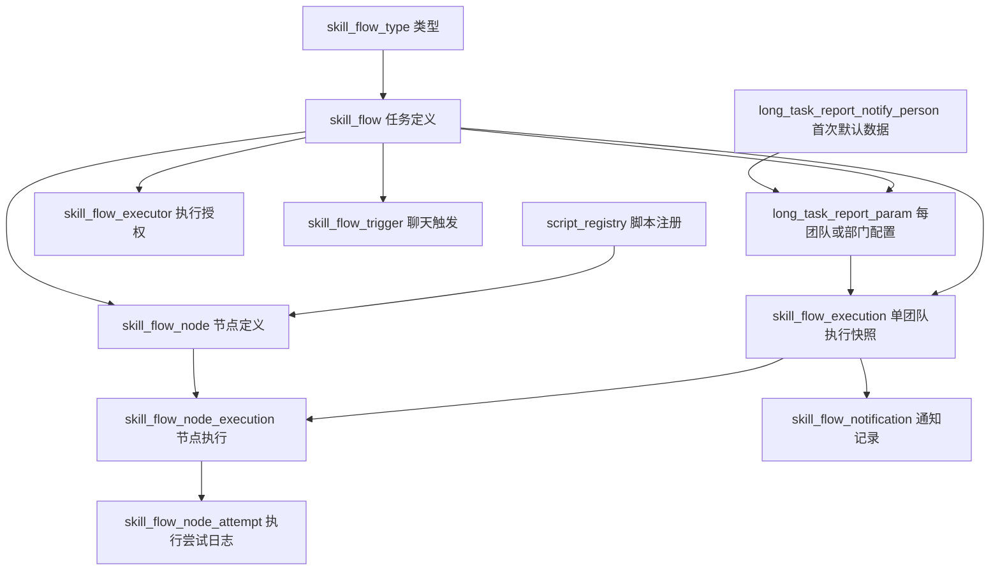

# 长任务、部门报告、团队报告数据表梳理

整理日期：2026-11-06。按当前代码与迁移后的数据库结构说明；部分历史 SQL 的注释与当前行为存在差异，以本文的实际用途为准。本文是表结构与存储职责说明，不是建表或变更脚本。

2026-11-09 更新：不同任务允许复用相同的团队／部门关键词，同一任务内仍按归一化关键词去重。启用新版后端前，需执行 `V20261109.1__flow_scoped_trigger_keywords.sql`，将 `skill_flow_trigger` 的全局唯一约束替换为 `(flow_id, normalized_keyword)` 唯一约束；`long_task_report_param` 无需变更。当前环境默认关闭 Gauss 自动迁移，需手动执行该脚本。聊天同时命中多个可用任务时展示候选列表（序号选择，0 或“直接回答”转普通回答），选择后仍需确认执行；选择与执行前均重新校验任务可用性和原有权限。原始问题用于最终执行，选择状态保留 5 分钟且限定当前用户和会话。

新增报告表统一使用 `long_task_report_` 前缀，表名对应关系如下：

| 原表名 | 新表名 |
|---|---|
| team_report_department | long_task_report_department |
| team_report_team | long_task_report_team |
| team_report_notify_person | long_task_report_notify_person |
| skill_flow_report_param | long_task_report_param |

已有环境在执行完 V20261105.5 后，执行 `V20261106.1__long_task_report_table_names.sql`，再启用新版后端。新环境按顺序执行历史建表脚本和本次重命名脚本。历史迁移保留原表名，业务查询统一使用新表名；现有 `skill_flow` 系列表本次不改名。

## 1. 三种任务模式的区别

| 配置项 | 普通长任务 | 部门报告 | 团队报告 |
|---|---|---|---|
| 主任务 | skill_flow | skill_flow | skill_flow |
| 识别模式 | team_report_json 为空 | reportType=DEPARTMENT | reportType=TEAM |
| 部门配置 | 不使用报告参数池 | 单部门 | 多部门 |
| 参数池记录 | 无 | 一部门一行，team_id 为空字符串 | 每团队一行，包含该团队所属部门 |
| 可用公共参数 | 不使用该报告公共池 | report_type、dev_dept、data_date | report_type、dev_dept、stat_group、data_date |
| 联系人 | 任务级 | 部门对象独立维护 | 任务级，所有团队共用 |
| 可执行人 | 任务级 | 任务级 | 任务级，所有部门和团队共用 |
| 通知名单、正文 | 任务级通知配置 | 参数行独立配置 | 每团队参数行独立配置 |
| 手动执行结果 | 通常一条执行 | 一条部门执行 | 所选团队各一条执行，同批共享 batch_id |
| 报告名称 | 普通任务命名规则 | 默认部门名＋日期，可修改 | 默认团队名＋团队报告，不自动加日期，可修改 |

部门报告和团队报告复用长任务执行体系，没有单独的“团队执行表”或“部门执行表”。新任务类型由 skill_flow_type 管理；历史记录可以继续保留默认类型，不应仅通过当前名称猜测历史执行模式。

## 2. 表关系概览



主要关联键：

- skill_flow.type_id → skill_flow_type.id。
- skill_flow_executor / skill_flow_trigger / skill_flow_node / long_task_report_param 的 flow_id → skill_flow.id。
- skill_flow_node.script_id → script_registry.script_id，注意不是脚本表的数字 id。
- skill_flow_execution.flow_id → skill_flow.id；batch_id 只用于聚合同批团队执行，不是一张独立批次表的主键。
- skill_flow_node_execution.flow_execution_id → skill_flow_execution.id。
- skill_flow_node_attempt.node_execution_id → skill_flow_node_execution.id。
- skill_flow_notification.flow_execution_id → skill_flow_execution.id。

以上是业务关联关系，不能据此认定所有字段都已建立数据库外键。正文中的字段为关键字段，不是全量建表 DDL。

## 3. 核心表与字段

### 3.1 部门、团队与默认人员来源

| 表 | 关键字段 | 实际用途 |
|---|---|---|
| long_task_report_notify_person | id、dev_dept、stat_group、user_id、user_name | 导入部门、团队、通知人员的来源；dev_dept 是部门名，stat_group 是团队名，一人一行 |
| 同表 | position_role | 岗位信息；生成报告名单时不按岗位过滤或限制人数，直接按 recipient_type 分配 TO/CC |
| 同表 | recipient_type | TO/CC；无岗位默认规则时用于兼容旧名单。岗位规则生效时主要以岗位分配 |
| 同表 | enabled、sort_order | 有效性与来源默认顺序；默认名单按 sort_order、id 排序，去重后保存 |

默认名单初始化直接保留当前部门／团队来源表中已启用且工号非空的人员，不要求工号已存在于全量人员台账；统一按 `recipient_type` 分配 TO/CC，与岗位无关。来源表仅用于首次添加对象，修改来源表不会自动覆盖已保存的参数池名单，包括已保存的空名单。

执行 `V20261106.4__report_recipient_source_only.sql` 后，人员来源表不再包含关键词、联系人或联系电话。首次新增对象时仅从该表读取通知名单；关键词按部门／团队名称生成可编辑初始值，保存到 `long_task_report_param.keyword`。已保存的对象参数和历史执行快照不会因本次来源表清理而改变。团队报告联系人与电话在任务外层填写，保存到 skill_flow，所有团队执行共用；联系人姓名未填写时回填创建人姓名，电话手动补充。团队参数池不再保存联系人。
| 同表 | remark、created_at、updated_at | 来源备注与维护时间 |
| long_task_report_department | id、name、enabled | 旧部门字典；当前主要通过名称关联取得稳定 ID，候选来自人员来源表 |
| long_task_report_team | id、department_id、name、sort_order、enabled | 旧团队字典；当前主要复用 ID 和排序，不是唯一候选来源 |

当前部门、团队候选由 long_task_report_notify_person.enabled=true 的记录去重产生；没有对应字典时，按部门名、团队名计算确定性 MD5 ID。因此不要把字典表 enabled 当作当前候选的控制开关。来源导入后没有人员记录的部门、团队不会自动成为候选。

每个团队允许多位项目经理、分管领导及其他岗位人员，不限制同岗位人数。数据库唯一约束是 (dev_dept, stat_group, user_id)，同一团队内同一人员不重复配置。

### 3.2 长任务定义、授权、触发词与脚本

| 表 | 关键字段 | 存储内容 |
|---|---|---|
| skill_flow_type | id、name、enabled、sort_order | 类型字典，如团队报告、部门报告；列表筛选使用 type_id |
| skill_flow | id、code、name、description、created_by | 整份任务身份、名称、说明和创建人 |
| 同表 | type_id、team_report_json | 任务类型及团队报告配置头；多部门列表位于 team_report_json.departments |
| 同表 | notify_contact_name、notify_contact_phone | 普通长任务和团队报告的任务级联系人；历史部门对象保留参数池联系人 |
| 同表 | enabled、auto_trigger_enabled、schedule_rules、max_parallelism | 任务启停、自动触发开关、时间规则、单次执行内节点并发上限 |
| 同表 | report_outline、summary_question_template | 共用报告章节结构和汇总模板；不是每个团队保存一份大纲 |
| skill_flow_executor | flow_id、user_id | 整份任务的额外执行授权；创建人始终可执行 |
| skill_flow_trigger | flow_id、keyword、enabled、priority | 聊天触发词索引；团队参数池保存时同步生成对应触发词 |
| skill_flow_node | id、flow_id、node_key、node_name、node_type、script_id | 共用执行节点和绑定的脚本 |
| 同表 | script_params_json | 节点参数配置，保存固定值、动态规则或 $public 引用，不存各团队实际值 |
| 同表 | metric_override_configured、required、sort_order | 指标是否显式覆盖、节点是否必需、输出排序；具体指标关联另在 skill_flow_node_metric |
| script_registry | id、script_id、name、params_schema、script_path、datasources、timeout_seconds、enabled | 脚本注册、参数定义、源码路径、允许的数据源、超时与启停；源码存脚本文件，不在此表直接保存全文 |

任务配置头示例：
```json
{
  "reportType": "TEAM",
  "departmentId": "部门A的ID",
  "departmentName": "平台研发部",
  "departments": [
    {"id":"部门A的ID","name":"平台研发部"},
    {"id":"部门B的ID","name":"数据产品部"}
  ]
}
```
旧 departmentId/departmentName 保留兼容，当前写入第一部门；完整集合以 departments 为准。保存后的 team_report_json 不重复保存完整团队 targets，读取时由参数池重组。

### 3.3 部门／团队报告参数池：long_task_report_param

一份长任务下，每个团队一行；唯一约束 (flow_id, team_id)。任务 26 对应 4 行。

| 字段 | 实际内容 |
|---|---|
| id、flow_id | 参数行 ID、所属任务 ID |
| team_id | 团队稳定 ID；部门报告使用空字符串 |
| params_json | report_type、dev_dept、stat_group、department_id、report_name；分别为报告类型、部门名、团队名、部门 ID、可编辑报告名 |
| keyword | 团队独立聊天匹配关键词，区别于报告名称 |
| auto_enabled | 此团队是否参与自动触发；关闭后仍可手动选择执行 |
| sort_order | 参数行处理顺序 |
| to_receivers_json | 收件人 userId 有序 JSON 数组 |
| cc_receivers_json | 抄送人 userId 有序 JSON 数组 |
| notify_enabled | 此团队完成后是否通知 |
| notify_body_template | 此团队独立邮件正文；保留空格、换行和 {链接} 占位符 |
| notify_contact_name、notify_contact_phone | 历史部门对象的联系人和联系电话；团队报告不再使用，保存时置空，改用任务级联系人 |
| executors_json | 历史对象执行人兼容字段；当前授权仍以任务级配置为准 |
| created_at、updated_at | 创建、最后修改时间 |

示例：
```json
{
  "report_type":"团队报告",
  "dev_dept":"平台研发部",
  "stat_group":"平台研发统计组",
  "department_id":"dept_…",
  "report_name":"平台研发统计组团队报告"
}
```
没有独立的 report_name 列；它保存在 params_json 中。data_date 不在参数池重复保存，正式执行时使用当次业务数据日期。

### 3.4 参数解析、节点试跑和正式执行记录

script_registry.params_schema 声明脚本接受哪些参数；skill_flow_node.script_params_json 决定从哪里取值。例如：
```json
{"dev_dept":{"$public":"dev_dept"},"stat_group":{"$public":"stat_group"}}
```
只有名字相同不足以代表已绑定，必须保存 $public 引用。脚本可以只声明一个参数并只绑定该参数；零参数脚本 schema 为 []、节点参数为 {}。不把整份参数池直接传给所有脚本。

可引用的公共键为 report_type、dev_dept、stat_group、data_date。department_id、report_name 是元数据，不是可任意引用的公共键。部门报告不提供 stat_group。

节点试跑：前端选择团队 → /api/skill-flows/report-params-preview 解析当前草稿和当天日期 → /api/script-registry/{id}/debug 执行已保存脚本 → SSE 返回日志。ScriptDebugService 的 runs/events 保存在 JVM 内存，不写正式执行表，重启会丢失；不能在 skill_flow_node_attempt 中查这部分试跑日志。

正式执行：任务行加锁、校验权限和名单 → 按选择团队生成同一 batch_id 下的多条执行 → 每个团队分别解析参数并创建节点快照。当前同一任务的团队执行按队列串行推进，一个团队内部节点受 max_parallelism_snapshot 限制。手动批次未结束时不能重复提交新的手动批次；requestId 必须是 UUID，可用于幂等。

| 表 | 关键字段 | 用途 |
|---|---|---|
| skill_flow_execution | id、flow_id、type_id、batch_id、team_id | 每个团队的一次正式执行；同批团队共享 batch_id，但执行 ID 不同 |
| 同表 | public_params_json、data_date | 冻结当次报告类型、部门、团队、报告名等上下文及独立数据日期 |
| 同表 | report_outline_snapshot、flow_name、flow_code、summary_question_template_snapshot | 当次大纲及来源任务元信息快照；页面展示的报告名称可由 public_params_json.report_name 派生，不要混同数据库 flow_name |
| 同表 | notify_contact_name_snapshot、notify_contact_phone_snapshot | 普通长任务和团队报告保存任务联系人；历史部门对象保存参数池联系人 |
| 同表 | notify_enabled_snapshot、notify_body_template_snapshot、notify_receivers_snapshot、cc_receivers_snapshot | 当次团队通知设置；收件人和抄送人快照是有序逗号字符串 |
| 同表 | trigger_type、trigger_user_id、status、active_guard_key | 触发方式、执行人、状态、防重复活跃键 |
| 同表 | summary_json、report_path、started_at、completed_at | 汇总结果、HTML 报告文件相对路径、执行时间 |
| skill_flow_node_execution | id、flow_execution_id、node_key、script_id | 一次团队执行下的单个节点 |
| 同表 | script_params_json | 团队报告提交时已经按该团队解析后的输入快照 |
| 同表 | resolved_script_params_json | 节点第一次实际运行前持久化的最终输入；重试复用，不重新从当前参数池取值 |
| 同表 | status、attempt_count、max_attempts、next_run_at、lease_owner、lease_expires_at | 执行状态、重试和工作线程租约 |
| 同表 | result_json、artifact_path、error_code、error_message | 脚本结果、产物路径和错误 |
| skill_flow_node_attempt | node_execution_id、attempt_no、status、execution_ip、duration_ms、error_code、error_message、started_at、completed_at | 每次执行或重试的审计、耗时和错误记录 |
| skill_flow_notification | flow_execution_id、delivery_key、status、recipient、channel、request_json、response_json、error_message、sent_at | 一次通知的请求、响应、去重键和投递状态；最终 TO/CC 有序列表在 request_json 中 |

### 3.5 报告与通知落库

报告正文落 HTML 文件，数据库 report_path 记录相对路径，summary_json 记录汇总数据。配置后的 report_name 冻结到执行上下文，用于报告标题、文件名和链接文本。修改任务名称或参数池不回写历史执行快照；旧的无 report_name 执行仍可能使用后端兼容命名（部门＋团队＋日期）。

通知使用执行快照，不在完成时重新按岗位计算名单。TO/CC 保留页面编辑顺序，同人同时出现时从 CC 去除。{链接} 发送时转成报告链接；正文空或不含占位符存在默认/追加链接兼容逻辑。团队没有有效 TO 时暂停通知并记录失败，不阻止报告生成；不会按普通任务逻辑自动改发触发人。实际发送会校验人员有效性；保留全局有效人员或仍在来源表启用的通知账号，因此顺序稳定不代表永久保留失效人员。


## 4. 周边共用表

| 表 | 关键字段／关系 | 职责和使用范围 |
|---|---|---|
| skill_dependency_metric | id、code；作为 metric_id 的来源 | 依赖指标字典，定义哪些指标需等待就绪 |
| skill_flow_node_metric | flow_node_id、metric_id | 定义节点依赖的指标，与节点关联，不按团队重复维护 |
| skill_metric_readiness | metric_id、data_date、status | 某数据日期的指标就绪状态；自动触发会检查依赖是否就绪 |
| notification_config | id、target_type、target_id、enabled | 普通任务的通用通知配置，长任务 target_type 为 SKILL_FLOW；enabled 不是报告完成通知开关的替代 |
| notification_recipient | config_id、user_id、trigger_type、recipient_type、sort_order、channel、enabled | 普通任务按触发方式保存的有序通知名单关系；团队／部门独立名单以 long_task_report_param 为准，不能只查本表判断团队收件人 |
| developer_pl_person_info | user_id、统一认证号、姓名、部门、统计组、版本月份等 | 全量人员搜索、姓名回显与人员有效性校验的底层人员台账；与 long_task_report_notify_person 的“导入默认通知人员”职责不同 |
| skill_flow_tag | id、name 等 | 长任务配置域的标签字典，属于辅助分类，不控制团队参数解析 |
| skill_flow_tag_rel | flow_id、tag_id | 任务与标签的绑定关系 |
| skill_flow_node_cache | 通过缓存键关联节点结果 | 可选节点结果缓存；是否走缓存取决于运行配置，不是执行记录的权威来源 |
| skill_flow_notification_link_click（ClickHouse） | flow_execution_id、notification_id、actor_user_id、event_at、environment、source、event_type | 报告链接访问／点击埋点，与业务配置及执行表分库存储；不代表邮件已到达 |

核心配置和执行表通过 gauss-customer 数据源读写，已核对的开发库 schema 为 readwriter；人员台账 mapper 位于 gauss-common；链接点击记录在 ClickHouse。实际库名和 schema 应以部署环境的数据源配置为准，不能把开发库地址写死到业务逻辑。

## 5. 页面操作最终写到哪里

| 页面操作 | 保存位置 |
|---|---|
| 导入部门／团队人员及岗位 | long_task_report_notify_person |
| 配置部门集合 | skill_flow.team_report_json.departments |
| 添加／删除团队 | long_task_report_param，保存流程时增删对应参数行 |
| 编辑团队报告名 | long_task_report_param.params_json.report_name |
| 修改匹配关键词 | long_task_report_param.keyword，并同步 skill_flow_trigger |
| 参与自动执行开关 | long_task_report_param.auto_enabled |
| 编辑收件人／抄送人顺序 | long_task_report_param.to_receivers_json / cc_receivers_json |
| 编辑完成通知开关／邮件正文 | long_task_report_param.notify_enabled / notify_body_template |
| 编辑联系人／联系电话 | 团队报告及普通长任务：skill_flow.notify_contact_name / notify_contact_phone；历史部门对象：long_task_report_param 同名字段 |
| 编辑可执行人 | skill_flow_executor |
| 配置脚本节点与参数引用 | skill_flow_node.script_id / script_params_json |
| 编辑脚本参数定义 | script_registry.params_schema |
| 编辑脚本源码 | script_path 对应的 Python 文件，源码不直接存进 script_registry |
| 节点试跑 | ScriptDebugService 内存日志，不新增正式执行记录 |
| 手动批量执行 | skill_flow_execution + skill_flow_node_execution；每次实际尝试写 skill_flow_node_attempt |
| 生成最终报告 | skill_flow_execution.summary_json / report_path；HTML 正文保存在报告文件中 |
| 发送／补发通知 | skill_flow_notification；一次性修改名单不回写任务参数池 |

团队报告配置弹窗里的“保存并返回”只更新长任务编辑页草稿；最终点击“保存流程”才通过后端事务保存。切换部门、团队本身不写数据库，也不会重新覆盖当前团队的已保存名单。

通知展示补充：团队报告配置名称仍不带自动日期；通知标题和正文链接文字使用报告名＋当次执行数据日期，例如“平台研发统计组团队报告（2026-11-05）”。自动通知、补发预览与补发发送统一使用此规则；已带日期后缀的名称不重复拼接。生成报告及文件名仍按配置名称处理。

## 6. 容易混淆的字段

1. dev_dept 是部门名，stat_group 是团队名；department_id 和 team_id 是身份 ID，两组字段用途不同。
2. skill_flow.name 是来源长任务名称；params_json.report_name 是团队报告名称；执行列表显示报告名不意味着数据库 flow_name 被替换成报告名。
3. position_role 仅决定新建默认分组，手动维护和补发可按姓名或认证号搜索全量人员，不受本团队或岗位限制。
4. 收件人顺序是 JSON 数组 → 执行快照有序字符串 → 最终通知请求 toUserList / toCCUserList；发送时仍需过滤无效人员，且 TO 与 CC 去重。
5. auto_trigger_enabled 是整份任务自动触发开关，auto_enabled 是单个团队参与自动执行的开关，notify_enabled 是报告完成通知开关，不能相互替代。
6. report_type 在配置头中是 TEAM / DEPARTMENT，脚本公共参数中的 report_type 是“团队报告”／“部门报告”。
7. data_date 是当次执行的数据日期，不因为团队报告名称去掉日期而删除，也不等于创建时间 created_at。
8. 团队报告联系人和电话在任务外层统一维护，创建执行时冻结任务联系人快照，团队参数池旧联系人不覆盖该快照。历史部门对象保留参数池联系人规则。执行权限继续使用任务级配置，executors_json 不作为对象授权依据。
9. 节点最终输入有执行快照，Python 源码没有独立执行版本快照，不能据此认为历史脚本内容已冻结。
10. 手动试跑和正式批量执行不是同一套日志持久化入口；查节点尝试记录时先确认操作是哪一种。

## 7. 排查用只读 SQL

以下是查询示例，将 26 替换成目标长任务 ID，不会触发执行或发送邮件。

```sql
-- 任务配置头与普通长任务联系人；报告对象联系人另见参数池
SELECT id, name, type_id, team_report_json,
       notify_contact_name, notify_contact_phone,
       enabled, auto_trigger_enabled, schedule_rules
FROM skill_flow WHERE id = 26;

-- 每部门／团队已保存的参数和有序名单
SELECT id, team_id, params_json, keyword, auto_enabled, sort_order,
       to_receivers_json, cc_receivers_json, notify_enabled, notify_body_template
FROM long_task_report_param WHERE flow_id = 26 ORDER BY sort_order, id;

-- 节点定义中的参数引用
SELECT id, node_key, script_id, script_params_json
FROM skill_flow_node WHERE flow_id = 26 ORDER BY sort_order, id;

-- 每个团队的执行快照与报告路径
SELECT id, batch_id, team_id, public_params_json, data_date, status, report_path
FROM skill_flow_execution WHERE flow_id = 26 ORDER BY id DESC;

-- 节点真正收到的参数及结果状态
SELECT e.id AS execution_id, n.id AS node_execution_id, n.node_key,
       n.script_params_json, n.resolved_script_params_json,
       n.status, n.attempt_count, n.error_message
FROM skill_flow_execution e
JOIN skill_flow_node_execution n ON n.flow_execution_id = e.id
WHERE e.flow_id = 26 ORDER BY e.id DESC, n.id;

-- 实际执行／重试日志
SELECT a.* FROM skill_flow_node_attempt a
JOIN skill_flow_node_execution n ON n.id = a.node_execution_id
JOIN skill_flow_execution e ON e.id = n.flow_execution_id
WHERE e.flow_id = 26 ORDER BY a.id DESC;

-- 通知请求和投递结果
SELECT n.* FROM skill_flow_notification n
JOIN skill_flow_execution e ON e.id = n.flow_execution_id
WHERE e.flow_id = 26 ORDER BY n.id DESC;
```

## 8. 源码核对入口

- `src/main/java/com/agentscopea2a/v2/skillManager/service/TeamReportService.java`：来源默认值、配置头、参数池保存与读取、任务级权限。
- `src/main/java/com/agentscopea2a/v2/skillManager/mapper/TeamReportMapper.java`：部门／团队来源查询、参数池 CRUD 与团队队列。
- `src/main/java/com/agentscopea2a/v2/skillManager/service/FlowDefinitionService.java`：任务定义保存事务。
- `src/main/java/com/agentscopea2a/v2/skillManager/service/FlowExecutionService.java`：批量执行创建及快照。
- `src/main/java/com/agentscopea2a/v2/skillManager/service/ScriptExecutionParamsSnapshot.java`：最终脚本参数冻结。
- `src/main/java/com/agentscopea2a/v2/registry/service/ScriptDebugService.java`：试跑日志。
- `src/main/java/com/agentscopea2a/v2/skillManager/service/FlowCompletionService.java`：报告汇总与通知名单。
- `src/main/resources/db/migration/gauss`：各次表结构迁移；应结合后续 ALTER 读取，不能只参考最早建表 SQL。
